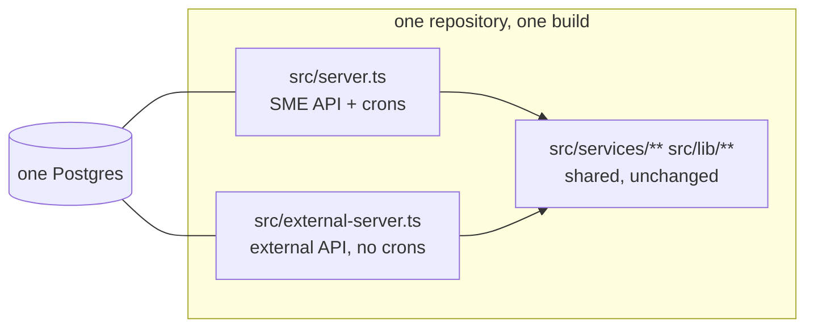

# External API — Platform (Embedded) Service — Implementation Plan v6

> # ⛔ SUPERSEDED — DO NOT WORK FROM THIS FILE
>
> Archived 2026-11-10. **Read `docs/external-api-service-plan.reviewed.md` (v9)
> instead.**
>
> This document describes a design that was abandoned: an external app **inside
> `backend/`**, importing `src/services/**`, sharing the SME app's database.
> v8 moved to a separate repository and a shared database. **v9 moved to a
> separate repository and a separate database.**
>
> Wrong here: §2.1 (why not a separate repository), §2.3 (the one-way import
> rule), §7.2–§7.5 (changes to existing models and migrations), §19 (file
> impact).
>
> Still useful: §5 (device auth), §9 (polling and sync), §10 (idempotency),
> §11 (deletes), §15 (rate limiting) — all carried into v9 unchanged.

> **v6 supersedes v5.** The reason is one fact that arrived after v5 was written:
> **Wowo (the client) has no backend. Their mobile app is the only consumer.**
> That single fact invalidates v5's entire auth model (a server-to-server API key
> plus a 15-minute session token minted by their server) — there is no server to
> hold the key or mint the token. §5 is rebuilt around a device credential.
>
> Every claim about existing code in this document was re-verified against the
> repository on **2026-11-10**. Where v5 disagreed with the code, v5 was wrong —
> see §1.4. Line numbers are from that date.
>
> **v6 also removes work that v5 created for itself.** The soft-delete design in
> v5 spawned four extra work items (three `deletedAt` columns, partial unique
> indexes, an `includeDeleted` parameter, a `deletedAt` guard on the public PDF)
> and put a cross-cutting query change through the tax engine, dashboard, ledger
> and statements. Replacing it with hard delete + a tombstone table deletes all
> four items and touches no existing query. See §1.3 and §11.
>
> Legend: **CONFIRMED** = read from the repository · **LIKELY** = inferred ·
> **UNVERIFIED** = needs a runtime check, vendor docs, or client input.

---

## 0. Read this page first

### What we are building

Wowo has ~100,000 small businesses as customers. Those businesses need somewhere
to record **sales, invoices and expenses**. Wowo does not want to build that. We
already have it. So we open a second door into our engine — an API that only
Wowo's mobile app can call.

```
   Wowo mobile app ──── device credential ────►  external API
   (no server)                                   /api/external/v1/...
                                                 new Express app factory
   Operator (us) ────── CLI / admin ─────────►   same codebase, same DB
                                                 each Wowo merchant = one Business row
```

### The three rules

1. **We compute no tax in this integration.** Nothing is calculated, filed or
   remitted. This is harder than it sounds — see §6.
2. **The platform key never goes in an app.** Apps are decompiled. Any long-lived
   shared secret in a shipped binary is a published secret. §5 explains what we
   do instead.
3. **We do not copy the business logic.** The external surface is a new front
   door on the same services. `src/external/**` may import from
   `src/services/**` and `src/lib/**`; nothing may import from
   `src/external/**` in the other direction (§2.3).

### How to use this document

- **§1** is the decision record. If a decision is not here, it is not decided.
- **§20** is the build order. Work item IDs (`P2.3`) are citable in commits and
  PRs.
- **§19** is the file list. Do not create a file that is not in it.
- **§24** is what is still open. Do not invent answers to those — ask.

### The thing that will actually bite you

You are about to create roughly 100,000 rows that are all owned by **one**
`User`. That user owns every connected business, so `verifyBusinessAccess`
(`src/lib/ownership.ts:161-163`) returns `role: 'owner'` for all of them — which
is exactly why the existing services work unchanged, and exactly why a bug in
account resolution is not "one merchant sees the wrong data", it is **every
merchant sees everyone's data**. The tenant boundary is `resolveAccount` (§3.3),
and it is the only part of this build that cannot be fixed after launch.

---

## 1. Decisions

### 1.1 The settled list

| # | Decision | Status |
|---|---|---|
| D1 | Scope is **sales, invoices, expenses** only | Settled 2026-11-05 |
| D2 | **No tax computed.** No VAT, PAYE, FIRS calls, statements or remittance | Settled |
| D3 | **No tax fields in the payload.** External invoices are always 0% VAT | Settled 2026-11-09 |
| D4 | KYC is **Wowo's**. We store what they send; we never claim verification | Settled |
| D5 | ~~Both Wowo's backend and their app call us~~ → **Wowo has no backend. The mobile app is the only consumer at launch.** A backend "may come later". | **Changed v6** |
| D6 | **Wowo delivers invoices.** We return documents; we never send them | Settled 2026-11-09 |
| D7 | **No finalisation, no month locks.** Any date may be recorded | Settled 2026-11-09 |
| D8 | External sales carry `source = 'api'` | Settled 2026-11-09 |
| D9 | **One flat fee**, editable by admin, default from env | Settled 2026-11-09 |
| D10 | Tenancy is **platform-owned businesses** — one platform `User` owns all accounts | Settled v3 |
| D11 | The end customer is a **resource reference**, not a principal | Settled v3 |
| D12 | **No webhooks.** Wowo polls with `updatedSince` + cursor | Settled v3 |
| D13 | External deletes are **hard deletes + a tombstone row**, not `deletedAt` columns | **Changed v6** |
| D14 | ~~Platform API key, HMAC-SHA256 + pepper~~ → **deferred.** No key exists until Wowo has a server | **Changed v6** |
| D15 | Account scoped in the path; foreign account returns **404, not 403** | Settled v3 |
| D16 | Three-layer kill switch: env → platform → account | Settled v3 |
| D17 | PDFs reuse the existing generators; invoice links reuse the invoice share token | Settled v3 |
| D18 | Audit rows carry `externalDeviceId` and `platformId` | **Changed v6** |
| D19 | **Commercial Invoices only.** PDFs render "COMMERCIAL INVOICE" + FIRS non-fiscal disclaimer | Settled v5 |
| D20 | **NDPA compliance via data minimisation & B2B DPA.** PII optional; Wowo is Controller | Settled v5 |
| D21 | ~~OpenAPI + a new frontend SPA route~~ → **OpenAPI spec served by the external service at `/docs`.** No frontend changes | **Changed v6** |
| **D22** | **One credential type: a per-account device token, issued by exchanging a one-time activation code.** No API key, no session token, no scopes | **Settled v6** |
| **D23** | **Provisioning is operator-side (CLI), not an HTTP endpoint.** Nothing in the app can create accounts | **Settled v6** |
| **D24** | **No `Idempotency-Key` header.** Durable idempotency is `externalRef` (required on creates) + idempotent state transitions | **Settled v6** |

### 1.2 What v6 removed from v5, and why

Read this before you "helpfully" add any of it back.

| Removed | Why |
|---|---|
| `ApiKey` model, `API_KEY_PEPPER`, HMAC key minting, key prefixes | No server exists to hold a key (D5). Nothing to authenticate |
| `POST /sessions`, `EXTERNAL_TOKEN_SECRET`, HS256 minting/verification | A signer needs a server. Mobile gets a device credential instead (§5) |
| The whole scope system (`requireScope`, `ApiKey.scopes`, 12 scopes, `SCOPE_NOT_ALLOWED`) | Scopes existed to fence a server key against admin routes. With one account-bound credential and no admin routes on this surface, authorisation is "which route class" + "which account". Fewer states to get wrong |
| `Idempotency-Key` middleware, its TTL store, its 422-on-mismatch rule | `externalRef` is required on every create and is durable forever (§10). A TTL cache is strictly weaker than a unique index |
| `deletedAt` on `SalesTransaction`, `Expense`, `Invoice` | Would force a `deletedAt: null` filter through tax calc, dashboard, ledger, statements, reports, search and settlement — a cross-cutting change to the main app for a partner-only feature. Replaced by hard delete + tombstone (§11) |
| Partial unique indexes on `(business_id, external_ref)` | Only needed because soft delete kept the row. Gone with the `deletedAt` columns |
| `?includeDeleted=true` | Tombstones carry deletions (§11) |
| `deletedAt` guard in `getPublicInvoicePdfByToken` | A hard-deleted invoice's row is gone, so the token resolves to nothing. The hole closes itself |
| `Platform.billingMode`, `billingCycle`, `Customer.metadata` | Speculative structure with no reader. D9 is one flat fee; `externalId` is the join key |
| `frontend/src/pages/external/BusinessApiDocs.tsx` + `/external/businessapi` route | 8 h in the SME SPA to document a partner API. The external service serves its own `/docs` from the same OpenAPI file — same audience, zero frontend change, and it cannot drift from the spec |
| "Interactive Try-It console" against dev | Needs credentials to be useful, and an unauthenticated proxy into our data is a security footgun. Ship cURL examples instead |
| CORS middleware on the external app | Native mobile requests do not send `Origin`. Add CORS only when a browser consumer exists |
| `POST /accounts`, `POST /accounts/:id/deactivate`, `accounts:*` | Nothing in Wowo's app may create or deactivate accounts. Operator CLI instead (D23) |
| Per-platform rate bucket of 120,000 req/min | Sized for v5's imaginary server polling 100k accounts. The real load is foreground mobile devices (§15) |
| `onDelete: Restrict` on `Business.user` | Would change cascade behaviour globally. Guard in application code instead (§16.4) |

### 1.3 What v6 added

| Added | Why |
|---|---|
| `ExternalDevice` model (one credential per installed app per merchant) | D22 — the only credential a mobile app can safely hold |
| `POST /auth/activate`, `POST /auth/revoke` | Issue and revoke that credential |
| `ExternalTombstone` model | D13 — deletions must be visible to a polling client without touching existing tables |
| `externalRef` **required** on external creates | D24 — durable idempotency with no TTL |
| `TaxGuard` also applied to the sale created by `mark-paid` | **v5 missed this.** `markInvoicePaid` writes `isTaxable: true` (`invoice-crud.service.ts:857`) — v5 only guarded direct sales |
| `opts?: { docTitle, footerNote }` on `buildInvoicePdf` | D19 needs a different title/footer without forking a 400-line generator |
| Operator CLI: provision, issue activation code, suspend, usage | D23 |
| `/docs` + `/openapi.json` served by the external service | D21 |

### 1.4 Corrections — v5 claims that the code contradicts

Each was read from the repository on 2026-11-10.

| v5 said | Reality |
|---|---|
| "`receipt.service.ts:80` and `statement.service.ts:535` mean sale-receipt and statement PDFs will print a tax basis" | **Wrong.** Those resolve policy for `taxBasis` = *which monthly payment was settled*, an advisory label on tax-payment receipts and P&L statements. Neither prints a VAT line. v5's Phase 0.5 work item ("verify PDFs print no tax basis") is deleted |
| §5 auth: platform key + 15-min session token | **Impossible for this client.** No server exists to hold the key or mint the token. Rebuilt as §5 |
| §16.4 "apply the guard to any user-delete path" | **There is no user-delete route or handler.** The only delete is in `scripts/erase-test-accounts.ts:167`. The guard belongs on `toggleUserStatus` (`admin.routes.ts:16` → `admin.service.ts:342-385`) and nowhere else |
| Config: "Required: `SUPABASE_URL`, `SUPABASE_SERVICE_ROLE_KEY`" | **Wrong.** `config/index.ts:18-37` requires `DATABASE_URL`, `JWT_ACCESS_SECRET`, `JWT_REFRESH_SECRET`, plus `ENCRYPTION_KEY`, `BLIND_INDEX_KEY` in production. Supabase is optional |
| §19 "per platform 120,000 req/min" | Sized for a server polling 100k accounts. Corrected in §15 |
| §13.3 "add a `deletedAt` guard to the public PDF" | The concern is real; the fix was over-built. Hard delete removes the row, so the guard is unnecessary (§11) |
| §10 "add `SalesSource.api`" | Correct — the enum currently has `bank_transfer, paycode, pos, online_store, manual, cash, invoice, credit, store_voucher` (`schema.prisma:551-561`) and no `api` |
| §8 Blocker 2 "the platform user hits the cap on the 6th account" | True for a `role: 'user'` owner (`free` max = 5, `config/subscription-plans.ts:70`). Note `checkBusinessLimit` already has an **admin** bypass (`:203-206`) returning `max: -1`; we do **not** use it because it would grant admin-portal access |
| §1.4 v4 "audit writes 8/9 columns" | 9 columns confirmed (`lib/audit.ts:30-39`) |
| (unstated in v5) | **`Session` and `session.service.ts` are already taken** — they mean browser refresh-token login sessions (`schema.prisma:791-807`, `services/auth/session.service.ts`). v5's "external session" naming would have collided. v6 uses `ExternalDevice` |
| (unstated in v5) | **`AsyncLocalStorage` does not exist anywhere in `src/`** — CONFIRMED zero matches. v6 uses it, so it is new code, not an existing pattern |
| (unstated in v5) | `lib/encryption.ts` (`encryptPii`/`decryptPii`) is **dead code** — no callers. `lib/crypto.ts` is the live one, used only for BVN/NIN, DVA settlement accounts and AI provider keys. Customer PII is stored **plaintext** today. Do not "fix" that here (§19 DO NOT TOUCH) |

---

## 2. Repository and topology — same codebase, or a new one?

**Answer: the same repository. A new Express app. A second deployable. Not a new codebase, and not a rewrite.**

### 2.1 Why not a separate repository

Everything this API needs already exists here and is not published as a package:

| Need | Where it lives | Cost to duplicate |
|---|---|---|
| Invoice/sales/expense logic + totals + audit | `src/services/{invoice,sales,expense}/` | Reimplementing money maths is how you get two sets of books |
| PDF generators | `src/services/pdf/*` (12 files) | ~2,000 lines, brand fonts, layout |
| VAT policy | `src/services/tax/tax-policy.service.ts` | The exact thing §6 exists to control |
| Ownership + permissions | `src/lib/ownership.ts` | The tenant boundary |
| Prisma client + 40 models | `prisma/schema.prisma` (1,395 lines) | A second client on the same DB, or a shared-package project |
| Error envelope, `AppError`, Prisma error mapping | `src/middleware/error*` | Partners would see a second error shape |

A separate repo would need either a duplicated schema (guaranteed drift) or an
extracted shared package (a refactor of the whole backend, out of scope). Both
are larger than this feature.



### 2.2 Why a separate app and process anyway

The external app mounts **only** what it declares. It does not inherit:

- `src/routes/index.ts` — 20+ internal routers, JWT auth, admin routes
- JWT middleware, `requireActiveSubscription` (per-router mounts: `sales.routes.ts:12`, `invoice.routes.ts:9`, …)
- the cron jobs in `server.ts`
- Swagger UI at `/api-docs`, the static `/test` dashboard, the 10 MB JSON limit

A second process also means an external bug cannot take down the SME app, and
the kill switch is a real switch.

**Cost, stated honestly:** a second Railway service (~$5/mo), a second env set,
and a deploy step to remember. That is the entire price of the isolation.

**If the price is refused:** `external/app.ts` is an app factory, so it can be
mounted into the main app with one line in `routes/index.ts` for the pilot and
split later without a rewrite. That is a legitimate de-scope — but then the kill
switch no longer protects the SME app, and the two share a blast radius.

### 2.3 The one-way import rule

```
src/external/**  ──may import──►  src/services/**, src/lib/**, src/config/**, prisma
src/services/**  ──must NEVER import──►  src/external/**
```

Enforce with ESLint `no-restricted-imports` scoped to `src/services/**`:

```jsonc
// backend/.eslintrc — add to overrides for src/services/**
"no-restricted-imports": ["error", { "patterns": ["@/external/*", "../external/*"] }]
```

Why this matters: the day a service imports an external module, the main app
starts paying for partner code and the build coupling becomes permanent.

### 2.4 Running both locally

```bash
cd backend
npm run dev            # SME API, port 3000
npm run dev:external   # external API, port 3001
```

Two terminals. Both talk to the same `DATABASE_URL`. The mobile app / cURL hits
`http://localhost:3001/api/external/v1/...`.

---

## 3. Tenancy and provisioning

### 3.1 Shape

```
Wowo (Platform row)
 ├── N × connected account   ← a Business row, owned by ONE platform User
 │     ├── ExternalDevice    ← one per installed app per merchant (§5)
 │     └── M × Customer      ← that merchant's buyers (§4)
 │           └── Sales / Expenses / Invoices
```

One `User` ("Wowo Service") owns every connected `Business`. The decisive
advantage (CONFIRMED): `verifyBusinessAccess` (`src/lib/ownership.ts:161-163`)
grants `role: 'owner'` when `business.userId === userId`, so every existing
service, permission check and audit path works with **zero edits**.

Accepted trade-offs:

- Connected accounts cannot log into the WallXERP web app. Wowo is their UI.
- The platform owner's business list is 100,000 rows. Nobody opens it.
- Deleting the platform owner would cascade (`Business.user` is
  `onDelete: Cascade`, `schema.prisma:137`). Guarded in application code (§16.4).

### 3.2 The four provisioning blockers (all CONFIRMED, re-verified)

| # | Blocker | Evidence |
|---|---|---|
| 1 | `generateMerchantId` is O(n) | `business.service.ts:21-51` — `findMany()` over **every** `PMTW` business (`:26`), then a `findUnique` collision-probe loop (`:45-48`). 100k creates ≈ 5×10⁹ rows pulled into Node |
| 2 | Business limit is per user | `subscription-guard.service.ts:190-225` — `count({ where: { userId } })` (`:211`), `max` from `getPlanLimits` (`:208`) → `free` = 5 (`config/subscription-plans.ts:70`) |
| 3 | No plain customer creation | Both live create paths require a phone and mint a card + PIN: `quickCreateCustomer` (`customer-card.service.ts:189`, create at `:274`), `quickCreateCustomerWithVoucher` (`:342`). The only email-only path is `findOrCreateCustomerByIdentity` (`customer-resolver.service.ts:65`, create `:149`), which still refuses name-only input (`:74-76`) |
| 4 | `Business` has no active flag | CONFIRMED — no `isActive` on the model (`schema.prisma:89-166`). `Customer` *does* have one (`:407`), which §11 reuses |

**Also note:** `generateMerchantId` is called at `:71`, **before**
`checkBusinessLimit` at `:92` — so a rejected create still burns a merchant ID.
Harmless, but do not "fix" it by reordering; the transaction rolls back.

### 3.3 Blocker fixes

**1 — sequence table** (replaces `generateMerchantId`):

```ts
// src/services/business/business.service.ts
async function generateMerchantId(db: TxClient | typeof prisma): Promise<string> {
  const row = await db.merchantIdSequence.upsert({
    where:  { id: 1 },
    create: { id: 1, value: 1 },
    update: { value: { increment: 1 } },
  });
  if (row.value > 9_999_999) {
    throw new AppError(409, 'Merchant ID space exhausted', 'MERCHANT_ID_EXHAUSTED');
  }
  return `PMTW${String(row.value).padStart(7, '0')}`;
}
```

- Atomic and O(1). A single `UPDATE … RETURNING` under the hood.
- Two concurrent **first** calls both try to insert `id = 1`; one gets `P2002`.
  Catch it on the create branch and retry once. The `merchantId @unique`
  constraint (`schema.prisma:134`) stays as the backstop.
- The migration seeds the counter from `MAX(PMTW number)` (§7.3).
- **Restore caveat:** `scripts/db-restore.ts:74` inserts businesses with
  `createMany`, bypassing the sequence. After a restore the counter is stale and
  the next create collides. The restore script must re-seed the row — add it to
  the MODIFY list (§19) or the DR drill breaks provisioning.

**2 — platform branch** in `checkBusinessLimit`:

```ts
const platform = await db.platform.findUnique({
  where: { ownerUserId: userId },
  select: { id: true },
});
if (platform) {
  const current = await db.business.count({ where: { userId } });
  return { allowed: true, current, max: -1, tier: 'platform' };
}
```

`checkBusinessLimit` already returns early when `max === -1` (`:215-217`). Users
without a `Platform` row behave exactly as today. Do **not** reach for the
existing admin bypass at `:203-206` — it would mean making the owner an admin,
which grants the admin portal.

**3 — plain customer creation** (§4.5): a `createExternalCustomer` that writes
the `Customer` row only — no card, no PIN, no email.

**4 — `Business.isActive`** column, external-only (§7.1).

### 3.4 Provisioning is operator-side (D23)

Nothing in Wowo's app may create accounts. `POST /accounts` is **not** exposed.
The flow is a CLI command run by us against a batch Wowo sends us:

```
npx tsx src/scripts/external-cli.ts provision \
  --platform wowo --file ./wowo-merchants.csv
```

CSV columns: `externalCustomerId, businessName, ownerName, businessType, email, phone`.

Per row, in one transaction:
1. Look up `(platformId, externalCustomerId)`. Found → skip (idempotent, report as `skipped`).
2. Create `Business` (`userId = platform.ownerUserId`, `platformId`,
   `externalCustomerId`, `merchantId` from the sequence) + the owner `BusinessMember`.
3. Create an `ExternalDevice` row in **dormant** state (no `tokenHash`) and
   generate a one-time activation code (§5.4).
4. Audit `account.provisioned`.

On `P2002` for `(platformId, externalCustomerId)` → re-read and skip (concurrent
batch race). Output: a CSV of `externalCustomerId, accountId, activationCode`
for Wowo's onboarding team to distribute.

**No `taxProfile` is written. `taxId` is never accepted** — `Business.taxId` is
`@unique` (`schema.prisma:94`), so two merchants sharing a TIN would fail with
`P2002`. We do not remit tax, so a verified TIN buys nothing. If Wowo wants it
recorded later, it goes in a new non-unique column.

Bulk sizes: max 500 rows per CLI invocation. 100,000 accounts is 200 runs; that
is an ops chore, not a blocker, and it keeps the operation resumable by design
(the CLI skips rows that already exist).

---

## 4. End-customer identity

Wowo's end users do not have WallXERP accounts. We need a durable handle so an
invoice, sale or expense attaches to the right user *in Wowo's* platform.

**The framing:** the end customer is **not a principal — they are a resource.**
Wowo's app is the authenticated party. We need a *reference* to Wowo's user, not
a credential for them.

### 4.1 Three layers

| Layer | Field | Purpose | Guaranteed by |
|---|---|---|---|
| 1. Tenant | `accountId` in the path | Which connected merchant this belongs to | Us, via the device token (§5) |
| 2. Wowo's key | `Customer.externalId` | Wowo's own end-user ID — the join key back to their app | Wowo |
| 3. Our key | `Customer.id` (opaque uuid) | Stable handle we return, accepted on later calls | Us |

### 4.2 Schema

```prisma
model Customer {
  // …existing fields (schema.prisma:396-423)…
  externalId String? @map("external_id")   // Wowo's user ID

  @@unique([businessId, externalId])
}
```

`Customer` currently has **no unique constraint at all** (CONFIRMED) — only
`@@index([businessId, name])`, `@@index([businessId, phone])`,
`@@index([businessId, isActive])`. So the unique above is purely additive.

**Per-account uniqueness, never global.** Two Wowo merchants may legitimately
both have a buyer `wowo-user-88213`.

### 4.3 Contract rules

1. **`externalId` is required on `POST /customers`.** Without it Wowo cannot map
   the response back to their user.
2. **`externalId` is immutable.** Accept on create; reject changes on `PATCH` with
   `422 CUSTOMER_EXTERNAL_ID_IMMUTABLE`.
3. **Not a secret, not a credential.** It only works behind a device token. Safe
   to log.
4. **Reserved, not recycled.** Deleting a customer sets `isActive = false`
   (§11.2); the `(businessId, externalId)` pair stays reserved, so a later create
   resolves to the existing row instead of splitting history.
5. **Never the email or phone.** Mutable, shared within a household, duplicated.
   Attributes to search by, never identity.
6. **Never a guessable sequence.** Our IDs are uuids.
7. **NDPA data minimisation:** `email`, `phone`, `address` are all optional. A
   customer needs only `name` + `externalId`.

### 4.4 Per-transaction references

Each transaction gets a **required** `externalRef` (Wowo's own `invoice_id` /
`txn_id`, or a client-generated UUID):

```prisma
// SalesTransaction, Expense, Invoice
externalRef String? @map("external_ref")
// + @@unique([businessId, externalRef]) on each
```

This is the whole idempotency story (§10) — durable forever, unlike a TTL cache.
Nullable at the column level so internal PayMyTax writes are unaffected; Postgres
allows many `NULL`s in a unique index.

**Why not reuse `SalesTransaction.referenceId`?** It exists with
`@@unique([businessId, source, referenceId], name: "unique_sales_reference")`
(`schema.prisma:224`), but it is scoped by `source`, so the same reference under
two sources would not collide. `externalRef` is source-independent. Keep
`referenceId`; `externalRef` is additive.

### 4.5 The one new customer function

```ts
// src/services/customer/customer.service.ts  (add alongside existing functions)
export async function createExternalCustomer(
  userId: string,
  businessId: string,
  input: { externalId: string; name: string; email?: string; phone?: string; address?: string; city?: string; state?: string },
): Promise<Customer>
```

- Writes the `Customer` row only. **No `CustomerCard`, no PIN, no email, no SMS.**
- On `P2002` for `(businessId, externalId)` → return the existing row (idempotent).
- Does **not** import `@/lib/encryption` — it is dead code and decrypting is not
  symmetric with the `contains`/`mode: 'insensitive'` searches used by
  `searchCustomers`. PII is plaintext here today; that is a separate project.
- Deliberately skips the phone-dedupe logic in
  `findOrCreateCustomerByIdentity` (`customer-resolver.service.ts:81-107`). Two
  Wowo customers with the same phone are two customers — Wowo's `externalId` is
  the identity. Document that difference in the function's docblock (one line).

---

## 5. Auth — one device credential (rebuilt for mobile)

### 5.1 The problem

v5 assumed Wowo's server holds a long-lived key and mints short-lived tokens for
the app. **There is no Wowo server.** The alternative — ship the key in the app —
means anyone who unzips the APK has a credential that can read and write every
merchant's books.

So the credential must be:

- **per merchant** (one leaked device must not expose others),
- **issued once, to a device**, not shared,
- **revocable** without rotating anything global,
- **not derived from anything shipped in the binary**.

### 5.2 The design

```
Operator CLI ──creates──► ExternalDevice row (dormant) + one-time activation code
                                    │
              Wowo gives the code to the merchant (their onboarding flow)
                                    │
Mobile app ──POST /auth/activate { code, deviceName }──► device token (returned once)
                                    │
Mobile app ──Authorization: Bearer <device token>──► every other endpoint
```

- The **activation code** is short and human-typable (10 chars, Crockford base32
  = 50 bits). Single use, expires in 7 days, locks after 10 failed attempts.
- The **device token** is 32 random bytes, base64url — about 43 characters. Shown
  once. Stored `@unique` as `sha256(token)` hex. No pepper needed: the input is
  full-entropy random, so there is nothing to brute-force even with the hashes.
  (Do not use bcrypt here — it is for low-entropy human passwords and would cost
  ~100 ms per request.)
- The token resolves to exactly one `(platformId, businessId)`. There is no way
  to express "access another account" — `accountId` in the path must equal the
  token's `businessId`, else `403 TOKEN_ACCOUNT_MISMATCH`.
- Lifetime: 180 days from activation. On expiry the merchant re-activates with a
  fresh code (the CLI can re-issue). No refresh endpoint, no sliding window.
- Revocation: `revokedAt` set. Checked on every request (no cache) — this is the
  one lookup that must never be stale.

### 5.3 What a device token can never do

| Capability | Why |
|---|---|
| Reach another account | Bound to one `businessId`; mismatch → 403 |
| Create, deactivate or list accounts | Those routes do not exist on this surface (D23) |
| Reach internal routes | Separate Express app; `src/routes/index.ts` is not imported |
| Survive revocation | Checked per request |

### 5.4 Lifecycle

| Event | Where | Effect |
|---|---|---|
| Account provisioned | CLI | `ExternalDevice` row, dormant, `codeHash` + `codeExpiresAt` |
| Activation | `POST /auth/activate` | Sets `tokenHash`, `activatedAt`, `deviceName`, `platform`, `lastSeenAt`, `expiresAt` (+180 d), clears `codeHash` |
| Every request | middleware | `lastSeenAt` update (throttled to once per 60 s per device) |
| Self-revoke | `POST /auth/revoke` | `revokedAt = now()` |
| Admin/CLI revoke | CLI | Same |
| Re-activate with a new code | CLI re-issues → `POST /auth/activate` | Old token row must be revoked first, or use `POST /auth/activate` with a header `X-Device-Token` to replace in place. **Simplest correct rule:** the CLI re-issues a code on a *new* row, and revokes the old row in the same command. One device per merchant per activation; multiple devices allowed by design (merchant changes phone) |

**Activation code delivery** is an ops fact, not code: the CLI prints a CSV, and
Wowo's onboarding team sends each merchant their code. Ask Wowo for the delivery
channel before the pilot — it is the only step we cannot do for them.

### 5.5 Hardening checklist (all cheap, all required)

- [ ] `POST /auth/activate`: 10 req/min per IP, plus 10 attempts per code then
      lock (`codeAttempts`). Compare hashes with `crypto.timingSafeEqual`.
- [ ] Never log the `Authorization` header or the activation code. The request
      logger must redact both (P2.6).
- [ ] Response on bad code: `401 ACTIVATION_CODE_INVALID` — **identical** for
      unknown, expired, used and locked. Do not tell the attacker which.
- [ ] Body limit 1 MB (not the main app's 10 MB).
- [ ] Helmet on. `trust proxy` in production so per-IP limits see real IPs.
- [ ] Token in iOS Keychain / Android Keystore on the client. Document it in
      §9.6 — we cannot enforce it, but we must say it.

### 5.6 When Wowo gets a backend (additive, not built now)

If a server appears, add a `PlatformApiKey` model and `POST /sessions` at that
time. Nothing in this design blocks it: `ExternalDevice` and a future key both
resolve to a `platformId`, and `resolveAccount` takes `(platformId, accountId,
scopes?)`. **Do not build it speculatively.**

---

## 6. The tax boundary — build this first

This is the most important section. It is also the one place where v5 was
incomplete (§6.4).

### 6.1 What the code does today (CONFIRMED)

| Step | File:line | Behaviour |
|---|---|---|
| 1 | `services/invoice/invoice-crud.service.ts:153` | `const policy = await resolveTaxPolicy(businessId, tx)` |
| 2 | `services/tax/tax-policy.service.ts:69-84` | No profile, **or an incomplete one**, ⇒ `{ source: 'DEFAULT', vat: { chargeable: true, rate: config.tax.defaultRate } }` |
| 3 | `config/index.ts:254` | `defaultRate: parseFloat(process.env.TAX_DEFAULT_RATE \|\| '7.5')` |
| 4 | `invoice-crud.service.ts:162` | `const vatRate = policy.vat.chargeable ? (input.vatRate ?? policy.vat.rate) : 0;` |
| 5 | `invoice-crud.service.ts:96-112` | `vatAmount = money(taxable * vatRate / 100)`; `total = taxable + vatAmount` |
| 6 | `schema.prisma:443` | `vatRate Decimal @default(7.5)` — a writer that forgets the field gets 7.5% |

**Result:** an invoice created for a connected account — which by §3 has no tax
profile — gets VAT added to its total, stored, and printed on the PDF.

Also true, and **not** in v5:

- `Invoice.vatRate` defaults to `7.5` (`schema.prisma:443`), and
  `SalesTransaction.isTaxable` defaults to `true` (`:210`).
- **`markInvoicePaid` creates the linked sale with `isTaxable: true`
  (`invoice-crud.service.ts:857`).** Tax reports filter on
  `TAXABLE_SALES_WHERE` (`status in SETTLED` + `isTaxable: true`,
  `src/shared/helpers/settled-status.ts:21`). So a paid external invoice would
  enter a tax report's sales total unless that write is also guarded. v5 guarded
  direct sales only.
- `TAX_DEFAULT_RATE` is env-overridable, so never hard-code 7.5 in assertions —
  read `config.tax.defaultRate`.

### 6.2 The fix

One module owns the decision:

```ts
// src/external/services/tax-guard.ts
// The external surface never computes tax. This is the only place that decides
// a tax rate, and it always decides zero.
export const EXTERNAL_TAX = { vatRate: 0, isTaxable: false } as const;
```

Three write paths must apply it:

| Path | How |
|---|---|
| External invoice **create** | Pass `vatRate: 0` in the service input (`invoice.validator.ts:25` already accepts an optional `vatRate`; `??` treats `0` as a real value) |
| External invoice **update** | Pass `vatRate: 0` **explicitly**. Omitting it keeps `existing.vatRate` (`:420-422`) — an invoice that already carries VAT stays VAT'd |
| External sale **create** | Pass `isTaxable: false` |
| Sale created by **`markInvoicePaid`** | The service takes a new optional argument, `opts?: { external?: boolean }`; when set, the linked sale is written with `isTaxable: false` (`:857`) |

**Do not** add a global `throw` when `vatRate` is omitted — v5 proposed that and
it would break every existing internal caller. Thread an explicit opt-in flag
instead; internal behaviour stays byte-identical.

### 6.3 The regression test (blocking)

```
Given a Business with no BusinessTaxProfile
When  an invoice is created through the external API
Then  invoice.vatRate   === 0
And   invoice.vatAmount === 0
And   invoice.total     === subtotal - discount
And   the invoice PDF contains no VAT line
```

Plus the one v5 missed:

```
Given the same invoice
When  it is marked paid through the external API
Then  the linked SalesTransaction.isTaxable === false
```

These must **fail on today's code** before the fix lands. If they pass, the test
is wrong, not the code.

### 6.4 What we deliberately do not build

- No per-account VAT setting. If a connected merchant is VAT-registered, their
  external invoices show 0%. The future answer is a `vatRate` column on the
  business — a setting, never a payload field. Do not build it now.
- No FIRS integration, no statements, no `MonthlyTaxReport` writes.
- No changes to `resolveTaxPolicy` itself. It is correct for the SME product.

---

## 7. Schema and migrations

One additive migration plus one enum migration. Nothing here changes an existing
column.

### 7.1 New models

```prisma
model Platform {
  id              String    @id @default(uuid())
  name            String
  ownerUserId     String    @unique @map("owner_user_id")
  isActive        Boolean   @default(true) @map("is_active")
  suspendedAt     DateTime? @map("suspended_at")
  suspendedReason String?   @map("suspended_reason")
  flatFeeNgn      Decimal?  @map("flat_fee_ngn") @db.Decimal(12, 2) // null → env default
  createdAt       DateTime  @default(now()) @map("created_at")
  updatedAt       DateTime  @updatedAt @map("updated_at")

  owner      User             @relation(fields: [ownerUserId], references: [id], onDelete: Restrict)
  businesses Business[]
  devices    ExternalDevice[]
  auditLogs  AuditLog[]

  @@map("platforms")
}

/// One row per installed app per merchant. Dormant until activated.
model ExternalDevice {
  id             String    @id @default(uuid())
  platformId     String    @map("platform_id")
  businessId     String    @map("business_id")

  // Activation (cleared once used)
  codeHash       String?   @unique @map("code_hash") @db.VarChar(64)
  codeExpiresAt  DateTime? @map("code_expires_at")
  codeAttempts   Int       @default(0) @map("code_attempts")

  // Credential (null while dormant)
  tokenHash      String?   @unique @map("token_hash") @db.VarChar(64)
  expiresAt      DateTime? @map("expires_at")

  deviceName     String?   @map("device_name")
  devicePlatform String?   @map("device_platform") // 'ios' | 'android'
  activatedAt    DateTime? @map("activated_at")
  lastSeenAt     DateTime? @map("last_seen_at")
  revokedAt      DateTime? @map("revoked_at")
  createdAt      DateTime  @default(now()) @map("created_at")

  platform Platform @relation(fields: [platformId], references: [id], onDelete: Cascade)
  business Business @relation(fields: [businessId], references: [id], onDelete: Cascade)

  @@index([platformId, businessId])
  @@index([businessId, revokedAt])
  @@map("external_devices")
}

/// Deletions, so a polling client can see them. See §11.
model ExternalTombstone {
  id         String   @id @default(uuid())
  businessId String   @map("business_id")
  entityType String   @map("entity_type") // 'sale' | 'expense' | 'invoice' | 'customer'
  entityId   String   @map("entity_id")
  createdAt  DateTime @default(now()) @map("created_at")

  @@index([businessId, createdAt])
  @@map("external_tombstones")
}

model MerchantIdSequence {
  id    Int @id @default(1)
  value Int @default(0)
  @@map("merchant_id_sequence")
}
```

### 7.2 Changes to existing models

```prisma
model Business {
  platformId         String? @map("platform_id")
  externalCustomerId String? @map("external_customer_id")
  isActive           Boolean @default(true) @map("is_active") // external API only

  platform Platform? @relation(fields: [platformId], references: [id], onDelete: Restrict)
  devices  ExternalDevice[]

  @@unique([platformId, externalCustomerId])
}

model Customer {
  externalId String? @map("external_id")
  @@unique([businessId, externalId])
}

// SalesTransaction, Expense, Invoice — same two lines each
externalRef String? @map("external_ref")
@@unique([businessId, externalRef])

model AuditLog {
  platformId       String? @map("platform_id")
  externalDeviceId String? @map("external_device_id")
  @@index([platformId, createdAt])
  @@index([externalDeviceId, createdAt])
}
```

Notes:

- `@@unique([platformId, externalCustomerId])` makes provisioning idempotent.
  Postgres allows many `NULL` pairs, so ordinary businesses are unaffected.
- No `@@index([platformId])` on `Business` — the composite unique covers it.
- No new index on `Invoice` for `createdAt` — `@@index([businessId, createdAt(sort: Desc)])` already exists.
- **`ExternalTombstone.businessId` has no FK** on purpose: the tombstone must
  outlive a business deletion. `@relation` would cascade it away.

### 7.3 Migration `…_add_external_platform` (additive)

In this order, one transaction:

1. `CREATE TABLE platforms`, `external_devices`, `external_tombstones`, `merchant_id_sequence`.
2. `ALTER TABLE businesses ADD COLUMN platform_id, external_customer_id, is_active DEFAULT true;`
3. `ALTER TABLE customers ADD COLUMN external_id;`
4. `ALTER TABLE sales_transactions|expenses|invoices ADD COLUMN external_ref;`
5. `ALTER TABLE audit_logs ADD COLUMN platform_id, external_device_id;`
6. Unique constraints + indexes from §7.2.
7. Seed the sequence:

```sql
INSERT INTO merchant_id_sequence (id, value)
SELECT 1, COALESCE(MAX(NULLIF(regexp_replace(merchant_id, '\D', '', 'g'), '')::bigint), 0)
FROM businesses
WHERE merchant_id LIKE 'PMTW%';
```

Existing businesses keep their IDs; the next allocation continues from the max.

### 7.4 Migration `…_add_sales_source_api` (**its own migration**)

```sql
ALTER TYPE "SalesSource" ADD VALUE 'api';
```

Postgres will not let a newly added enum value be *used* in the same transaction
that adds it. Keep it separate and do not backfill in this migration. This is a
known drift trap in this repo — see the memory note on enum migrations.

### 7.4.1 `SalesSource` is defined in **five** places, not one

This is the highest-value trap in the whole build. Adding the enum value to
Prisma is necessary and **not sufficient**:

| # | Location | Action | If you miss it |
|---|---|---|---|
| 1 | `prisma/schema.prisma` `SalesSource` (`:551-561`) | add `api` | Prisma insert fails |
| 2 | `src/validators/sales.validator.ts` `SALES_SOURCES` (`:10-20`) → `salesSourceSchema` (`:22`) | add `'api'` | **Zod rejects every external sale with a 400** — the boundary never reaches Prisma |
| 3 | `src/services/pdf/sales-receipt.pdf.ts` `source` union (`:19`) | add `'api'` | TypeScript error when rendering an API sale's receipt |
| 4 | `src/services/pdf/sales-report.pdf.ts` label map (`:46`) | add `api: 'API'` | Report prints the raw fallback string |
| 5 | `src/services/documents/statement.service.ts` `SALES_SOURCE_LABELS` (`:391`) | add `api: 'API (Wowo)'` | Ledger/statement shows a raw fallback (non-blocking) |

**Do not touch** `SOURCE_VALUES` in `src/lib/sales-import/template.ts:21`. That
is the **SME spreadsheet import dropdown**, and it is deliberately narrower than
`SALES_SOURCES` (it omits `manual`, `credit` and `store_voucher` too). Adding
`api` there would offer partner-only provenance to ordinary merchants filling in
a template.

`CLAUDE.md` describes `SALES_IMPORT_SOURCES` as "the single source of truth for
the source enum". For the *import flow* that is true; for the enum as a whole it
is not. Verify all five sites before claiming the value is wired.

### 7.5 Local drift warning

The local database is not migration-built, so `prisma migrate dev` cannot detect
existing drift. Compare `schema.prisma` against the migration files statically
before deploying; a schema-only change with no migration is a production 500.

---

## 8. Endpoints

```
POST   /api/external/v1/auth/activate              public (rate limited)
POST   /api/external/v1/auth/revoke                device token
GET    /api/external/v1/me                         device token, never blocked
GET    /api/external/v1/openapi.json               public
GET    /api/external/v1/docs                       public (HTML)

# connected account (one, by token)
GET    /api/external/v1/accounts/:accountId

# customers
GET    /api/external/v1/accounts/:accountId/customers
POST   /api/external/v1/accounts/:accountId/customers
GET    /api/external/v1/accounts/:accountId/customers/by-external-id/:externalId
GET    /api/external/v1/accounts/:accountId/customers/:id
PATCH  /api/external/v1/accounts/:accountId/customers/:id
DELETE /api/external/v1/accounts/:accountId/customers/:id

# sales
GET    /api/external/v1/accounts/:accountId/sales           ?updatedSince ?from ?to ?cursor ?limit
POST   /api/external/v1/accounts/:accountId/sales
GET    /api/external/v1/accounts/:accountId/sales/:id
PUT    /api/external/v1/accounts/:accountId/sales/:id
DELETE /api/external/v1/accounts/:accountId/sales/:id
GET    /api/external/v1/accounts/:accountId/sales/:id/pdf

# expenses
GET    /api/external/v1/accounts/:accountId/expenses        ?updatedSince ?from ?to ?cursor ?limit
POST   /api/external/v1/accounts/:accountId/expenses
GET    /api/external/v1/accounts/:accountId/expenses/:id
PUT    /api/external/v1/accounts/:accountId/expenses/:id
DELETE /api/external/v1/accounts/:accountId/expenses/:id

# invoices
GET    /api/external/v1/accounts/:accountId/invoices        ?updatedSince ?status ?cursor ?limit
POST   /api/external/v1/accounts/:accountId/invoices
GET    /api/external/v1/accounts/:accountId/invoices/:id
PUT    /api/external/v1/accounts/:accountId/invoices/:id
DELETE /api/external/v1/accounts/:accountId/invoices/:id
POST   /api/external/v1/accounts/:accountId/invoices/:id/mark-paid
POST   /api/external/v1/accounts/:accountId/invoices/:id/cancel
GET    /api/external/v1/accounts/:accountId/invoices/:id/pdf
GET    /api/external/v1/accounts/:accountId/invoices/:id/pdf-link

# reports (PDF)
GET    /api/external/v1/accounts/:accountId/reports/sales.pdf     ?from&to
GET    /api/external/v1/accounts/:accountId/reports/expenses.pdf  ?from&to

# sync
GET    /api/external/v1/accounts/:accountId/deletions      ?since ?cursor
```

**No send endpoints** (D6). There is no `/send`, `/send-email` or
`/send-whatsapp` on this surface.

**No account-create endpoints** (D23). Accounts come from the CLI.

Path-scoped accounts mirror the internal `/businesses/:businessId/...` shape and
make a cross-tenant mistake visible in the URL rather than hidden in a header.

### 8.1 Responses

Reuse the existing envelope and error handler verbatim, so a partner sees the
same contract our own app does:

```json
{ "success": true, "data": { } }
{ "error": { "code": "SALE_NOT_FOUND", "message": "Sale not found" } }
```

`AppError`, `asyncHandler` and the Prisma error mapper (`P2002`→409,
`P2025`→404, `P2003`→400) are imported from `src/middleware` unchanged.
Key ordering: use `{ id }` ascending as the stable tiebreaker, never `updatedAt`
alone.

---

## 9. Polling and sync

Every list endpoint is a sync primitive, not just a browse view.

### 9.1 Contract

- `?updatedSince=<ISO8601>` — rows where `updatedAt > since`, **including**
  status transitions like `invoice.status → paid`. This replaces an `invoice.paid`
  webhook.
- With `updatedSince`: sort `updatedAt ASC, id ASC` (oldest change first, so a
  partial page resumes). Without: `createdAt DESC`.
- `?limit` (≤100, default 50) + `?cursor` → response carries `nextCursor` and
  `hasMore`.
- `invoices?status=paid&updatedSince=…` is the common "what got paid" query.
- Every resource carries `updatedAt`; invoices also carry `paidAt` and
  `paymentMethod` once paid.

### 9.2 Required indexes

```prisma
@@index([businessId, updatedAt])   // on SalesTransaction, Expense, Invoice
```

All three already have `updatedAt` (`SalesTransaction:199`, `Expense:250`,
`Invoice:453`) — only the index is new. Without it the change query degrades to a
scan on the largest tables in the system.

### 9.3 Cursors are bound to their query — without a signature

Encode `base64url(JSON.stringify({ u: updatedAtISO, id }))`. On use, decode and
**reject if `u` ≠ the request's `updatedSince`** with `400 CURSOR_QUERY_MISMATCH`.

v5 proposed signing the cursor with a secret. That is unnecessary: a cursor is
not an authorisation token — the device token already gates the data, and a
tampered cursor can only mis-page the caller's *own* account. Signing would add a
secret to manage and an HMAC to get wrong for no security gain.

### 9.4 Deletions

`GET /accounts/:id/deletions?since=<ISO8601>` returns tombstone rows:
`{ entityType, entityId, deletedAt }`, ordered `createdAt ASC`, cursor-paginated
the same way. The client applies them locally, then re-polls the resource lists.

Delete tombstones after 90 days (a nightly cleanup job is out of scope for v1 —
one `DELETE FROM external_tombstones WHERE created_at < now() - interval '90 days'`
in the existing reminder cron is enough if it ever matters).

### 9.5 Guidance to give Wowo

- Poll on app foreground and after any local write, **not** on a timer while
  backgrounded. iOS and Android will suspend you anyway.
- No faster than once per 60 s per account.
- Do a full reconciliation (`?from&to`, no `updatedSince`) on login.
- **There is no push.** A payment confirmed server-side (DVA transfer, Paystack
  webhook) reaches the app on its next poll. Say this out loud in the docs — it
  is the cost of D12, and a mobile partner will assume push otherwise.

### 9.6 Client storage rules (document, cannot enforce)

- Device token in Keychain / Keystore, never `AsyncStorage` / `SharedPreferences` / plaintext.
- Do not log requests containing the token; strip it in crash reporting.
- Stable `externalRef` per user action, generated **before** the network call, so
  a retry after a timeout is the same reference.

---

## 10. Idempotency (no header, no cache)

D24. One durable mechanism, plus state machines that are naturally idempotent.

| Operation | Mechanism |
|---|---|
| `POST /sales`, `/expenses`, `/invoices` | `externalRef` **required**. Insert; on `P2002` for `(businessId, externalRef)` re-read and return the existing row with `200` |
| `POST /customers` | `(businessId, externalId)` unique — same replay |
| `PUT …/:id` | Full replace; naturally idempotent. Reject `externalRef` changes with `422 EXTERNAL_REF_IMMUTABLE` |
| `DELETE …/:id` | Already absent → `204`. Never `404` on a repeat |
| `POST …/mark-paid` | Already `paid` and `linkedSaleId` set → `200` with the invoice. `cancelled` → `409 INVOICE_CANCELLED` |
| `POST …/cancel` | Already `cancelled` → `200`. `paid` → `409 INVOICE_ALREADY_PAID` |
| `POST /auth/activate` | Code is single-use; a used code returns `401` like any bad code |

**Why this beats an `Idempotency-Key` header:** the header's guarantee expires
(24 h), needs a table with a TTL sweeper, and has a hard case the header cannot
solve — a retry three days later. `externalRef` never expires, and the unique
index enforces it at the database, which is where it belongs.

**Cost:** clients must generate a stable `externalRef`. That is a documented
contract requirement, not an optional nicety. The failure mode if they don't:
the API returns `400 EXTERNAL_REF_REQUIRED` rather than silently double-booking.

**Double-booking safety net that already exists:** `Invoice.linkedSaleId` is
unique (`schema.prisma:451`) and `unique_sales_reference`
(`schema.prisma:224`) still applies to the linked sale.

---

## 11. Deletes

### 11.1 Why not `deletedAt` (the v5 design)

A polling client cannot see a hard delete — the row is gone, so it never appears
in `updatedSince`. v5's answer was a `deletedAt` column on `SalesTransaction`,
`Expense` and `Invoice`. The hidden cost:

- every existing query on those three tables must add `deletedAt: null` — tax
  calculation, dashboard, ledger, statements, reports, search, credits, settlement;
- missed sites return wrong money silently, not with an error;
- soft delete collided with `(businessId, externalRef)` uniqueness, so v5 needed
  partial unique indexes;
- it needed an `?includeDeleted` parameter and a `deletedAt` guard on the public
  PDF, because deleted invoices would otherwise stay downloadable.

That is four work items and a cross-cutting change to the main app, bought for a
partner-only feature.

The blast radius was measured, not estimated: a `deletedAt` filter would have to
be added at **~35 read sites** — tax calculation and dashboard aggregates
(`tax.service.ts`), sales overview/timeline/monthly summary (`sales.service.ts`),
expense summaries, invoice numbering, the tax-history statement, the ledger, the
DVA balance and duplicate-inflow check, settlement withdrawable-funds maths,
search, receivable reminders and cron, the sales-import duplicate check, and
payment refund lookups (which must still *find* reversed rows). Every missed site
returns wrong money silently. For comparison, the tombstone design below touches
zero existing queries.

### 11.2 What we do instead

| Entity | Delete = | Effect on existing app |
|---|---|---|
| Sale | `DELETE` the row + insert a tombstone | none — `deleteSale` already hard-deletes (`sales.service.ts:250`) |
| Expense | same | none — `deleteExpense` already hard-deletes (`expense.service.ts:232`) |
| Invoice | same, **draft only** — everything else is `cancel`, not delete | none — `deleteInvoice` already refuses non-draft with `409 INVOICE_NOT_DELETABLE` (`invoice-crud.service.ts:502-506`) |
| Customer | `isActive = false` (existing column, `schema.prisma:407`) + tombstone | none — lists already filter `isActive` |

All in one transaction. The tombstone is what the sync feed reads (§9.4).

**Invoices keep the existing rule: `draft` only.** This is not a new restriction —
`deleteInvoice` already enforces it (`invoice-crud.service.ts:502-506`). A
`sent`/`overdue` invoice is cancelled instead, which preserves the record and
keeps the external surface identical to the SME app's behaviour. A `paid` invoice
is refused (`409 INVOICE_ALREADY_PAID`) because it owns a `SalesTransaction`.

**Why customers are *not* hard-deleted:** `(businessId, externalId)` must stay
reserved (§4.3 rule 4) so a re-create does not split the customer's history.
Deactivating keeps the unique pair occupied.

**Audit trail is unaffected** — audit rows reference `resourceId` as a string and
are never cascaded.

---

## 12. Dates and backdating

D7: no finalisation, no month locks. Any date may be recorded.

- No `423`, no horizon, no lock check. External writes never read or write
  `MonthlyTaxReport` (where `isFinalized` / `isLocked` live).
- **Every `@db.Date` value must be built in UTC.** `transactionDate`,
  `expenseDate` and `issueDate` are date-only columns. Parse `"2026-03-15"` as
  `new Date(Date.UTC(y, m, d))` — never `new Date("2026-03-15")` and never a
  local-time constructor. On a UTC+1 host the naive version silently records the
  previous day. This repo already has this bug class; do not add to it.
- The shared helper for this belongs in `src/external/lib/dates.ts` and every
  external date parse goes through it. No exceptions, including tests.
- **Absurd dates are input validation, not policy.** Year < 2000 or > current+10
  → `400 INVALID_DATE`. Everything else is accepted.

---

## 13. PDFs

D6: Wowo delivers invoices. We return documents; we never send them.

### 13.1 Existing generators (CONFIRMED)

| Generator | Export | Signature |
|---|---|---|
| `src/services/pdf/invoice.pdf.ts` | `buildInvoicePdf` (`:175`) | `(business, invoice) → Buffer` |
| `src/services/pdf/sales-receipt.pdf.ts` | `buildSalesReceiptPdf` (`:327`) | `(data) → Buffer` |
| `src/services/pdf/sales-report.pdf.ts` | `buildSalesReportPdf` (`:50`) | `(data) → Buffer` |
| `src/services/pdf/expense-report.pdf.ts` | `buildExpenseReportPdf` (`:62`) | `(data) → Buffer` |

The other eight generators (`dva-receipt`, `ledger-statement`, `pnl-statement`,
`tax-slip`, `tax-slip-seal`, `tax-obligation-report`, `tax-payment-receipt`,
`receipt-common`) are **out of scope**.

**Trap:** flat duplicates of some generators exist at `src/services/*.pdf.ts`
(`invoice.pdf.ts`, `receipt.pdf.ts`, `ledger-statement.pdf.ts`, `tax-slip.pdf.ts`).
Edit only `src/services/pdf/**`. If you find yourself in
`src/services/invoice.pdf.ts`, you are in the legacy copy.

### 13.2 External surface

```
GET …/invoices/:id/pdf        → application/pdf
GET …/invoices/:id/pdf-link   → { url, shareToken }
GET …/sales/:id/pdf           → application/pdf (per-sale receipt)
GET …/reports/sales.pdf       → application/pdf (?from&to)
GET …/reports/expenses.pdf    → application/pdf (?from&to)
```

- **Binary** — the app fetches and re-serves / saves it.
- **Link** — for anything opened directly, including from Inside the app via the
  OS viewer.

### 13.3 Commercial invoice rendering (D19)

`buildInvoicePdf` currently hard-codes the header text and has no footer hook. Do
**not** fork it. Add an optional third parameter:

```ts
export async function buildInvoicePdf(
  business: BusinessForPdf,
  invoice: InvoiceForPdf,
  opts?: { docTitle?: string; footerNote?: string },
): Promise<Buffer>
```

Internal callers pass nothing → today's PDF byte-for-byte. The external surface
passes:

```ts
{ docTitle: 'COMMERCIAL INVOICE',
  footerNote: 'This is a commercial billing document generated via Wowo. This document does not constitute a statutory FIRS Tax Invoice, VAT receipt or tax return filing. Statutory tax compliance and fiscalisation (if required by applicable law) remain the sole responsibility of the billing entity.' }
```

The title must never be `TAX INVOICE` or `VAT INVOICE`.

### 13.4 Reuse the invoice share token

`ensureInvoiceShareToken` (`invoice-delivery.service.ts:78`) mints a 32-hex token
stored on `Invoice.shareToken` (`@unique`, `schema.prisma:458`), and
`getPublicInvoicePdfByToken` (`:112`) serves it publicly. `GET …/pdf-link`
returns that URL. No new token type, no new route, no new attack surface.

**v5 wanted a `deletedAt` guard here. It is unnecessary** — hard delete removes
the row, so the token resolves to nothing and returns 404 for free.

Two behaviours of the existing service to document rather than change: a
cancelled invoice returns `410 INVOICE_CANCELLED` (`invoice-delivery.service.ts:144`),
and the controller already sets `Cache-Control: private, max-age=300`
(`invoice.controller.ts:186`). The external `pdf-link` inherits both — say so in
the client docs so Wowo does not treat a 410 as a bug.

Add the two headers instead: `Cache-Control: private, max-age=60` and
`Referrer-Policy: no-referrer`, so the capability does not leak through caches or
referrers.

**Known gap, deliberately deferred:** sales have no share token, only the
key-authenticated binary. Add `SalesTransaction.shareToken` only if Wowo asks.

### 13.5 Constraints

- PDF routes are **GETs**: never idempotency-wrapped.
- PDF generation is CPU work — it must happen **outside** any transaction.
- A PDF must embed the invoice's own stored totals, never today's settings.
- `Content-Disposition` with a stable filename (`INV-2026-001.pdf`). Support
  `?disposition=inline` for the OS viewer.
- PDFs have no QR/tamper-evidence today — do not describe them as verifiable.
- Cap report ranges at 366 days → `400 RANGE_TOO_WIDE`, rather than streaming a
  decade of rows into PDFKit.

---

## 14. Audit

`logAudit` (`src/lib/audit.ts:24`) writes **9 columns** and is
transaction-aware: with `tx` it awaits; without, it is fire-and-forget and
**swallows errors** (`:57-62`).

Two new nullable columns on `AuditLog` (§7.2): `platformId`, `externalDeviceId`.

**How they get populated:** a request-scoped `AsyncLocalStorage` in
`src/lib/audit-context.ts` (new — there is none in `src/` today). The external
app opens a context per request; `logAudit` reads it. When there is no context
(the main app), both columns are null — identical behaviour to today.

Why a context instead of threading parameters: the services that call
`logAudit` are the *same* services the SME app uses (`invoice-crud.service.ts`,
`sales.service.ts`, …). Their call sites have no idea an external caller exists,
and adding parameters to them would touch shared code for a partner-only feature.

**Rule for external mutations:** always pass `tx` to `logAudit` so the audit row
commits atomically with the data. A fire-and-forget audit that silently fails on
a partner write is not an audit.

New actions: `account.provisioned`, `account.updated`, `account.suspended`,
`platform.suspended`, `platform.reactivated`, `device.activated`, `device.revoked`,
`customer.external_id_conflict`.

`businessId` on the audit row already identifies the merchant. `platformId`
survives device revocation, so attribution is not lost when a credential is
deleted.

---

## 15. Rate limiting and the kill switch

### 15.1 Limits (sized for the real client: foreground mobile devices)

| Bucket | Limit | Why |
|---|---|---|
| Activation, per IP | 10 / min | Makes 50-bit code brute force impractical |
| Activation, per code | 10 attempts, then locked | Defence in depth |
| Per device | 120 / min | A single merchant's phone is not a sync client |
| Per platform | 3,000 / min | Safety valve; alert well before this |
| Per IP, unauthenticated | 60 / min | Protects activation + key lookup paths |

Concurrency reality check: 100,000 devices do **not** poll simultaneously.
Foreground-only polling means the real steady-state is a fraction of that number
of requests per minute, and the per-device limit bounds a single misbehaving app.
No horizontal sizing exercise is needed for the pilot — measure at 1,000 devices
and revisit (P9).

Use `express-rate-limit` (already a dependency), in-memory, **one replica**.
Redis (`REDIS_URL` exists in config at `:117-120` but is read nowhere) becomes
necessary only at multi-replica — documented, not built.

**Do not copy the main app's `skipLocalhost`** (`middleware/security.ts:102-107`).
That skip is fine for the SME app; on the external surface it would leave
activation unthrottled in every dev and staging environment that calls from
localhost.

Return `429` with `Retry-After`.

### 15.2 Kill switch — three layers

| Layer | Mechanism | Granularity | Use |
|---|---|---|---|
| Global | `EXTERNAL_API_ENABLED=false` | whole service → `503 EXTERNAL_API_DISABLED` | emergency |
| Per platform | `Platform.isActive = false` | one customer → `403 PLATFORM_SUSPENDED` | billing lapse |
| Per account | `Business.isActive = false` | one merchant → `403 ACCOUNT_INACTIVE` | abusive / offboarded |
| Per device | `ExternalDevice.revokedAt` | one install → `401` | lost phone |

### 15.3 Suspension semantics

- Every endpoint returns `403 PLATFORM_SUSPENDED` **except** `GET /me`, which
  returns `200` with `{ isActive: false, suspendedAt, suspendedReason }`.
- Why keep `/me` open: a fully opaque 403 turns a billing lapse into a 2 a.m.
  debugging incident.
- **Reads are blocked too.** Grace mode means the client keeps operating and
  keeps data without paying, and doubles the state machine.
- Reactivation is instant and idempotent; suspension is a flag, never a delete.
- `/health` always returns `200`, even when the kill switch is on — otherwise the
  platform health check restarts the container in a loop.

### 15.4 Middleware order (this matters)

```
app.use(helmet)
app.use(express.json({ limit: '1mb' }))
app.use(requestLogger)                      // redacts Authorization + codes
app.get('/health', ...)                     // always 200
app.use('/api/external/v1/auth/activate', activationLimiter, activateRoute)
app.use(authenticateDevice)                 // sets req.device, req.platform, req.business
app.get('/api/external/v1/me', ...)         // BEFORE requirePlatformActive
app.use(requirePlatformActive)              // 403 when suspended
app.use(resolveAccount)                     // 404 for a foreign account
app.use('/api/external/v1', routes)
app.use(notFoundHandler)
app.use(errorHandler)
```

If `/me` is mounted after `requirePlatformActive`, the switch becomes the incident.

### 15.5 What the external app must NOT mount

`requireActiveSubscription` (`middleware/subscription.ts:51-190`) exists to gate
SME subscriptions. For the platform owner it would count 100,000 businesses
(`:96`), fail the team-member path, and gate on an SME plan. **The fix is not to
modify the middleware — it is not to mount it.** `Platform.isActive` is the only
entitlement that governs this surface.

Note: it is *not* mounted globally today (CONFIRMED — `app.ts` has no mount; it is
per-router in 12 files). The external app imports none of those routers, so this
is already true by construction — but do not add it.

### 15.6 Protect the platform owner from admin actions

`User.isActive` (`schema.prisma:19`) is a global flag, and
`PATCH /admin/users/:id/status` → `toggleUserStatus`
(`admin.routes.ts:16` → `admin.service.ts:342-385`) can flip it. Deleting the
user would cascade (`Business.user` is `onDelete: Cascade`).

**Do not change the foreign key** — that alters cascade behaviour for every
business in the system.

Guard in the service layer:

```ts
const platform = await db.platform.findUnique({ where: { ownerUserId: targetUserId } });
if (platform) {
  throw new AppError(409, 'This user owns a Platform and cannot be deactivated', 'PLATFORM_OWNER_PROTECTED');
}
```

Four lines, no schema change, no blast radius. Apply to `toggleUserStatus` only —
**there is no user-delete route** (CONFIRMED), so do not go looking for one.

Also invalidate the ownership cache after a status change
(`invalidateOwnershipCache`), otherwise a deactivated owner keeps working for up
to 60 s per process.

---

## 16. Admin and operator CLI

### 16.1 Admin (SME admin portal API)

```
GET   /api/v1/admin/platforms        list platforms + activeAccountCount + effectiveFeeNgn
PATCH /api/v1/admin/platforms/:id    { isActive, suspendedReason, flatFeeNgn }
```

Two routes. Reuse the existing admin patterns (`admin.routes.ts`, admin auth);
no new page is required for v1 — the admin portal UI can follow.

### 16.2 CLI (`src/scripts/external-cli.ts`)

```
provision --platform <name> --file <csv>   # bulk create accounts + activation codes
code      --account <accountId>            # re-issue an activation code
suspend   --account <accountId>            # Business.isActive = false
resume    --account <accountId>
devices   --account <accountId>            # list devices + lastSeenAt
revoke    --device <deviceId>
```

Bootstrap (one-off, run by hand):

```
npx tsx src/scripts/external-cli.ts bootstrap --platform wowo --name "Wowo Service"
```

Creates the `Platform` + the owner `User` (random password, `role: 'user'` — **not**
admin) + the first dormant device rows. **Never create the platform owner through
public registration.**

---

## 17. Billing

One flat fee per platform, editable, defaulting from config. **There is no payment
rail** — the fee is invoiced out-of-band. Do not build a checkout.

```
effectiveFee = platform.flatFeeNgn ?? config.external.flatFeeNgn
```

- `PLATFORM_FLAT_FEE_NGN` — env, default `0`.
- `Platform.flatFeeNgn` — `Decimal?`; null means "use the env value".
- Admin edits one number on one row.

**VAT on our own fee:** the fee we charge Wowo is a taxable service, and whatever
rate applies must appear on that out-of-band invoice. Finance/legal item — flag
it, do not implement it.

---

## 18. Security review

| # | Threat | Control | Where |
|---|---|---|---|
| S1 | Credential extracted from the app | No shared secret ships. Per-merchant token, issued to one device, revocable | §5 |
| S2 | Token replay across tenants | `accountId` in path must equal the token's `businessId` → `403` | §5.2 |
| S3 | Activation code brute force | 50 bits + 10/min/IP + 10 attempts per code; identical error for every failure | §5.5 |
| S4 | Secret in logs | Logger redacts `Authorization` and activation codes | P2.6 |
| S5 | Tax computed on partner invoices | Forced `vatRate: 0` **and** `isTaxable: false` on the linked sale; blocking tests | §6 |
| S6 | Mass assignment (`PATCH` body spread into Prisma) | Every Zod schema `.strict()`; never spread `req.body` into `create`/`update` | §20 |
| S7 | Cross-tenant read via a guessed id | `resolveAccount` runs before any handler; every query is `where: { businessId, id }` | §15.4 |
| S8 | Deleted invoice still downloadable | Hard delete removes the row; the share token resolves to 404 | §11 |
| S9 | Partner can reach internal routes | Separate Express app; `routes/index.ts` not imported; ESLint one-way rule | §2.3 |
| S10 | Platform owner frozen by an admin | Owner guard on `toggleUserStatus` + cache invalidation | §15.6 |
| S11 | Leaked hash dump → working tokens | Only `sha256(token)` stored, tokens are full-entropy random | §5.2 |
| S12 | Enum/drift mismatch breaks prod | Enum value in its own migration; static schema-vs-migration audit | §7.4, §7.5 |
| S13 | Audit silently failing on partner writes | `logAudit(entry, tx)` on every external mutation | §14 |

**Input validation:** Zod schemas live in `src/external/validators/`. Use
`.strict()` so unknown keys are rejected rather than ignored. Validate money as
`z.number().nonnegative().multipleOf(0.01)`, quantities as positive, dates
through `src/external/lib/dates.ts` (§12), and strings with explicit max lengths
(name ≤ 200, description ≤ 1000, notes ≤ 2000).

**Injection:** Prisma is parameterised; never build SQL strings. The only raw SQL
in this feature is the advisory CLI sequence seed and the partial-index-free
DDL — no user input reaches either.

---

## 19. Verified file impact

### CREATE

| File | Purpose |
|---|---|
| `backend/src/external-server.ts` | entry point: prisma connect, app, listen, graceful shutdown |
| `backend/src/external/app.ts` | Express app factory: helmet, JSON, logger, routes, error handler |
| `backend/src/external/routes/index.ts` | mounts `/api/external/v1`, `/health`, `/me`, `/docs`, `/openapi.json` |
| `backend/src/external/routes/{auth,accounts,customers,sales,expenses,invoices,pdf,reports,deletions}.routes.ts` | thin routers |
| `backend/src/external/middleware/auth.ts` | `authenticateDevice`, `resolveAccount`, `requirePlatformActive` |
| `backend/src/external/middleware/rateLimit.ts` | activation / per-device / per-IP buckets |
| `backend/src/external/middleware/logger.ts` | request logging with header redaction |
| `backend/src/external/services/account.service.ts` | provisioning, listing, suspend/resume, flat fee |
| `backend/src/external/services/device.service.ts` | mint activation code, activate, verify, revoke |
| `backend/src/external/services/tax-guard.ts` | **the only place that decides a tax rate — always zero** (§6) |
| `backend/src/external/services/sync.service.ts` | `updatedSince` + cursor + tombstones |
| `backend/src/external/lib/token.ts` | 32-byte token + code generation, `sha256`, `timingSafeEqual` |
| `backend/src/external/lib/cursor.ts` | encode/decode + query binding (§9.3) |
| `backend/src/external/lib/dates.ts` | UTC date parsing (§12) |
| `backend/src/external/validators/*.validator.ts` | Zod `.strict()` schemas |
| `backend/src/external/docs/openapi.json` | OpenAPI 3.1 spec |
| `backend/src/lib/audit-context.ts` | `AsyncLocalStorage` for platformId / externalDeviceId |
| `backend/src/scripts/external-cli.ts` | provision / code / suspend / resume / devices / revoke |
| `backend/prisma/migrations/<ts>_add_external_platform/migration.sql` | additive + sequence seed |
| `backend/prisma/migrations/<ts>_add_sales_source_api/migration.sql` | `ALTER TYPE` — **own migration** |

### MODIFY

| File | Current role | Change |
|---|---|---|
| `prisma/schema.prisma` | all models | new models (§7.1); columns (§7.2); `SalesSource.api` |
| `src/validators/sales.validator.ts` | `SALES_SOURCES` const (`:10-20`) + `salesSourceSchema` | add `'api'` — **without this Zod rejects every external sale** (§7.4.1) |
| `src/services/pdf/sales-receipt.pdf.ts` | `source` union type (`:19`) | add `'api'` or the receipt will not typecheck |
| `src/services/pdf/sales-report.pdf.ts` | source label map (`:46`) | add `api: 'API'` |
| `src/services/documents/statement.service.ts` | `SALES_SOURCE_LABELS` (`:391`) | add `api: 'API (Wowo)'` — has a fallback, so not blocking |
| `src/services/business/business.service.ts` | `generateMerchantId` O(n) (`:21-51`) | sequence allocation (§3.3) |
| `src/services/subscription/subscription-guard.service.ts` | per-user cap (`:190-225`) | platform branch returning `max: -1` |
| `src/services/customer/customer.service.ts` | customer CRUD | add `createExternalCustomer` (§4.5) |
| `src/services/invoice/invoice-crud.service.ts` | resolves policy (`:153`, `:400`); marks paid (`:857`) | accept explicit `vatRate: 0`; `opts.external` → linked sale `isTaxable: false` (§6.2) |
| `src/services/pdf/invoice.pdf.ts` | `buildInvoicePdf(business, invoice)` (`:175`) | optional `opts.docTitle` / `opts.footerNote` (§13.3) |
| `src/lib/audit.ts` | 9 columns, no attribution | read `audit-context`; write 2 columns (§14) |
| `src/config/index.ts` | no external section | `external { enabled, flatFeeNgn, rateLimits }` (§24) |
| `src/routes/admin.routes.ts` + `controllers/admin.controller.ts` + `services/admin/admin.service.ts` | no platform surface | 2 platform routes; owner guard on `toggleUserStatus` (`:342-385`) |
| `src/scripts/db-restore.ts` | inserts businesses (`:74`) bypassing the sequence | re-seed `merchant_id_sequence` after restore (§3.3) |
| `backend/package.json` | no external start | `start:external`, `dev:external` |
| `backend/.env.example` | — | `EXTERNAL_API_ENABLED`, `PLATFORM_FLAT_FEE_NGN`, limits |
| `backend/.eslintrc*` | — | `no-restricted-imports` one-way rule (§2.3) |

### MAY MODIFY

| File | Depending on |
|---|---|
| `src/services/invoice/invoice-delivery.service.ts` | only if the share-token response needs the new headers (they can be set on the external route instead — prefer that) |
| `src/jobs/reminders.cron.ts` | only if tombstone cleanup is added (§9.4) |

### DO NOT TOUCH

| File | Why |
|---|---|
| `src/middleware/subscription.ts` | Not mounting it is the fix (§15.5) |
| `src/lib/ownership.ts` | `verifyBusinessAccess` works unchanged; the cache cap is P9 |
| `src/routes/public.routes.ts` | Reuse as-is; no `deletedAt` guard needed (§13.4) |
| `Business.user` foreign key | Leave `Cascade`; guard in code (§15.6) |
| The other 8 PDF generators | Out of scope |
| `src/services/*.pdf.ts` (flat duplicates) | Legacy copies — editing them changes nothing (§13.1) |
| `src/lib/sales-import/template.ts` | `SOURCE_VALUES` is the **SME spreadsheet dropdown**. Adding `api` there would offer partner-only provenance to merchants (§7.4.1) |
| `SalesTransaction.referenceId` | Keep it; `externalRef` is additive (§4.4) |
| `src/lib/encryption.ts` | Dead code. Wiring it up breaks every customer search (§1.4) |
| `resolveTaxPolicy` / `tax-policy.service.ts` | Correct for the SME product (§6.4) |

### CONFIGURATION

```
EXTERNAL_API_ENABLED=true
PLATFORM_FLAT_FEE_NGN=0
EXTERNAL_DATA_RATE_LIMIT=120
EXTERNAL_ACTIVATION_RATE_LIMIT=10
```

No new secrets. **No pepper, no token secret** — D22 removed the need for both.

### DATABASE

One additive migration + one enum migration (§7.3, §7.4). No destructive DDL.

---

## 20. Implementation phases

Dependency-ordered. Each phase ships independently and is independently testable.
Every work item is sized for a developer who has not read the codebase before.

### Phase 0 — Prove the tax boundary (5 h)

**Must come first.** Everything else assumes it.

| ID | What to do | Files | Depends | Done when | Verify | Rollback |
|---|---|---|---|---|---|---|
| P0.1 | Write the failing tests (§6.3), both of them | `backend/tests/integration/` | — | Tests **fail** on current code | `npm run test:integration` shows 2 failures | Revert |
| P0.2 | `tax-guard.ts` returning the constant | `external/services/tax-guard.ts` | — | Unit test passes | `npm run test:unit` | Revert |
| P0.3 | External invoice create/update pass `vatRate: 0` | `invoice-crud.service.ts:153,400` | P0.2 | P0.1 invoice test passes | `npm run test:integration` | Revert |
| P0.4 | `markInvoicePaid` writes the linked sale with `isTaxable: false` when `opts.external` | `invoice-crud.service.ts:857` | P0.2 | P0.1 mark-paid test passes | same | Revert |
| P0.5 | External sales written with `isTaxable: false`, `source: 'api'` | sales service call site | P0.2 | Assert in test | same | Revert |

**Risk:** LOW to implement, **highest** to skip. Internal callers must remain
byte-identical — verify by running the existing invoice tests unchanged.

### Phase 1 — Schema, sequence, limits (10 h)

| ID | What to do | Files | Depends | Done when | Verify | Rollback |
|---|---|---|---|---|---|---|
| P1.1 | Add models + columns (§7.1, §7.2) | `schema.prisma` | — | `npx prisma generate` clean | `npm run typecheck` | — |
| P1.2 | Write migration §7.3 incl. sequence seed | `prisma/migrations/<ts>_add_external_platform/` | P1.1 | `migrate deploy` on a scratch DB; existing IDs unchanged | `npm run prisma:migrate:deploy` | Additive — drop tables |
| P1.3 | `ALTER TYPE "SalesSource" ADD VALUE 'api'` in its **own** migration | new migration | P1.2 | Enum usable in a later transaction | insert a test row | — |
| P1.3b | Propagate `api` to the other four sites (§7.4.1), **not** the import template | `sales.validator.ts:10`, `sales-receipt.pdf.ts:19`, `sales-report.pdf.ts:46`, `statement.service.ts:391` | P1.3 | A sale with `source: 'api'` passes validation and renders on every PDF | integration + manual PDF | Revert |
| P1.4 | Replace `generateMerchantId` with the sequence | `business.service.ts:21-51` | P1.2 | 100 sequential creates → 100 unique IDs | integration test | Revert |
| P1.5 | Handle `P2002` on the upsert create branch | same | P1.4 | Two concurrent first-calls both succeed | integration test | Revert |
| P1.6 | Platform branch in `checkBusinessLimit` | `subscription-guard.service.ts:190-225` | P1.1 | Platform user unlimited; normal user unchanged | integration test | Revert |
| P1.7 | Re-seed sequence after restore | `scripts/db-restore.ts:74` | P1.4 | Restore then provision → no collision | manual | Revert |

**Risk:** MEDIUM — P1.3 enum ordering; P1.7 is the non-obvious one.

### Phase 2 — External app, device auth, audit context (16 h)

| ID | What to do | Files | Depends | Done when | Verify | Rollback |
|---|---|---|---|---|---|---|
| P2.1 | `config.external` (§24) | `config/index.ts` | — | Loads in dev and prod | boot | — |
| P2.2 | `token.ts`: generate, hash, timing-safe compare, base32 codes | new | — | Round-trip test; tampered token fails | unit tests | — |
| P2.3 | `audit-context.ts` + `logAudit` writes 2 columns | `lib/audit-context.ts`, `lib/audit.ts` | P1.1 | External request → audit row carries `externalDeviceId`; internal request → nulls | unit + integration | — |
| P2.4 | `external/app.ts` factory + `external-server.ts` + `/health` + `/me` | new | P2.1 | Boots on 3001; `/health` 200 | `npm run dev:external` | Stop the process |
| P2.5 | `POST /auth/activate`, `POST /auth/revoke`, `authenticateDevice` | `middleware/auth.ts`, `device.service.ts` | P2.2 | Activate → use → revoke → 401 | integration | — |
| P2.6 | Request logger redacts `Authorization` / activation code | `middleware/logger.ts` | P2.4 | No token appears in `logs/` | grep the log | — |
| P2.7 | `resolveAccount` + `requirePlatformActive` in the correct order | `middleware/auth.ts`, `routes/index.ts` | P2.5 | Suspended → 403 everywhere but `/me` | integration | — |

**Risk:** MEDIUM — P2.7's ordering is the one that turns a billing lapse into an
incident if wrong.

### Phase 3 — Tenant isolation hardening (8 h)

| ID | What to do | Depends | Done when | Verify |
|---|---|---|---|---|
| P3.1 | Integration tests for all four isolation failures: foreign account → 404, token on wrong account → 403, revoked token → 401, expired token → 401 | P2.7 | All four pass | `npm run test:integration` |
| P3.2 | `requirePlatformActive` bypass list contains exactly `/me` and `/health` | P2.7 | Anything else 403s | test |
| P3.3 | Assert every handler scopes by `businessId` from `resolveAccount`, never from the body | P2.7 | Grep shows no `body.businessId` | code review checklist |

**Risk:** HIGH — this is the tenant boundary. **Do not proceed to Phase 4 until
P3.1 is green.**

### Phase 4 — Customers, sales, expenses (18 h)

| ID | What to do | Files | Depends | Done when | Verify |
|---|---|---|---|---|---|
| P4.1 | `createExternalCustomer` (§4.5) | `customer.service.ts` | P1.1 | Customer with only `name` + `externalId` succeeds | integration |
| P4.2 | Customer routes: list / get / by-external-id / patch / delete | `customers.routes.ts` | P4.1 | `PATCH externalId` → 422 | integration |
| P4.3 | Sales CRUD; `source: 'api'`; `isTaxable: false`; `externalRef` required | `sales.routes.ts` | P0.5, P3.1 | Replay returns the same row | integration |
| P4.4 | Expenses CRUD | `expenses.routes.ts` | P3.1 | — | integration |
| P4.5 | Delete → hard delete + tombstone, in one transaction | 3 services | P1.1 | Tombstone row exists; re-create with the same `externalRef` succeeds | integration |
| P4.6 | Cursor + `updatedSince` helper (§9) | `lib/cursor.ts`, `sync.service.ts` | P4.3 | Only changed rows, oldest first | integration |

**Verification:** same `externalId` under two accounts succeeds; soft-deleted
customer is invisible but its `externalId` stays reserved; a customer created
without email or phone succeeds.
**Risk:** MEDIUM — P4.5 touches existing delete paths.

### Phase 5 — Invoices and PDFs (16 h)

| ID | What to do | Files | Depends | Done when | Verify |
|---|---|---|---|---|---|
| P5.1 | Invoice CRUD, `mark-paid`, `cancel` (no send) | `invoices.routes.ts` | P0.3, P4.x | `mark-paid` twice → one sale, one `200` | integration |
| P5.2 | `buildInvoicePdf` optional `opts` | `pdf/invoice.pdf.ts:175` | — | Internal PDFs byte-identical | manual diff |
| P5.3 | External invoice PDF with `COMMERCIAL INVOICE` + disclaimer | `invoices.routes.ts` | P5.2 | Header and footer present | manual |
| P5.4 | `pdf-link` reuses `ensureInvoiceShareToken` (`:78`) | `pdf.routes.ts` | P5.1 | Link works with no credential | manual |
| P5.5 | Binary PDFs + the two report PDFs, 366-day cap | `pdf.routes.ts`, `reports.routes.ts` | P5.1 | `application/pdf` + stable filename; >366 d → 400 | integration |
| P5.6 | `Cache-Control` / `Referrer-Policy` on PDF responses | same | P5.4 | Header check | manual |

**Risk:** MEDIUM — P5.2 is a shared file; the "byte-identical" check is the guard.

### Phase 6 — Sync completion (8 h)

| ID | What to do | Depends | Done when | Verify |
|---|---|---|---|---|
| P6.1 | `GET /deletions?since` | P4.5 | Returns tombstones, oldest first | integration |
| P6.2 | Cursor query binding (§9.3) | P4.6 | Mismatch → 400 | integration |
| P6.3 | `EXPLAIN ANALYZE` on the change query | P4.6 | Index scan, not seq scan | manual |

**Risk:** LOW.

### Phase 7 — Spec and docs (5 h)

| ID | What to do | Depends | Done when | Verify |
|---|---|---|---|---|
| P7.1 | Author `openapi.json` for every endpoint, header, error code | P5.x | Validates against OpenAPI 3.1 | `npx @redocly/cli lint` |
| P7.2 | Serve `/openapi.json` + `/docs` (Scalar or Redoc standalone HTML) | P7.1 | Both load with no credential | browser |
| P7.3 | Write the client integration guide: activation, token storage, `externalRef`, polling, no-push | P7.2 | A developer who has never seen the repo can integrate from it alone | read it |

**Risk:** LOW.

### Phase 8 — Admin, CLI, owner guard (8 h)

| ID | What to do | Files | Depends | Done when | Verify |
|---|---|---|---|---|---|
| P8.1 | `external-cli.ts` (§16.2) | new | P2.5, P4.1 | 500-row CSV provisions; re-run skips | run it twice |
| P8.2 | Owner guard on `toggleUserStatus` + cache invalidation | `admin.service.ts:342-385` | P1.1 | Deactivating the owner → 409 | integration |
| P8.3 | Admin list + patch for platforms | `admin.routes.ts` | P1.1 | `effectiveFeeNgn` reflects config | integration |

**Risk:** MEDIUM — P8.2 prevents a 100k-merchant outage.

### Phase 9 — Scale check (8 h)

1,000 synthetic devices, then 100,000 `Business` rows. Measure main-app p95
before/after, DB connection count, and `verifyBusinessAccess` cache memory (the
cache is a `Map` with a 60 s TTL and **no size cap**, `ownership.ts:24-25` —
measure it here and add an LRU cap of 5,000 entries if it grows).

**Total: ~99 h.** Phases 0–4 (~57 h) are the pilot; 5–9 follow.

---

## 21. Testing

**Unit**
- `token.ts`: generate → hash → verify; tampered token fails; codes are unique
  and lock after 10 attempts.
- `tax-guard`: always zero.
- Merchant ID allocator: monotonic, zero-padded, survives concurrent increments.
- `checkBusinessLimit`: platform unlimited; normal user unchanged.
- `dates.ts`: `2026-03-15` at 23:59 UTC+1 is still 2026-03-15.
- `cursor.ts`: round-trip; mismatch rejected.

**Integration** — note `TEST_DATABASE_URL == DATABASE_URL`, so **generate fixture
IDs per run; never hard-code them.**
- Invoice for a business with no tax profile → `vatRate 0`, `vatAmount 0`,
  `total = subtotal - discount`.
- Mark-paid → linked sale `isTaxable === false`.
- External sale carries `source = 'api'` and `isTaxable = false`.
- Provision 100 accounts → all succeed, IDs sequential and unique.
- Re-provision the same `externalCustomerId` → same account, count unchanged.
- Concurrent duplicate provisioning → exactly one row.
- Platform A device → platform B account → `404`.
- Token on a foreign account → `403`; revoked → `401`; expired → `401`.
- Kill switch → `503`; suspended → `403`; `/me` still `200`; `/health` `200`.
- `externalRef` replay returns the same row; missing `externalRef` → `400`.
- `mark-paid` twice → one sale.
- Hard-delete then re-create with the same `externalRef` → succeeds.
- Customer delete → invisible in list, `externalId` still reserved.
- `?updatedSince` returns only changed rows, oldest first, resumable cursor.

**Regression**
- Main app suites pass unchanged (schema change is additive).
- `createBusiness` still works for a normal user and respects the plan limit.
- Audit rows for main-app requests still write null `platformId` /
  `externalDeviceId`.
- `resolveTaxPolicy` behaviour for ordinary merchants is unchanged.
- Internal invoice PDFs are byte-identical after P5.2.

**Manual**
- `EXPLAIN ANALYZE` on the `updatedSince` query shows an index scan.
- 100k `Business` rows: main-app p95 unchanged.
- No token or activation code appears in any log file.

**Commands:** `npm run typecheck`, `npm run test:unit`,
`npm run test:integration`, `npm run lint`.
Do not claim a suite passed unless it was actually run.

---

## 22. Acceptance criteria

- [ ] Invoice created through the external API for a business with no tax profile has `vatRate = 0`, `vatAmount = 0`, and `total = subtotal − discount` — proven by a test that fails on pre-Phase-0 code
- [ ] Marking that invoice paid creates a linked sale with `isTaxable = false`
- [ ] External sales carry `source = 'api'` and `isTaxable = false`
- [ ] External service boots on `start:external`; `/health` 200; no crons mounted
- [ ] No secret is required to build or run the external service (no secret ships in the app)
- [ ] An activation code issues exactly one device token; the code cannot be reused
- [ ] A device token cannot read another account → `403`; a revoked token → `401`
- [ ] `DELETE` on a sale/expense/invoice writes a tombstone and the re-create with the same `externalRef` succeeds
- [ ] `GET /deletions?since=` returns that tombstone
- [ ] `Platform.isActive = false` → `403` everywhere but `/me`; `/me` returns the reason
- [ ] `EXTERNAL_API_ENABLED=false` → `503` on API routes, `/health` still `200`
- [ ] Deactivating the platform owner via admin → `409`
- [ ] `PATCH /admin/platforms/:id` sets `flatFeeNgn`; the list reflects it
- [ ] Customer created with only `name` + `externalId`
- [ ] Changing `externalId` via `PATCH` → `422`
- [ ] Invoice PDF renders `COMMERCIAL INVOICE` + the FIRS disclaimer footer
- [ ] `pdf-link` serves the same PDF with no credential; a deleted invoice's link → 404
- [ ] Sales and expense report PDFs return for a ≤366-day range; longer → `400`
- [ ] `?updatedSince` returns only changed rows, oldest first, resumable cursor
- [ ] `mark-paid` twice = one sale, one replayed response
- [ ] No external endpoint sends email or WhatsApp
- [ ] External audit rows carry `platform_id` and `external_device_id`
- [ ] `/openapi.json` and `/docs` load with no credential
- [ ] Main app p95 unchanged during the scale test
- [ ] `src/services/**` does not import from `src/external/**` (lint enforced)

---

## 23. Risks

| Risk | Impact | Mitigation |
|---|---|---|
| **VAT computed on external invoices** | tax line nobody asked for, on 100k merchants | §6 — forced `vatRate: 0`, `isTaxable: false` on the linked sale, blocking tests |
| **Credential shipped in the app** | total cross-tenant breach | §5 — no shipped secret; per-device token via activation |
| Token not bound to one account | one merchant reads another's books | §5.2 + P3.1 negatives |
| Activation code brute force | account takeover | 50 bits + 10/min/IP + 10 attempts/code |
| `generateMerchantId` scan | provisioning slows and collides | sequence table (§3.3) |
| Business limit | provisioning fails after 5 accounts | platform branch (§3.3) |
| Restore leaves the sequence stale | provisioning collides after a DR drill | P1.7 |
| Duplicate merchants on retry | 100k → 200k rows | unique `(platformId, externalCustomerId)` |
| Hard delete loses history | no audit of what was deleted | tombstone + audit rows (§11.2) |
| **No push for confirmed payments** | the app sees a payment on its next poll, not instantly | documented contract (§9.5) — accepted with D12 |
| Admin deactivates the owner | silently freezes 100k merchants | don't mount the middleware (§15.5) + guard (§15.6) |
| `taxId` collision | onboarding failures | not accepted at provisioning (§3.4) |
| Compliance / KYC & NDPA | holding ~100k customer records without an agreement | B2B DPA + data minimisation (§4.3) |
| E-invoicing / FIRS clearance | a "tax invoice" claim without clearance | "COMMERCIAL INVOICE" + disclaimer + MSA tax neutrality (§13.3) |
| Second Railway service reads the root `railway.json` | `npm start` runs `prisma migrate deploy` on both services | override the start command per service; check the deploy log for `migrate deploy` and fail the deploy if it appears (§24) |

---

## 24. Open items — do not invent answers

1. **Activation code delivery.** Who sends the code to the merchant, and how?
   Wowo's onboarding team, presumably — but that must be agreed before the pilot.
   We generate; they distribute.
2. **Fee amount.** Structure is built; the number is pending.
   `PLATFORM_FLAT_FEE_NGN` when known — no code change.
3. **Pilot size and timeline.** Recommend 25–50 accounts before committing to
   100,000.
4. **Does Wowo need a sale-receipt share link?** Deferred; the authenticated
   binary is the default.
5. **When Wowo gets a backend**, revisit §5.6. Additive; nothing here blocks it.
6. **E-invoicing / FIRS** and **NDPA DPA** are settled technically (§13.3,
   §4.3). The MSA clauses are legal work, not code — flag, do not implement.

---

## 25. Config in full

```ts
// src/config/index.ts
external: {
  enabled:      process.env.EXTERNAL_API_ENABLED === 'true',
  flatFeeNgn:   parseFloat(process.env.PLATFORM_FLAT_FEE_NGN || '0'),
  rateLimits: {
    data:       parseInt(process.env.EXTERNAL_DATA_RATE_LIMIT || '120', 10),
    activation: parseInt(process.env.EXTERNAL_ACTIVATION_RATE_LIMIT || '10', 10),
  },
},
```

No new required env vars. The service refuses to start in production if
`PLATFORM_FLAT_FEE_NGN` is missing and no `Platform.flatFeeNgn` is set — a fee of
zero should be a decision, not an accident.

---

## 26. Final assessment

| | |
|---|---|
| Root-cause confidence | **High** — every blocker and every line reference above was read from the repository on 2026-11-10 |
| Fix confidence | **High** — the auth rebuild is forced by a client fact, not a preference; the tax boundary is verified in both directions |
| Implementation complexity | **Medium** — one new app, one auth mechanism, one additive migration |
| Regression risk | **Low** — the only shared edits are `generateMerchantId`, `checkBusinessLimit`, `logAudit`, two invoice-service call paths, one optional PDF parameter and the admin owner guard |
| Plan readiness | **9/10** — blocked only on the activation-code delivery channel (§24.1) |

The three genuinely novel designs are the identity contract (§4), the device
credential (§5) and the tax boundary (§6). Each is written down as an explicit
rule with a test rather than as an assumption — which is what v3 was missing when
it labelled the VAT risk "CONFIRMED LOW" and was wrong, and what v5 was missing
when it designed an auth model for a server the client does not own.
