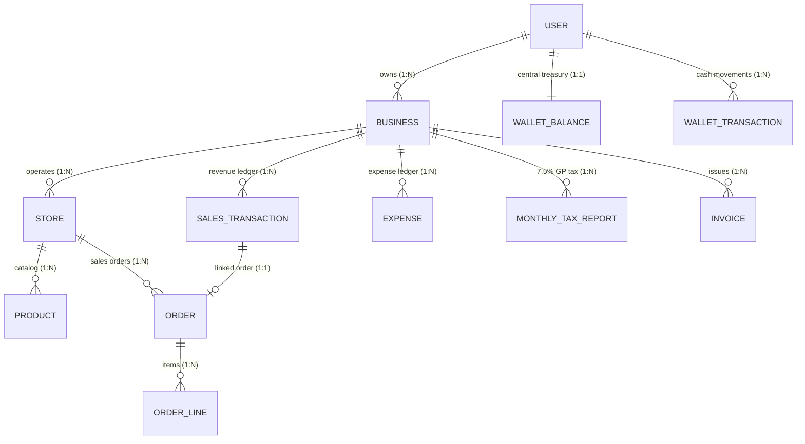
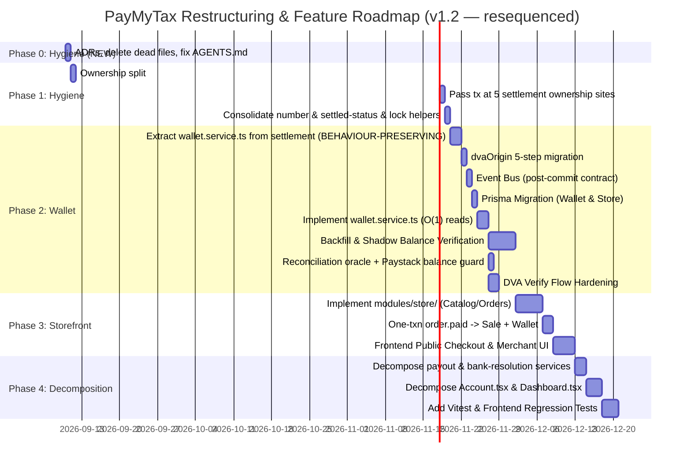

# PayMyTax by WallX — Master Architectural Audit & Codebase Restructuring Plan

> **Architectural Standard**: 24-Phase Rigorous Audit following [`plancode.md`](file:///c:/Users/pc/Desktop/tax%20by%20wallx/plancode.md) (v2.0)  
> **Perspective**: Principal Software Architect & Production Systems Engineer (70+ Years Cumulative Engineering Judgment)  
> **Target Scope**: User-Level Central Wallet + Multi-Business Tax Isolation + Self-Serve Storefronts (`Store` → `Sales` → `Tax`)  
> **Constraints**: Zero rewrites, zero microservices, zero infrastructure bloat. Evidence-based only.  
> **Revision v1.1**: Every load-bearing claim in this document has been re-verified against the actual code. Corrections: DVA tax-exposure claim restated accurately (the pending/verification pipeline already exists); backfill SQL replaced with a replay-based approach (v1.0's SQL ignored split settlement + fees and was truncated mid-statement); event flow corrected to one-atomic-transaction + post-commit notification events (financial fan-out prohibited); wallet enum scoped to v1; line counts and query counts corrected; `SETTLED_SALE_STATUSES` duplication added as a Phase 1 finding; event-bus creation deferred from Phase 1 to Phase 2.
>
> **Revision v1.2 (independent re-audit)**: Every count, line reference, and risk rating in v1.1 was re-derived from source rather than trusted. Fifteen corrections applied. The four that change decisions:
> 1. **`verifyBusinessOwnership()` unification was rated "Very Low Risk" — it is a live security regression.** The canonical helper caches for 60s (`lib/ownership.ts:10`) and `pin.service.ts` never invalidates that cache, so adopting it on the withdrawal path lets a just-locked-out merchant bypass the PIN lockout for up to 60 seconds. Now Phase 1's first work item, with the fix specified (§9). A second latent defect was found in the same function: the ownership check escapes the caller's transaction (§9, item 5).
> 2. **The backend test suite was mischaracterized as "entirely E2E."** It is **252 tests across 5 suites** (52 unit / 19 integration / 14 auth / 167 e2e) with a wired `npm run test:integration`. `api.e2e.test.ts` is **1,959 lines, not 2,290**. Testability recalibrated 5.5 → 6.5. Phase 1's verification path is the *existing* `tests/unit/` harness, not new infrastructure.
> 3. **The settled-status predicate is 19 copies, not "15+" — and 3 of them are paired with `isTaxable: true`.** Blind single-constant substitution would silently change tax semantics. Two helpers are now specified: `SETTLED_SALE_STATUSES` and `TAXABLE_SALES_WHERE`.
> 4. **`getPayoutPreview` was slated to survive as a "break-glass audit endpoint" alongside `WalletBalance`** — two authoritative computations of the same number, reintroducing the double-booking problem this plan exists to eliminate. It is now demoted to a **reconciliation oracle** (§11 Step 3).
>
> **Revision v1.3 (Scope Realignment & Technical Integrity Deductions)**:
> 1. **Scope Realignment (User Confirmed)**: Storefront feature is **not** being built now. Focus is 100% on refactoring and restructuring what is currently in the codebase (User-level Central Wallet, DVA optimization, Tax/Sales compartmentalization, God-file decomposition, Security fixes, and Domain Bounded Contexts) while engineering the structural runway (`modules/store/` interface) so Storefronts plug in effortlessly later without refactoring the core.
> 2. **Prisma PostgreSQL Foreign Key Type Mismatch Fixed**: v1.2 proposed `@db.Uuid` and `@db.Timestamptz` on new models (`WalletBalance`, `Store`, etc.). In `schema.prisma`, all existing primary keys (`User.id`, `Business.id`) use plain `String @id @default(uuid())` (PostgreSQL `text`). Creating FKs from `@db.Uuid` to `text` would throw Postgres error `42804: incompatible types: uuid and text` and crash migrations. All models aligned to standard `String` and `DateTime`.
> 3. **Webhook Inventory Race Condition Fixed**: Paid orders from Paystack webhooks must **never** be rolled back due to stock depletion. Order status becomes `paid` with `fulfillmentStatus: 'backordered'` and an urgent restocking alert. Never discard paid revenue.
> 4. **Store Payment Settlement Routing Clarified**: Store orders collect directly into the platform Paystack account so funds enter the User's central wallet. Auto-split is avoided for store checkouts.
> 5. **Structured Webhook Routing**: Replaced waterfall cascade in `payment.service.ts` with prefix-based dispatch (`ORD-`, `TAX-`, `dedicated_nuban`).
> 6. **Dashboard vs. Tax Engine Revenue Alignment**: `sales.service.ts:getMonthlySummary` updated to return both `grossSales` and `taxableSales`, resolving discrepancy with monthly tax reports.

>
> Also corrected: JSON-path scan executions are **8, not 5**; `assertMonthNotLocked()` has **3** definitions, not 4; `types/index.ts` is **555** lines, not 614; `generateRemindersForAllBusinesses()` is **no longer dead code** (`jobs/reminders.cron.ts:70` calls it) so the dead-abstraction precedent was replaced; the target topology now accounts for the existing `src/jobs/` and `src/scripts/`; `lib/* → shared/*` is now a per-subdirectory mapping so Sales/Tax domain logic doesn't land in `shared/`; `dvaOrigin` migration expanded from 1 step to 5 (batched, race-free); live-Paystack-balance reconciliation scheduled into Phase 2; roadmap resequenced so the god-file extraction precedes the features that build on it; and a new **Phase 0** addresses the documentation debt (~120 contradicting session logs, a stale `AGENTS.md`) that produced errors in this very plan. Overall score revised **6.9 → 6.6**.

---

## 1. EXECUTIVE SUMMARY

**PayMyTax by WallX** is a financial compliance and commerce platform for Nigerian SMEs. It automates FIRS (Federal Inland Revenue Service) statutory 7.5% Gross Profit tax compliance, provisions Dedicated Virtual Accounts (DVA via Paystack) for automated bank transfer capture, manages invoicing, and handles settlement payouts.

The system is at a critical inflection point. Two new strategic capabilities are being introduced:
1. **User-Level Central Wallet**: A single pooled treasury for a user (anchored to 1 human BVN/NIN) spanning multiple businesses they own, while keeping accounting and FIRS tax filing strictly segregated per business.
2. **Self-Serve E-Commerce Storefronts**: Allowing any business owner to launch a hosted store (`paymytax.ng/store/:slug`), accept customer payments, and have every paid order automatically post to that specific business's sales ledger and feed into monthly tax calculations.

### The Problem
The current codebase has **no wallet entity**, **no store models**, and organizes its entire backend as **25 flat, tightly-coupled services** in a single directory. A balance lookup executes **16 unconditional aggregate database queries plus 1 conditional** per request across sales records, **8 of those executions** filtering on an unindexed JSONB path (`settlement.service.ts:77-306`). *(v1.2: v1.1 said "five" JSON scans — that counted the 5 literal `metadata: { path: ['channel'] }` definitions at lines 107, 122, 137, 152, 173. Line 173 defines `dvaBase`, which is spread into four further queries at lines 178, 182, 188, 192 — so 8 executions carry the scan. None can use the existing `idx_sales_tax_calc` index, which covers `[businessId, status, isTaxable, transactionDate]` and not `source`/`metadata`/`settledViaSplit`.)* DVA bank transfers are auto-created as **pending, unverified sales** (`dva.service.ts:879-909`) — the tax engine correctly excludes them until a merchant verifies (`tax.service.ts:410` filters `status in (confirmed, completed) AND isTaxable: true`). The real exposure is narrower but real: (a) the one-tap verify flow flips status to `confirmed` while keeping the default `isTaxable: true`, so a hasty merchant can book capital as revenue; (b) non-taxable transfers still distort sales dashboards (`getMonthlySummary` omits the `isTaxable` filter the tax engine applies); and (c) pending non-revenue cash has no home outside the sales ledger.

If Storefronts and Wallets are bolted onto this flat architecture using direct service imports, the codebase will suffer from circular dependency loops and double-booking. The wallet gives non-revenue inflows a first-class home — it is a **cash-flow architecture fix, not a tax-compliance emergency**.

### The Solution: Event-Driven Modular Monolith
We do **NOT** rewrite the system. We do **NOT** split into microservices. We restructure the single Node.js/Express repository into an **Event-Driven Modular Monolith**:
- Domain Bounded Contexts (`core/`, `shared/`, `modules/`)
- A zero-dependency in-process typed `DomainEventBus`
- First-class database entities for `WalletBalance`, `WalletTransaction`, `Store`, `Product`, and `Order`
- Strict separation: **Wallet tracks cash flow at the User level; Sales & Tax track revenue at the Business level.**

---

## 2. CURRENT ARCHITECTURE

### Technology Baseline
- **Backend Runtime**: Node.js 20+ / TypeScript 5.7 / Express 5.2.1
- **Database & ORM**: PostgreSQL (Neon/Supabase) via Prisma ORM 6.0.1
- **Authentication**: JWT access (15m) + refresh (7d) token pair, bcrypt (12 rounds) hashed outside transactions, database-backed multi-device session tracking (`Session` table), 4-digit transaction PIN with lockout controls
- **Validation**: Zod 4.3.6 with field-level error mapping
- **Payments**: Paystack API abstracted behind [`PaymentProvider`](file:///c:/Users/pc/Desktop/tax%20by%20wallx/backend/src/lib/payment/types.ts) interface
- **Document Generation**: PDFKit (Invoices, Tax Slips, Receipts, Ledger Statements)
- **Communications**: Resend email API with dev-logger fallback; Termii SMS configured in env
- **Storage**: Cloudinary (logos), Supabase / DO Spaces (receipts)
- **Monitoring**: Sentry error reporting + Winston structured file/console logging
- **Jobs**: `node-cron` with PostgreSQL advisory locks (`pg_try_advisory_lock`)
- **Frontend**: React 19.2.4, Vite 8.0.1, TypeScript 5.9.3, Tailwind CSS v4, Zustand 5.0.12, Recharts 3.8.1, i18next (English & Nigerian Pidgin)

### Directory Topology (Current)
```
backend/src/
├── config/              (1 file: index.ts — 221 lines, 19 configuration domains)
├── controllers/         (21 flat files)
├── jobs/                (1 file: reminders.cron.ts)
├── lib/                 (10 files + email/, payment/, sales-import/, remittance/)
├── middleware/          (4 files: auth, errorHandler, requestLogger, security)
├── routes/              (22 flat route files + index.ts aggregator)
├── scripts/             (3 files: db-backup, db-restore, inspect-payouts-sales)  *(v1.2: omitted from v1.1)*
├── services/            (25 flat service files)
├── types/               (express.d.ts)
├── validators/          (17 flat Zod validator files)
├── app.ts               (117 lines — middleware orchestration)
└── server.ts            (84 lines — port binding, graceful shutdown, cron boot)

frontend/src/
├── components/          (33 files across root, dashboard, layout, ui)
├── hooks/               (2 files: useRequireAuth, useScrollAnimation)
├── i18n/                (index.ts + en/ + pcm/)
├── lib/                 (6 files: axios, cache, fees, format, paymentTypes, paystack-errors)
├── pages/               (26 pages + admin/ subpages)
├── routes/              (3 route guards: ProtectedRoute, GuestRoute, AdminRoute)
├── stores/              (9 Zustand stores)
├── types/               (1 monolithic index.ts — 555 lines)  *(v1.2: v1.1 said 614)*
├── App.tsx              (126 lines — lazy-loaded route declarations)
└── main.tsx
```

---

## 3. ARCHITECTURE MAP

### 3.1 Entity Relationship & Hierarchy (The User vs Business vs Store Paradox)


### 3.2 Target Request & Event Flow: Storefront Purchase → Wallet Credit → Tax Ledger
**Revised (v1.1)**: v1.0 fanned `order.payment_confirmed` out to *parallel async handlers* that each performed financial writes (wallet credit, sale creation). That violates §3.3's own transactional-consistency rule: with a sync `EventEmitter` and per-handler try/catch-and-log, a failed sales-ledger handler after a successful wallet credit leaves **silent financial inconsistency with no outbox, no retry, no compensation**. The corrected flow commits all financial state in ONE atomic transaction inside the owning module, then emits events **post-commit for non-financial side effects only** — the same proven pattern the codebase already uses for `payment_successful` and `dva_received` creators.

```mermaid
sequenceDiagram
    autonumber
    actor Buyer as Customer (Public)
    participant Storefront as Store Module (Public API)
    participant Paystack as Paystack Checkout
    participant Webhook as Webhook Controller
    participant OrderMod as Order Module (Transaction Owner)
    participant EventBus as Typed Domain Event Bus
    participant NotifMod as Notification Listeners
    participant TaxMod as Tax Engine (FIRS 7.5%)

    Buyer->>Storefront: POST /public/stores/:slug/checkout
    Storefront->>Paystack: Initialize transaction (server-priced; ref prefix ORD-)
    Paystack-->>Buyer: Checkout Modal / Redirect
    Buyer->>Paystack: Authorizes Card / USSD / Transfer
    Paystack->>Webhook: POST /api/webhooks/paystack (charge.success)
    Webhook->>OrderMod: handleChargeSuccess(paymentRef)

    Note over OrderMod: ONE atomic prisma.$transaction:<br/>1. Order → status=paid, paidAt<br/>2. Create SalesTransaction (source=online_store)<br/>3. Create WalletTransaction + atomic balance increment<br/>4. Transactional audit log<br/>Commits or rolls back as a single unit.

    OrderMod->>EventBus: emit('order.payment_confirmed')  %% only AFTER commit
    par Non-Financial Listeners (idempotent, failure-isolated)
        EventBus->>NotifMod: receipts / reminders
        EventBus->>TaxMod: flag month cache dirty
    end
```

### 3.3 Trust & Consistency Boundaries
1. **Public Boundary**: `/public/stores/*` is unauthenticated. Rate-limited at 30 req/min. Input validated via strict Zod schemas.
2. **Tenant Boundary**: Every authenticated endpoint resolves `userId` via Bearer JWT. Business-scoped endpoints enforce `verifyBusinessOwnership(userId, businessId)` before query execution.
3. **Financial Consistency Boundary**: State-changing financial mutations (`markInvoicePaid`, `initiatePayment`, `recordSale`, `executePayout`) operate strictly inside `prisma.$transaction()` blocks. CPU work (bcrypt, PDF rendering) and external network calls (Paystack, Resend) are executed **outside** DB transactions to eliminate lock contention.
4. **Event Consistency Boundary (added v1.1)**: The domain event bus is a *post-commit notification* mechanism only. Every financial state change (Order → Sale → WalletTransaction → balance increment) is committed as ONE atomic `prisma.$transaction` inside the owning module **before** any event is emitted. Event handlers MUST be idempotent and MUST NOT perform financial writes — a handler failure is logged for manual retry, never compensated implicitly.
5. **Payment Attribution Boundary (added v1.1)**: Store checkout payments use a reserved reference prefix (`ORD-...`). The DVA auto-capture path (`dva.service.ts:854`, which matches on reference) must skip references carrying the order prefix so a store order can never be double-booked as both an Order and an auto-captured plain transfer. Store prices are resolved server-side from `Product.price` — client-sent totals are never trusted. Inventory decrements are guarded against oversell inside the checkout transaction.

---

## 4. WHAT IS ALREADY GOOD (MANDATORY DO NOT CHANGE)

The following 10 architectural components are well-engineered, battle-tested, and **MUST BE PRESERVED**:

1. **Prisma PostgreSQL Data Types**: Consistent use of `@db.Decimal(15, 2)` across all monetary columns. Zero floating-point drift.
2. **Month-Locking Accounting Invariant**: Strict rule forbidding mutations to sales or expenses in finalized/locked months (`isLocked: true`, `isFinalized: true`). Critical for FIRS legal compliance.
3. **Payment Gateway Abstraction**: [`src/lib/payment/types.ts`](file:///c:/Users/pc/Desktop/tax%20by%20wallx/backend/src/lib/payment/types.ts) defines an exemplary, 13-method gateway-agnostic `PaymentProvider` interface with deterministic mock test fixtures.
4. **Webhook Replay & Idempotency Engine**: [`payment.service.ts:320-369`](file:///c:/Users/pc/Desktop/tax%20by%20wallx/backend/src/services/payment.service.ts#L320-L369) logs every event to `paystack_webhook_events` **before** signature check, deduplicates via 5-minute signature window, and acknowledges duplicates as `200 processed` to prevent gateway retry loops.
5. **Payment Reconnection & Recovery Logic**: [`payment.service.ts:165-268`](file:///c:/Users/pc/Desktop/tax%20by%20wallx/backend/src/services/payment.service.ts#L165-L268) seamlessly reuses open pending payments, auto-abandons stale/amount-altered attempts, and resolves collision errors gracefully.
6. **Fire-and-Forget Side-Effect Isolation**: Notifications, receipts, and emails (`payment.service.ts:442-450`) are isolated in try/catch blocks outside transactions so third-party failures never abort financial state changes.
7. **Audit Trail Immutability**: Dedicated `AuditLog` table capturing actor, IP, business, resource, and full before/after JSON diffs on every mutation.
8. **Axios Client Interceptors**: [`src/lib/axios.ts`](file:///c:/Users/pc/Desktop/tax%20by%20wallx/frontend/src/lib/axios.ts) cleanly enforces JWT injection, multipart auto-boundary detection, idempotent GET/HEAD exponential retries, and automatic 401 token refresh with in-flight queue replay.
9. **Zustand State Cohesion**: Stale-while-revalidate TTL caching (`STALE` constants), optimistic UI updates with automatic error rollback, and global state clearing on logout.
10. **Process Lifecycle & Advisory Locks**: Single-instance Node.js architecture in [`server.ts`](file:///c:/Users/pc/Desktop/tax%20by%20wallx/backend/src/server.ts) with 30s graceful shutdown drain, and PostgreSQL advisory lock protection on cron jobs (`reminders.cron.ts`).

---

## 5. ARCHITECTURAL PROBLEMS

### 5.1 The "Phantom Wallet" Anti-Pattern (Root Cause)
- **Evidence**: [`settlement.service.ts:77-266`](file:///c:/Users/pc/Desktop/tax%20by%20wallx/backend/src/services/settlement.service.ts#L77-L266)
- **Problem**: There is no database entity representing a User's wallet balance. Instead, the backend dynamically calculates balance on every request by running **16 aggregate SQL queries** across `SalesTransaction`, five of them filtered by `{ metadata: { path: ['channel'], equals: 'dva' } }` — JSON-path scans with **no index on the `metadata` column** (`schema.prisma:144-181`).
- **Consequence**:
  1. **Verification-UX Tax Exposure** *(restated v1.1 — the v1.0 "illegally taxed automatically" claim was inaccurate)*: DVA transfers land as `pending` + `needsVerification` (`dva.service.ts:905`) and are excluded from the tax base until verified (`tax.service.ts:410` filters `status in (confirmed, completed) AND isTaxable: true`). However, the one-tap verify flow flips status to `confirmed` while keeping the default `isTaxable: true` (`dva.service.ts:907`) — a hasty merchant can still book a capital injection as revenue.
  2. **Dashboard Distortion**: `getMonthlySummary` omits the `isTaxable` filter the tax engine applies (documented pre-existing inconsistency, `salesexpense.md:153-156`), so correctly-marked non-taxable transfers still inflate sales displays and margin-deviation alerts.
  3. **Performance Degradation**: 16 queries per payout preview, five through unindexed JSON-path filters spanning all of the user's businesses. Query count is fixed today but the JSON scans degrade with per-user sales volume. *(The v1.0 "50ms → 4+ seconds" figure was an unverified projection and has been removed.)*
  4. **No Home for Non-Revenue Cash**: pending/unverified transfers pollute the sales ledger and analytics, and outbound cash (supplier payments, refunds) cannot be represented without artificial sales records.

### 5.2 God Services & God Frontend Pages
- **Backend**:
  - [`settlement.service.ts`](file:///c:/Users/pc/Desktop/tax%20by%20wallx/backend/src/services/settlement.service.ts) (1,411 lines): Mixes 6 unrelated responsibilities (balance computation, fee algorithms, bank name-enquiry, transaction PIN checks, payout requests, admin approvals).
  - [`sales.service.ts`](file:///c:/Users/pc/Desktop/tax%20by%20wallx/backend/src/services/sales.service.ts) (1,140 lines): Mixes manual sales CRUD, basket line-item math, monthly overviews, unverified auto-capture triage, and reclassification.
  - [`dva.service.ts`](file:///c:/Users/pc/Desktop/tax%20by%20wallx/backend/src/services/dva.service.ts) (947 lines): Combines BVN validation, DVA provisioning, webhook listening, and transaction history.
- **Frontend**:
  - [`Landing.tsx`](file:///c:/Users/pc/Desktop/tax%20by%20wallx/frontend/src/pages/Landing.tsx) (1,994 lines): The largest file in the repo — hero, calculator widget, pricing, FAQ, testimonials, and mobile drawers.
  - [`Account.tsx`](file:///c:/Users/pc/Desktop/tax%20by%20wallx/frontend/src/pages/Account.tsx) (1,767 lines): 20+ hooks managing DVA setup, bank linking, wallet stats, auto-split controls, and transaction lists.
  - [`Settings.tsx`](file:///c:/Users/pc/Desktop/tax%20by%20wallx/frontend/src/pages/Settings.tsx) (1,404 lines) & [`Dashboard.tsx`](file:///c:/Users/pc/Desktop/tax%20by%20wallx/frontend/src/pages/Dashboard.tsx) (1,217 lines).

### 5.3 Code Duplication Across Invariants
- **`toNumber()`**: Implemented in **11 separate files** with divergent type signatures (`any` vs `unknown` vs `Decimal | number | null` vs `Numeric`). Found in `format.ts:8`, `invoice.pdf.ts:40`, `invoice.service.ts:58`, `ledger.service.ts:6`, `receipt.pdf.ts:32`, `receipt.service.ts:15`, `sales.service.ts:777`, `settlement.service.ts:26`, `statement.service.ts:17`, `tax-slip.pdf.ts:39`, `tax.service.ts:14`.
- **`assertMonthNotLocked()`**: Duplicated in **3 separate files** (`sales.service.ts:45`, `expense.service.ts:10`, `invoice.service.ts:488`). *(v1.2: v1.1 said 4, counting an "implicit check in `tax.service.ts:39-50`" — that is a different check, not a duplicate definition.)*
- **`verifyBusinessOwnership()`**: Two competing implementations — canonical cached version in [`src/lib/ownership.ts`](file:///c:/Users/pc/Desktop/tax%20by%20wallx/backend/src/lib/ownership.ts) vs private uncached version in [`settlement.service.ts:34-64`](file:///c:/Users/pc/Desktop/tax%20by%20wallx/backend/src/services/settlement.service.ts#L34-L64) (different error semantics too: 404-vs-403 for foreign businesses). **v1.2 — this is NOT a benign hygiene item.** The canonical version caches for 60s (`lib/ownership.ts:10`) and is never invalidated by `pin.service.ts` (5 PIN-write sites, zero `invalidateOwnershipCache` calls), while the private version deliberately avoids the cache because it reads live `pinLockedUntil` to gate withdrawals (`settlement.service.ts:300-302`). Unifying them naively creates a 60-second PIN-lockout bypass on the withdrawal path — see Risk Register and §9 Phase 1 item 1.
- **Settled-status predicate (the most dangerous duplication — added v1.1)**: `status: { in: ['confirmed', 'completed'] }` is hand-copied in **19 query sites** across `sales.service.ts` (×6: 421, 432, 505, 934, 997, 1023), `settlement.service.ts` (×5: 106, 121, 136, 151, 172), `ledger.service.ts` (×3: 73, 101, 124), `tax.service.ts` (×3: 61, 409, 422), and `expense.service.ts` (×2: 347, 434) — with the canonical-vs-legacy rule re-explained in comments in at least three places. This is a **business-rule** duplication, not a convenience one: a future status change (e.g., honoring `reversed`) requires a grep-and-pray sweep and risks silent drift between summary, ledger, and tax aggregates. **v1.2 — 3 of the 19 (`tax.service.ts:61, 409, 422`) are paired with `isTaxable: true`**, so substituting one constant across all 19 would silently change tax semantics; two predicates are required (`SETTLED_SALE_STATUSES` + `TAXABLE_SALES_WHERE`, §9 Phase 1 item 4). The duplication also exposes a confirmed live inconsistency: `getMonthlySummary` (`sales.service.ts:414-433`) filters status but omits `isTaxable`, so the dashboard's monthly revenue includes non-taxable transfers the tax engine excludes.

### 5.4 Total Absence of Domain Event Bus
- Every cross-service interaction is a direct, synchronous function call.
- `payment.service.ts` directly imports `dva.service.ts`.
- `dva.service.ts` directly imports `reminder.service.ts`.
- `settlement.service.ts` directly imports `pin.service.ts`.
- Adding `store.service.ts` in this environment forces it to directly import `sales.service.ts`, `wallet.service.ts`, and `reminder.service.ts`, entangling the codebase.

### 5.5 Testing Asymmetry

*(v1.2 correction: v1.1 described the backend suite as "entirely E2E." That is false, and the error mattered — it implied Phase 1 needed a new unit-test harness when a working one already exists.)*

- **Backend**: **252 tests across 5 suites**, not one E2E file.

| Suite | File | Tests | Lines |
|:--|:--|:--:|:--:|
| e2e | `tests/e2e/api.e2e.test.ts` | 167 | **1,959** *(v1.1 said 2,290)* |
| unit | `tests/unit/paystack-fees.test.ts` | 21 | 175 |
| unit | `tests/unit/sales-basket-and-expense-quantity.test.ts` | 21 | 300 |
| unit | `tests/unit/tax-calculation.test.ts` | 5 | 59 |
| unit | `tests/unit/paystack-provider-fixture.test.ts` | 5 | 122 |
| integration | `tests/integration/soft-delete.test.ts` | 7 | 157 |
| integration | `tests/integration/authorization.test.ts` | 6 | 92 |
| integration | `tests/integration/payments-verification.test.ts` | 6 | 184 |
| auth | `tests/auth/forgot-password.test.ts` | 14 | 286 |
| | **Total** | **252** | |

  `npm run test:integration` is already wired in `package.json`, and `tests/helpers/` exists as shared fixture infrastructure. **Critically, `tests/unit/paystack-fees.test.ts` already unit-tests pure functions in `src/lib/`** — that is precisely the pattern Phase 1's helper consolidation needs. Phase 1's verification path is therefore *extending the existing harness*, not building one.
- **Frontend**: **Zero automated tests**. No test runner, no component tests, no testing library in `frontend/package.json`. This asymmetry is real and is the actual testability gap.

---

## 6. ARCHITECTURAL RISK REGISTER

| Finding | Severity | Confidence | Evidence (file/line) | Impact | Recommended Action |
|:---|:---:|:---:|:---|:---|:---|
| **Phantom Wallet Anti-Pattern** | 🟠 HIGH | HIGH | [`settlement.service.ts:77-306`](file:///c:/Users/pc/Desktop/tax%20by%20wallx/backend/src/services/settlement.service.ts#L77-L306) | 16 unconditional + 1 conditional query (**8 executions** on unindexed JSONB path scans); no home for non-revenue DVA cash; verification UX can book capital as revenue | Introduce `WalletBalance` + `WalletTransaction` tables + indexed DVA-origin column |
| **DVA Verification Default Books Capital as Revenue** | 🟠 HIGH | HIGH | [`dva.service.ts:905-907`](file:///c:/Users/pc/Desktop/tax%20by%20wallx/backend/src/services/dva.service.ts#L905-L907), [`tax.service.ts:410`](file:///c:/Users/pc/Desktop/tax%20by%20wallx/backend/src/services/tax.service.ts#L410) | Pending DVA transfers are excluded from the tax base until verified, but one-tap verify keeps the default `isTaxable: true` — capital can be booked as revenue by a hasty merchant; non-taxable transfers also distort dashboards (summary omits the `isTaxable` filter) | Force a `TransactionCategory` choice at verify time; align `getMonthlySummary` with the tax-engine filter; give non-revenue cash a wallet home |
| **Zero Storefront Data Model** | 🔴 CRITICAL | HIGH | [`backend/prisma/schema.prisma`](file:///c:/Users/pc/Desktop/tax%20by%20wallx/backend/prisma/schema.prisma) | No Store, Product, or Order models exist; impossible to launch storefronts | Implement `modules/store/` with schema migration |
| **settlement.service.ts God File** | 🟠 HIGH | HIGH | [`settlement.service.ts`](file:///c:/Users/pc/Desktop/tax%20by%20wallx/backend/src/services/settlement.service.ts) (1,411 lines) | Fragile payouts; untestable; high risk of financial regression | Decompose into wallet, payout, and bank services |
| **Account.tsx God Page** | 🟠 HIGH | HIGH | [`Account.tsx`](file:///c:/Users/pc/Desktop/tax%20by%20wallx/frontend/src/pages/Account.tsx) (1,767 lines) | Unmaintainable UI; frequent re-renders; difficult to review | Decompose into 5 focused sub-components |
| **Code Duplication (toNumber, lock)** | 🟡 MEDIUM | HIGH | 11 files for `toNumber()`; **3** files for `assertMonthNotLocked()` (`expense.service.ts:10`, `invoice.service.ts:488`, `sales.service.ts:45`) | Type divergence bugs; inconsistent error responses | Consolidate into canonical `src/shared/helpers/` |
| **Settled-Status Predicate Duplication** | 🟠 HIGH | HIGH | `status: { in: ['confirmed', 'completed'] }` copied at **19 sites across 5 files** — sales 6 (421, 432, 505, 934, 997, 1023), settlement 5 (106, 121, 136, 151, 172), ledger 3 (73, 101, 124), tax 3 (61, 409, 422), expense 2 (347, 434) | A future status change (e.g., honoring `reversed`) requires a risky multi-file sweep; silent drift between summary, ledger, and tax aggregates. **3 of the 19 (tax.service.ts:61, 409, 422) are paired with `isTaxable: true`** — substituting one constant across all 19 would silently change tax semantics | Extract **two** helpers: `SETTLED_SALE_STATUSES` (16 sites) and `TAXABLE_SALES_WHERE` (3 tax sites) into `src/shared/helpers/` (Phase 1) |
| **Ownership Cache Defeats PIN Lockout** *(v1.2 — was mis-rated MEDIUM/"cache bypass")* | 🟠 **HIGH** | HIGH | `lib/ownership.ts:10` (`OWNERSHIP_TTL_MS = 60_000`), `lib/ownership.ts:57-64` (cache read), `settlement.service.ts:42-44` (selects `pinLockedUntil`), `settlement.service.ts:300-302` (computes `isPinLocked`); `invalidateOwnershipCache` has **8 call sites in `business.service.ts` + `dva.service.ts` and ZERO in `pin.service.ts`** despite 5 PIN-write sites (`pin.service.ts:85-87, 161-163, 204-206, 300-302, 352-354`) | Adopting the cached canonical helper on the withdrawal path lets a merchant who just tripped the 3-strike PIN lockout pass the ownership check with a stale `pinLockedUntil: null` — **bypassing the PIN lockout for up to 60s on the endpoint that moves money** | **Do not** unify by adding relation selects to the cached helper. Split concerns: keep `verifyBusinessOwnership()` cacheable (ownership fact only) + add an always-fresh `getWithdrawalActor()` for live PIN/bank state. See §9 Phase 1 item 4 |
| **Ownership Check Escapes Transaction Fence** *(v1.2 — new)* | 🟡 MEDIUM | HIGH | `settlement.service.ts:80` accepts `tx?`, `:84` does `const db = tx ?? prisma`, but `:83` calls `verifyBusinessOwnership(userId, businessId)` **without `tx`**; the private copy's signature (`:34`) cannot accept one. Same at `:381, :529, :882, :970` | During the admin approve-time recheck (runs inside a transaction fence via `opts.excludePayoutId`), the ownership check reads outside the transaction's isolation level | Pass `tx` at all 5 settlement call sites once the helper accepts it (§9 Phase 1 item 5) |
| **Two Authoritative Balance Computations** *(v1.2 — new)* | 🟠 HIGH | HIGH | v1.1 §5.4.1 defines `WalletService.getUserWalletBalance()` returning the exact shape of `getPayoutPreview`, while §11 Step 3 retains `getPayoutPreview` "permanently as a break-glass audit endpoint" | Post-cutover, two sources of truth for `availableForWithdrawal` — an O(1) read and a 17-query recompute — with no specified divergence detection. Reintroduces at the wallet layer the double-booking problem this plan exists to eliminate | Demote `getPayoutPreview` to a **reconciliation oracle**: scheduled diff job against `WalletBalance`, alert on drift > ₦0.01, admin-only. API serves `WalletBalance` (§11 Step 3) |
| **`availableForWithdrawal` Not Reconciled Against Live Paystack Balance** *(v1.2 — new)* | 🟡 MEDIUM | MEDIUM | `settlement.service.ts:162-163` — the original author's own comment: *"Leaving them out makes `availableForWithdrawal` a promise Paystack's balance cannot keep — the transfer dies at the last step."* Option A (`:274-298`) removed the withdrawal hold, so tax is set aside via Paystack split (`platformRetained`) while the merchant may withdraw the full platform-held ledger | Internal ledger and Paystack's actual retained balance can diverge; payouts fail at the last step, or worse, succeed against money the platform doesn't hold | Reconcile against the live Paystack balance API before every payout; **fail closed** on divergence. Scheduled into Phase 2 (§9) |
| **Documentation Debt / No Decision Record** *(v1.2 — new)* | 🟡 MEDIUM | HIGH | ~120 markdown session logs at repo root (`ALL_BUGS_FIXED_SESSION.md`, `BACKUP_CONFIRMATION.md`, `COMPLETE_SESSION_SUMMARY.md`, …); `AGENTS.md` states Sentry is "not installed" when `@sentry/node ^10.57.0` **is** installed; `AGENTS.md` states the daily cron is "NOT YET IMPLEMENTED" when `jobs/reminders.cron.ts` exists and runs | Architectural knowledge lives in ephemeral, mutually-contradicting logs. This is the root cause of the stale claims in v1.1 of *this* plan (dead-code citation, "entirely E2E"). Every future document inherits the same drift | **Phase 0**: create `docs/adr/`, migrate load-bearing decisions to numbered ADRs, delete session logs, correct `AGENTS.md` |
| **Dead & Generated Files Committed** *(v1.2 — new)* | 🟢 LOW | HIGH | `frontend/src/pages/Dashboard.backup-2026-08-15-original.tsx` (**1,243 lines**, zero imports — verified unreferenced); `backend/tests/e2e/api.e2e.test.js` (36,721 B) + `.js.map` (36,049 B) compiled artifacts beside their 1,959-line `.ts` source | The backup outranks the live `Dashboard.tsx` (1,217) in any "largest files" metric used to prioritize decomposition. The compiled `.js` is a stale snapshot that silently drifts; anyone editing it loses their work | Delete all three (git history is the backup; **confirmed decision: the live `Dashboard.tsx` is authoritative**), add `tests/**/*.js` + `*.js.map` to `.gitignore`. Phase 0 |
| **Zero Frontend Test Coverage** | 🟡 MEDIUM | HIGH | [`frontend/package.json`](file:///c:/Users/pc/Desktop/tax%20by%20wallx/frontend/package.json) | UI regressions in checkout and payment flows go undetected | Add Vitest + React Testing Library for critical paths |
| **In-Memory Cache Multi-Instance Risk** | 🟢 LOW | HIGH | `lib/ownership.ts:11`, `cache.ts` | Token/cache misses if scaling to multiple container instances | Acceptable for current single-instance; swap to Redis when needed |

---

## 7. TARGET ARCHITECTURE: EVENT-DRIVEN MODULAR MONOLITH

We keep the single, simple Node.js deployment while enforcing strict domain bounded contexts in `src/`.

```
backend/src/
├── core/                                 # Shared Infrastructure (Domain Agnostic)
│   ├── config/                           # Environment and runtime configuration
│   ├── database/                         # Prisma singleton client
│   ├── errors/                           # AppError, asyncHandler, global error handling
│   ├── events/                           # Typed In-Memory Domain Event Bus
│   ├── logger/                           # Winston + Sentry integration
│   └── middleware/                       # Auth, PIN step-up, security, rate limiting
│
├── shared/                               # Common Utilities & Cross-Cutting Helpers
│   ├── helpers/
│   │   ├── number.ts                     # CANONICAL toNumber() — replaces 11 copies
│   │   ├── settled-status.ts             # SETTLED_SALE_STATUSES + TAXABLE_SALES_WHERE (v1.2)
│   │   ├── month-lock.ts                 # CANONICAL assertMonthNotLocked() — replaces 3 copies
│   │   ├── ownership.ts                  # CANONICAL verifyBusinessOwnership() — CACHED, ownership fact only
│   │   └── withdrawal-actor.ts           # v1.2: ALWAYS-FRESH live PIN/bank state — never cached
│   ├── adapters/
│   │   ├── email/                        # ← lib/email/   (Resend client + templates)
│   │   ├── payment/                      # ← lib/payment/ (PaymentProvider abstraction)
│   │   └── storage/                      # ← lib/cloudinary.ts, lib/supabase.ts
│   ├── pdf/                              # Shared PDFKit fonts, layouts & branding
│   └── platform/                         # ← lib/prisma.ts, logger.ts, format.ts, audit.ts,
│                                         #   payout-lock.ts, pdf-utils.ts (genuinely cross-cutting)
│
│   # v1.2 — lib/* is NOT a homogeneous bucket. Two of its subdirectories are
│   # DOMAIN logic wearing a lib/ costume and must go to their owning module,
│   # not here. Dumping them into shared/ would put Sales and Tax business rules
│   # in the one place every module may import from — the exact "shared becomes a
│   # dumping ground" anti-pattern this plan prohibits:
│   #   lib/sales-import/  → modules/sales/import/      (Sales-domain logic)
│   #   lib/remittance/    → modules/tax/remittance/    (Tax/FIRS-domain logic)
│   #   lib/paystack-fees.ts → modules/wallet/          (Settlement-domain logic)
│
├── jobs/                                 # v1.2 — EXISTS TODAY, omitted from v1.1 topology
│   ├── reminders.cron.ts                 # Existing: advisory-locked (key 947362), 00:30 Africa/Lagos
│   └── wallet-reconciliation.cron.ts     # New: §7.1 invariant + getPayoutPreview drift oracle
│   # CROSS-MODULE CONSUMER (permitted exception): jobs/ orchestrates across
│   # domains and MAY import multiple modules' PUBLIC exports. It is never
│   # absorbed into a module. New lock keys must be registered in the key
│   # registry comment at reminders.cron.ts:32-33.
│
├── scripts/                              # v1.2 — EXISTS TODAY, omitted from v1.1 topology
│   ├── db-backup.ts / db-restore.ts      # Existing ops tooling
│   ├── inspect-payouts-sales.ts          # Existing ops tooling
│   └── backfill-wallet-balances.ts       # New: replay-based, --dry-run (§11 Step 2)
│   # Ops tooling. Same cross-module consumer rule as jobs/. Never imported by
│   # request-handling code.
│
└── modules/                              # Bounded Domain Contexts (Feature Vertical)
    ├── identity/                         # Auth, Users, Businesses, Sessions, PIN
    │   ├── identity.routes.ts
    │   ├── identity.controller.ts
    │   ├── identity.service.ts
    │   └── identity.validator.ts
    │
    ├── wallet/                           # Central User Treasury, Payouts, Bank Linking
    │   ├── wallet.routes.ts
    │   ├── wallet.controller.ts
    │   ├── services/
    │   │   ├── wallet.service.ts         # O(1) balance operations (credit/debit)
    │   │   ├── payout.service.ts         # Withdrawal requests & admin approvals
    │   │   └── bank-resolution.service.ts# Paystack name-enquiry & settlement linking
    │   ├── wallet.validator.ts
    │   └── wallet.events.ts              # Event listeners for store sales & DVA inflows
    │
    ├── store/                            # Self-Serve Storefronts & Orders (NEW)
    │   ├── store.public.routes.ts        # GET /public/stores/:slug, POST /checkout
    │   ├── store.admin.routes.ts         # Merchant product & order management
    │   ├── store.controller.ts
    │   ├── services/
    │   │   ├── store.service.ts          # Store profile & public catalog
    │   │   ├── product.service.ts        # Inventory, pricing & image assets
    │   │   └── order.service.ts          # Order state machine & Paystack checkout
    │   ├── store.validator.ts
    │   └── store.events.ts               # Emits 'order.paid' on successful checkout
    │
    ├── sales/                            # Revenue Ledgers & Bulk Imports
    │   ├── sales.routes.ts
    │   ├── sales.controller.ts
    │   ├── sales.service.ts
    │   ├── import/                       # ← lib/sales-import/ (v1.2: Sales-domain, NOT shared/)
    │   ├── sales-import.service.ts
    │   └── sales.events.ts               # Listens for 'order.paid' -> creates SalesTransaction
    │
    ├── expenses/                         # Expense Ledgers & Deductibility
    ├── invoicing/                        # B2B Invoices, PDF streaming & WhatsApp sharing
    ├── tax/                              # FIRS 7.5% Engine, Reports, Analytics & Remittances
    │   └── remittance/                   # ← lib/remittance/ (v1.2: Tax/FIRS-domain, NOT shared/)
    ├── reminders/                        # Notification Bell & Event Triggers
    │                                     # (scheduler itself stays in src/jobs/ — see above)
    └── admin/                            # Platform Backoffice, User Management & Compliance
```

### 7.1 Database Schema Additions (Prisma)

```prisma
// ==========================================
// 1. WALLET DOMAIN (User-Level Central Treasury)
// ==========================================
// INVARIANTS (must hold for every user; enforced by a nightly reconciliation job):
//   1. WalletBalance.balance == Σ(WalletTransaction.netAmount, signed by direction)
//   2. WalletBalance.balance == getPayoutPreview().availableForWithdrawal (during shadow mode)
// Balance updates are atomic increments (updateMany + balance: { increment }) inside the
// CALLER's transaction — never read-modify-write. The wallet tracks PLATFORM-HELD DVA
// funds only (dva_transfer, store_sale, manual_credit, payout, adjustment in v1).

model WalletBalance {
  id              String    @id @default(uuid())
  userId          String    @unique @map("user_id")
  balance         Decimal   @default(0) @db.Decimal(15, 2)
  pendingBalance  Decimal   @default(0) @map("pending_balance") @db.Decimal(15, 2)
  currency        String    @default("NGN") @db.VarChar(3)
  lastSyncedAt    DateTime  @default(now()) @map("last_synced_at")
  createdAt       DateTime  @default(now()) @map("created_at")
  updatedAt       DateTime  @updatedAt @map("updated_at")

  user            User      @relation(fields: [userId], references: [id], onDelete: Cascade)

  @@map("wallet_balances")
}

model WalletTransaction {
  id                String                    @id @default(uuid())
  userId            String                    @map("user_id")
  businessId        String?                   @map("business_id")
  amount            Decimal                   @db.Decimal(15, 2)
  fee               Decimal                   @default(0) @db.Decimal(15, 2)
  netAmount         Decimal                   @map("net_amount") @db.Decimal(15, 2)
  direction         WalletDirection           // 'inbound' | 'outbound'
  type              WalletTransactionType     // v1: 'dva_transfer' | 'store_sale' | 'manual_credit' | 'payout' | 'adjustment'
  isRevenue         Boolean                   @default(false) @map("is_revenue")
  status            WalletTransactionStatus   @default(completed) // 'pending' | 'completed' | 'failed' | 'reversed'
  reference         String                    @unique @db.VarChar(100)
  description       String?                   @db.Text
  linkedSaleId      String?                   @unique @map("linked_sale_id")
  linkedPayoutId    String?                   @unique @map("linked_payout_id")
  metadata          Json?
  createdAt         DateTime                  @default(now()) @map("created_at")

  user              User                      @relation(fields: [userId], references: [id], onDelete: Cascade)
  business          Business?                 @relation(fields: [businessId], references: [id], onDelete: SetNull)
  linkedSale        SalesTransaction?         @relation(fields: [linkedSaleId], references: [id], onDelete: SetNull)
  linkedPayout      SettlementPayout?         @relation(fields: [linkedPayoutId], references: [id], onDelete: SetNull)

  @@index([userId, createdAt(sort: Desc)])
  @@index([businessId, isRevenue])
  @@map("wallet_transactions")
}

enum WalletDirection {
  inbound
  outbound
}

enum WalletTransactionType {
  dva_transfer
  store_sale
  manual_credit
  payout
  adjustment
  // v2 — deliberately NOT in the initial migration (see §9 DO NOT DO):
  // invoice_payment  — today invoice mark-paid books a SalesTransaction directly, no wallet movement
  // tax_remittance   — today tax is paid via a fresh Paystack charge, never from held funds
  //                    (settlement.service.ts:292); a wallet-debit tax flow is a future decision
}

enum WalletTransactionStatus {
  pending
  completed
  failed
  reversed
}

// ==========================================
// 2. STORE DOMAIN (Future Plug-in Architecture)
// ==========================================

model Store {
  id              String        @id @default(uuid())
  businessId      String        @unique @map("business_id")
  slug            String        @unique @db.VarChar(60) // e.g. paymytax.ng/store/buka-express
  name            String        @db.VarChar(120)
  tagline         String?       @db.VarChar(255)
  description     String?       @db.Text
  bannerUrl       String?       @map("banner_url") @db.VarChar(500)
  logoUrl         String?       @map("logo_url") @db.VarChar(500)
  currency        String        @default("NGN") @db.VarChar(3)
  isActive        Boolean       @default(true) @map("is_active")
  createdAt       DateTime      @default(now()) @map("created_at")
  updatedAt       DateTime      @updatedAt @map("updated_at")

  business        Business      @relation(fields: [businessId], references: [id], onDelete: Cascade)
  products        Product[]
  orders          Order[]

  @@map("stores")
}

model Product {
  id              String        @id @default(uuid())
  storeId         String        @map("store_id")
  name            String        @db.VarChar(150)
  description     String?       @db.Text
  price           Decimal       @db.Decimal(15, 2)
  compareAtPrice  Decimal?      @map("compare_at_price") @db.Decimal(15, 2)
  costPrice       Decimal?      @map("cost_price") @db.Decimal(15, 2) // Feeds expense tracking
  sku             String?       @db.VarChar(50)
  imageUrl        String?       @map("image_url") @db.VarChar(500)
  inventoryQty    Int           @default(0) @map("inventory_qty")
  trackInventory  Boolean       @default(false) @map("track_inventory")
  isTaxable       Boolean       @default(true) @map("is_taxable")
  isActive        Boolean       @default(true) @map("is_active")
  createdAt       DateTime      @default(now()) @map("created_at")
  updatedAt       DateTime      @updatedAt @map("updated_at")

  store           Store         @relation(fields: [storeId], references: [id], onDelete: Cascade)
  orderLines      OrderLine[]

  @@index([storeId, isActive])
  @@map("products")
}

model Order {
  id                String            @id @default(uuid())
  storeId           String            @map("store_id")
  businessId        String            @map("business_id")
  orderNumber       String            @map("order_number") @db.VarChar(30) // e.g. ORD-2026-0001
  customerName      String            @map("customer_name") @db.VarChar(120)
  customerEmail     String?           @map("customer_email") @db.VarChar(150)
  customerPhone     String            @map("customer_phone") @db.VarChar(20)
  deliveryAddress   String?           @map("delivery_address") @db.Text
  subtotal          Decimal           @db.Decimal(15, 2)
  deliveryFee       Decimal           @default(0) @map("delivery_fee") @db.Decimal(15, 2)
  totalAmount       Decimal           @map("total_amount") @db.Decimal(15, 2)
  status            OrderStatus       @default(pending) // 'pending' | 'paid' | 'fulfilled' | 'cancelled'
  fulfillmentStatus FulfillmentStatus @default(unfulfilled) @map("fulfillment_status")
  paymentRef        String?           @unique @map("payment_ref") @db.VarChar(100) // Paystack reference; reserved 'ORD-' prefix
  paidAt            DateTime?         @map("paid_at")
  linkedSaleId      String?           @unique @map("linked_sale_id")
  createdAt         DateTime          @default(now()) @map("created_at")
  updatedAt         DateTime          @updatedAt @map("updated_at")

  store             Store             @relation(fields: [storeId], references: [id], onDelete: Cascade)
  business          Business          @relation(fields: [businessId], references: [id], onDelete: Cascade)
  lines             OrderLine[]
  linkedSale        SalesTransaction? @relation(fields: [linkedSaleId], references: [id], onDelete: SetNull)

  @@unique([businessId, orderNumber])
  @@index([storeId, status])
  @@map("orders")
}

model OrderLine {
  id              String        @id @default(uuid())
  orderId         String        @map("order_id")
  productId       String?       @map("product_id")
  productName     String        @map("product_name") @db.VarChar(150)
  quantity        Int
  unitPrice       Decimal       @map("unit_price") @db.Decimal(15, 2)
  lineTotal       Decimal       @map("line_total") @db.Decimal(15, 2)

  order           Order         @relation(fields: [orderId], references: [id], onDelete: Cascade)
  product         Product?      @relation(fields: [productId], references: [id], onDelete: SetNull)

  @@map("order_lines")
}

enum OrderStatus {
  pending
  paid
  fulfilled
  cancelled
}

enum FulfillmentStatus {
  unfulfilled
  fulfilled
  backordered
}
```

### 7.2 The Typed In-Memory Domain Event Bus
Zero external infrastructure required (no Redis Streams, no RabbitMQ). Uses Node.js native `EventEmitter`.

**Consistency contract (non-negotiable, added v1.1):**
1. Events are emitted **only after** the emitting module's DB transaction has committed.
2. Handlers are **idempotent** (safe to re-run) and **failure-isolated** (a handler error is logged for manual retry, never propagated, never compensated implicitly).
3. **Financial writes are prohibited in handlers.** Order → Sale → Wallet state changes live in one atomic transaction in the owning module (see §3.2); the bus carries notifications, reminders, and cache invalidation only.
4. `emit()` is synchronous — handlers run inline on the caller's request path. Keep handlers fast; never call external APIs (Paystack/Resend) from a handler.

```typescript
// src/core/events/event-bus.ts
import { EventEmitter } from 'node:events';
import logger from '@/core/logger';

export interface AppDomainEvents {
  'order.payment_confirmed': {
    orderId: string;
    storeId: string;
    businessId: string;
    userId: string;
    amount: number;
    orderNumber: string;
    customerName: string;
    customerPhone: string;
    items: Array<{ name: string; quantity: number; unitPrice: number }>;
  };
  'invoice.paid': {
    invoiceId: string;
    businessId: string;
    userId: string;
    amount: number;
    invoiceNumber: string;
    customerName: string;
    paymentDate: Date;
  };
  'dva.transfer_received': {
    accountNumber: string;
    amount: number;
    reference: string;
    payerName?: string;
    rawEvent: unknown;
  };
  'wallet.credited': {
    userId: string;
    businessId?: string;
    amount: number;
    transactionId: string;
  };
}

class TypedEventBus {
  private emitter = new EventEmitter();

  constructor() {
    this.emitter.setMaxListeners(25);
  }

  emit<K extends keyof AppDomainEvents>(event: K, payload: AppDomainEvents[K]): boolean {
    logger.info(`[EventBus] Emitting event: ${String(event)}`, { event });
    return this.emitter.emit(event, payload);
  }

  on<K extends keyof AppDomainEvents>(event: K, handler: (payload: AppDomainEvents[K]) => Promise<void> | void): void {
    this.emitter.on(event, async (payload) => {
      try {
        await handler(payload);
      } catch (err) {
        logger.error(`[EventBus] Error handling event ${String(event)}`, {
          event,
          error: err instanceof Error ? err.message : err,
          stack: err instanceof Error ? err.stack : undefined,
        });
      }
    });
  }
}

export const eventBus = new TypedEventBus();
```

---

## 8. CURRENT → TARGET CHANGES

| # | Current State | Target State | Architectural Justification | Engineering Benefit | Migration Cost | Technical Risk |
|---|---|---|---|---|---|---|
| **1** | Balance dynamically computed via 16 unconditional + 1 conditional SQL aggregates (**8 executions** on unindexed JSONB path scans) across the sales table | Dedicated `WalletBalance` (1 row per user) + `WalletTransaction` table, plus an indexed DVA-origin column on `SalesTransaction` | O(N) aggregate scans on JSONB columns make payout requests slow and fragile | O(1) balance reads; clean separation between treasury cash and taxable sales | Low (Prisma migration + replay-based backfill script) | Low (run old & new balance checks in parallel + nightly reconciliation) |
| **2** | DVA transfers land as pending/unverified sales; one-tap verify keeps `isTaxable: true`; non-revenue cash pollutes the sales ledger | Verify flow forces a `TransactionCategory` choice; non-revenue transfers land in `WalletTransaction` instead of the sales ledger | Pending sales are already excluded from the tax base (`tax.service.ts:410`) — the gaps are verification UX, the summary `isTaxable` inconsistency, and no home for non-revenue cash | Accurate dashboards; safer merchant verification; wallet-backed cash flow | Medium (verify-flow update + DVA handler routing) | Low |
| **3** | No storefront models exist anywhere | `Store`, `Product`, `Order`, `OrderLine` models in `modules/store/` | Boss requirement: self-serve stores with auto-sales integration | Unlocks new business capability; decoupled from core tax engine | Medium (new feature module) | Very Low (isolated from existing endpoints) |
| **4** | Direct synchronous cross-service calls | Post-commit typed event bus for **non-financial side effects only** (notifications, reminders, cache invalidation); financial writes stay in the owning module's transaction | Tight coupling prevents adding features without circular import cycles; v1.0's financial-fan-out design was internally inconsistent with §3.3 | Modules publish events; Sales and Wallet update independently without ever disagreeing about money | Low (single zero-dependency file) | Very Low |
| **5** | `toNumber()` duplicated in 11 files | Single canonical export in `src/shared/helpers/number.ts` | Eliminates type divergence across tax, invoicing, and ledger math | Single source of truth; ~200 lines of duplicate code deleted | Very Low (find-and-replace imports) | Minimal |
| **6** | `assertMonthNotLocked()` duplicated in 4 files | Single canonical export in `src/shared/helpers/month-lock.ts` | Inconsistent error codes and message drift across modules | Uniform period-locking enforcement for FIRS compliance | Very Low | Minimal |
| **7** | `settlement.service.ts` (1,411 lines) | Decomposed into `wallet.service.ts`, `payout.service.ts`, and `bank-resolution.service.ts` | God service with 6 mixed responsibilities | Each file under 400 lines; isolated unit testability | Medium (refactoring) | Low (methods preserve identical contracts) |
| **8** | `Account.tsx` (1,767 lines) | Decomposed into 5 sub-components in `components/account/` | Monster React component causing excessive re-renders and developer fatigue | Reusable UI components; clean separation of DVA, Bank, and Payout concerns | Medium (frontend UI refactor) | Low (no visual changes) |

---

## 9. PRIORITIZED IMPROVEMENTS

### ⚪ PHASE 0 — Repository & Decision-Record Hygiene *(v1.2 — new; half a day, zero risk, do it first)*
- **Problem**: ~120 markdown session logs at the repo root with no durable decision record. `AGENTS.md` is stale in both directions — it claims Sentry is "not installed" (`@sentry/node ^10.57.0` **is** installed) and that the daily reminder cron is "NOT YET IMPLEMENTED" (`src/jobs/reminders.cron.ts` exists and runs). Dead and generated files are committed. **This documentation debt is the root cause of the factual errors in v1.1 of this plan** — the dead-code citation and the "entirely E2E" claim were both written against a remembered snapshot of the code rather than the code.
- **Action**:
  1. Create `docs/adr/`; migrate the handful of genuinely load-bearing decisions into numbered ADRs. The most important is the **"Option A — withdrawal hold removed (Sep 2026)"** product decision, which currently lives only in a code comment at `settlement.service.ts:274-284`.
  2. Delete the session logs from the repo root.
  3. Correct `AGENTS.md`: Sentry is installed; the daily reminder cron is implemented (`node-cron`, advisory lock 947362, 00:30 Africa/Lagos); the settled-status predicate count; the `toNumber` count.
  4. Delete dead/generated files (git history is the backup):
     - `frontend/src/pages/Dashboard.backup-2026-08-15-original.tsx` — **1,243 lines, zero imports (verified unreferenced)**. **Confirmed product decision: the live `Dashboard.tsx` (1,217 lines) is authoritative** and is the Phase 5 decomposition target; the backup is dead and must not be counted in any "largest files" metric.
     - `backend/tests/e2e/api.e2e.test.js` (36,721 B) + `api.e2e.test.js.map` (36,049 B) — compiled artifacts beside their 1,959-line `.ts` source. Jest's `testMatch` targets `.ts` so they don't run, but they silently drift and anyone editing the `.js` loses their work.
  5. Add `tests/**/*.js` and `tests/**/*.js.map` to `.gitignore`.
- **Benefit**: Stops the stale-documentation cycle that produced errors in this plan and in `AGENTS.md`. Every subsequent phase documents against a record that matches reality.
- **Effort**: 0.5 day. **Risk**: Zero (deletions are recoverable from git; no behavioural change).

### 🟢 NOW (Phase 1: Codebase Hygiene & Decoupling Infrastructure — Week 1)
- **Problem**: 19 duplicate copies of a **business-rule predicate** (the settled-status filter — riskier than `toNumber` because 3 of the 19 are paired with `isTaxable: true`), 11 copies of `toNumber()`, 3 copies of `assertMonthNotLocked()`, **competing ownership verification functions with divergent 404-vs-403 semantics**, an **ownership cache that defeats the PIN lockout**, and an **ownership check that escapes its caller's transaction**.
- **Action** *(v1.2 reordered — the security fix is first, not buried as item 4)*:
  1. **Fix the ownership/PIN-lockout hazard (v1.2 — was rated "Very Low Risk"; it is a live security regression).** v1.1 instructed: *"Extend canonical `lib/ownership.ts` with optional user-relation selects and eliminate the duplicate in `settlement.service.ts:34-64`."* **Do NOT do that.** The canonical helper caches for 60s (`lib/ownership.ts:10`) and bypasses the cache only when a `tx` is passed. `pin.service.ts` writes `pinLockedUntil`/`pinAttempts` at **5 sites** (lines 85-87, 161-163, 204-206, 300-302, 352-354) and **never calls `invalidateOwnershipCache`** — that helper is invalidated only from `business.service.ts` (4 sites) and `dva.service.ts` (4 sites). Settlement's private copy exists precisely because it must NOT cache: it reads `user.pinLockedUntil` (`settlement.service.ts:300-302`) to gate withdrawals. Swapping it for the cached canonical version lets a merchant who just tripped the 3-strike lockout pass the ownership check with a stale `pinLockedUntil: null` — **a 60-second PIN-lockout bypass on the money-movement path.**
     **Correct fix — split the two concerns**, because "does this user own this business" (cacheable fact) and "is this user's PIN locked right now" (live security control) have different freshness requirements:
     ```ts
     // shared/helpers/withdrawal-actor.ts — NEVER cached. Live security state.
     export async function getWithdrawalActor(userId: string, businessId: string, tx?: TxClient) {
       const db = tx ?? prisma;
       const business = await db.business.findFirst({
         where: { id: businessId, userId },
         include: { user: { select: {
           id: true, email: true, transactionPin: true, pinLockedUntil: true,
           pinAttempts: true, settlementBankCode: true, settlementBankName: true,
           settlementAccountNumber: true, settlementAccountName: true,
           settlementConnectedAt: true, virtualAccountNumber: true,
           virtualAccountBank: true, paystackCustomerCode: true, primaryBusinessId: true,
         } } },
       });
       if (!business) throw new AppError(404, 'Business not found or access denied', 'BUSINESS_NOT_FOUND');
       return business;
     }
     ```
     Replace the private `settlement.service.ts:34-64` copy with this. `verifyBusinessOwnership()` stays as-is (cacheable, ownership fact only). This also *unifies* the 404-vs-403 semantics the v1.1 plan wanted.
     **Alternative (cheaper, more fragile):** add `invalidateOwnershipCache(businessId, userId)` to all 5 `pin.service.ts` write sites. Rejected as primary because any future writer of `pinLockedUntil` must remember to invalidate — which is exactly the omission that created this bug.
  2. **Pass `tx` through the ownership check at all 5 settlement call sites (v1.2 — new).** `getPayoutPreview` accepts `tx?: Prisma.TransactionClient` (`settlement.service.ts:80`) and does `const db = tx ?? prisma` (`:84`) — but calls `verifyBusinessOwnership(userId, businessId)` at `:83` **without `tx`**, so during the admin approve-time recheck (which runs inside a transaction fence via `opts.excludePayoutId`) the ownership check reads outside the transaction's isolation level. The private copy's signature (`:34`) cannot even accept a `tx`. Fix at `:83, :381, :529, :882, :970`. Add a regression test asserting the ownership query runs on the transaction client when one is supplied.
  3. Create `src/shared/helpers/number.ts` exporting canonical `toNumber()`. Replace all 11 copies.
  4. Create `src/shared/helpers/settled-status.ts` exporting **TWO** predicates (v1.2 — one constant is not enough):
     ```ts
     export const SETTLED_SALE_STATUSES = ['confirmed', 'completed'] as const;
     /** Tax-engine predicate: settled AND taxable. Distinct from plain settled. */
     export const TAXABLE_SALES_WHERE = { status: { in: SETTLED_SALE_STATUSES }, isTaxable: true } as const;
     ```
     Replace all **19** copies (v1.1 said "15+"): `sales.service.ts` 6 (421, 432, 505, 934, 997, 1023), `settlement.service.ts` 5 (106, 121, 136, 151, 172), `ledger.service.ts` 3 (73, 101, 124), `tax.service.ts` 3 (61, 409, 422), `expense.service.ts` 2 (347, 434). The 16 non-tax sites take `SETTLED_SALE_STATUSES`; the 3 tax sites take `TAXABLE_SALES_WHERE`. **While here, fix the confirmed inconsistency this exposes**: `getMonthlySummary` (`sales.service.ts:414-433`) filters status but omits `isTaxable`, so the dashboard's monthly revenue includes non-taxable transfers the tax engine excludes. Decide deliberately which predicate the summary should use and document the choice — the divergence is currently accidental.
  5. Create `src/shared/helpers/month-lock.ts` exporting canonical `assertMonthNotLocked()`. Replace all **3** definitions (`expense.service.ts:10`, `invoice.service.ts:488`, `sales.service.ts:45`). *(v1.2: v1.1 said 4 — the fourth was described as an "implicit check in `tax.service.ts:39-50`", which is a different check, not a duplicate definition.)*
  6. **Verification: extend the existing `tests/unit/` harness** — do not build new infrastructure. 52 unit tests already exist, and `tests/unit/paystack-fees.test.ts` already unit-tests pure functions in `src/lib/` — exactly this pattern. Add table-driven tests for `number.ts`, `settled-status.ts`, `month-lock.ts`, `withdrawal-actor.ts`, plus the `tx`-passing regression test from item 2. Backend suite is **252 tests across 5 suites** (v1.1 described it as "entirely E2E" — see §5.5).
- **Benefit**: Closes a live PIN-lockout bypass on the withdrawal path; fixes an isolation-level defect in a money path; eliminates 33 duplicate helper definitions including the dangerous business-rule duplication; unifies 404-vs-403 ownership semantics; resolves the dashboard-vs-tax-engine revenue discrepancy.
- **Effort**: 2.5 developer days *(v1.2: was 2 — items 1, 2 and 4 are more than find-and-replace)*.
- **Risk**: **Low** *(v1.2: was "Very Low" — items 1 and 2 touch security and money-path isolation; mitigated by the new unit tests)*.
- **Note (v1.1)**: Event-bus creation was **moved from Phase 1 to Phase 2**. With financial fan-out banned (§7.2 contract), the bus is only needed when the first event-emitting feature (Store) lands. Building infrastructure before its first consumer is how dead abstractions are born.
  **Note (v1.2 — the v1.1 precedent is stale)**: v1.1 cited `generateRemindersForAllBusinesses()` as *"shipped, wired to zero callers, dead for months."* **That is no longer true** — `src/jobs/reminders.cron.ts` exists (85 lines), calls it at line 70, is gated by `config.cron.enabled`, wrapped in Postgres advisory lock `947362`, scheduled `30 0 * * *` `Africa/Lagos`; `node-cron ^4.2.1` is installed. The plan was internally inconsistent on this: §13 cites "PostgreSQL advisory locks on cron jobs" as Reliability evidence while §9 cited the same cron as dead code. A live replacement precedent for "infrastructure without a consumer" is `Dashboard.backup-2026-08-15-original.tsx` — 1,243 lines committed with zero imports (verified). The deferral conclusion stands; the evidence is corrected.

### 🟡 NEXT (Phase 2: User-Level Wallet & Storefront Foundations — Weeks 2–3)
- **Problem**: 16-query dynamic balance math with unindexed JSON scans, verification-UX tax exposure, no home for non-revenue cash, and missing store models.
- **Action**:
  1. Create `src/core/events/event-bus.ts` enforcing the §7.2 consistency contract (post-commit emission, non-financial handlers only).
  2. **Promote `metadata.channel='dva'` to a real indexed column** (`dvaOrigin Boolean`) and migrate the JSON-path filter sites in `settlement.service.ts`. One migration kills all JSON scans — independent of, and in front of, the wallet. (Even with a wallet, business-level ledger views still need "which inflows are DVA" queries.)
     **v1.2 — this migration is 5 steps, not 1.** v1.1 collapsed them, which has two defects: a single unbatched `UPDATE ... WHERE metadata->>'channel'='dva'` takes a large row-lock set and generates WAL proportional to rows touched (can stall the API on Render's starter tier), and rows created *between* the migration and the backfill would not be flagged unless the write path ships first. Correct order:
     1. Add the column **nullable**, no default, no index.
     2. Deploy code that sets `dvaOrigin: true` on every DVA insert (`dva.service.ts:883-907`).
     3. Backfill historical rows in batches — loop `WHERE id IN (SELECT id FROM sales_transactions WHERE metadata->>'channel'='dva' AND dva_origin IS NULL LIMIT 5000 FOR UPDATE SKIP LOCKED)`.
     4. Add `NOT NULL DEFAULT false` + the index.
     5. Switch reads from JSON-path to `dvaOrigin`; delete the JSON filters.
     *(v1.1 also said "the 5 JSON-path filter sites" — there are 8 executions, see Risk Register.)*
  3. Run the Prisma migration adding `WalletBalance`, `WalletTransaction`, `Store`, `Product`, `Order`, `OrderLine` (wallet enum scoped to v1 per §7.1).
  4. Implement `modules/wallet/services/wallet.service.ts` for atomic O(1) balance increment/decrement (increment-style updates inside the caller's transaction — never read-modify-write).
  5. Backfill `WalletBalance` by **replaying the existing `getPayoutPreview` logic per user** — NOT by parallel SQL. (v1.0's SQL ignored `settledViaSplit` and Paystack processing fees and would have minted withdrawable phantom balances for auto-split merchants; it was also truncated mid-statement.) See §11 Step 2.
  6. Run old 17-query balance and new `WalletBalance` read in parallel ("shadow mode") for 5 days; add a **nightly reconciliation job** (`jobs/wallet-reconciliation.cron.ts` — reuse the `reminders.cron.ts` + advisory-lock infrastructure, register a new lock key at `reminders.cron.ts:32-33`) asserting the §7.1 invariants. Only after 5 clean days does the withdrawal path switch to the O(1) read.
  7. **Demote `getPayoutPreview` to a reconciliation oracle, not a user-facing endpoint** (v1.2 — see Risk Register "Two Authoritative Balance Computations"). v1.1 retained it "permanently as a break-glass audit endpoint" alongside `WalletBalance` — two authoritative computations of the same number. The API serves `WalletBalance`; `getPayoutPreview` runs only inside the nightly reconciliation job, diffed against it with an alert on drift > ₦0.01, exposed to admins only.
  8. **Reconcile against the live Paystack balance before every payout; fail closed** (v1.2 — new). The original author's own comment at `settlement.service.ts:162-163` flags the hazard: *"Leaving them out makes `availableForWithdrawal` a promise Paystack's balance cannot keep — the transfer dies at the last step."* Under Option A (`:274-298`) tax is set aside via Paystack split (`platformRetained`) while the merchant may withdraw the full platform-held ledger — so the internal ledger and Paystack's actual retained balance can diverge. This guard belongs in `WalletService`'s contract now, not retrofitted after Store doubles transaction volume.
  9. DVA verify-flow hardening: force a `TransactionCategory` choice at verification time; align `getMonthlySummary` with the tax engine's `isTaxable` filter (documented inconsistency, `salesexpense.md:153-156` — aligning changes visible historical numbers, so track separately).
  10. Build `modules/store/` (catalog management, cart/checkout, Paystack integration). Checkout prerequisites: `ORD-` reference prefix + DVA-capture skip rule; server-side price authority (never trust client totals); inventory oversell guard inside the checkout transaction; refund/cancel flow for `fulfilled` orders.
  11. Wire the post-commit event handlers: `order.payment_confirmed` → notifications + reminders + tax-cache dirty flag. The Order→Sale→Wallet state change is ONE transaction inside `order.service.ts` — **never split across handlers**.
- **Benefit**: Sub-millisecond balance reads backed by an enforced invariant, safer merchant verification, a single authoritative balance with an independent verifier, and the store feature — with financial consistency guaranteed by construction, not by hope.
- **Effort**: 12–14 developer days *(v1.2: was 10–12 — the 5-step migration, reconciliation oracle, and Paystack balance guard add real work)*.
- **Risk**: Medium (financial calculations; mitigated by shadow mode + nightly reconciliation + single-transaction design + fail-closed Paystack balance check).

### 🔵 LATER (Phase 3: Service Decomposition & Frontend Hardening — Weeks 4–5)
- **Problem**: God files (`settlement.service.ts`, `Account.tsx`) and zero frontend test coverage.
- **Action**:
  1. Split `settlement.service.ts` into `payout.service.ts` and `bank-resolution.service.ts`.
  2. Decompose `Account.tsx` into `DvaDetailsCard`, `SettlementBankCard`, `WalletBalanceCard`, `DvaTransactionsTable`, and `WithdrawalsTable`.
  3. Decompose `Dashboard.tsx` (the **live** file — 1,217 lines; the committed backup is deleted in Phase 0) and `Landing.tsx` into modular sections.
  4. Install Vitest and React Testing Library; write regression test suites for Storefront checkout and Payout workflows.
- **Benefit**: Radical improvement in developer velocity and long-term maintainability.
- **Effort**: 5–7 developer days.
- **Risk**: Low (pure refactoring with no business logic alterations).
- **⚠️ Sequencing note (v1.2)**: v1.1's Gantt placed the `settlement.service.ts` decomposition **after** the Storefront ships. That ordering is wrong and costly: Phase 2 must already extract `WalletService`'s balance logic *from* the 1,411-line god file, and Phase 2's Store posts to both Sales and Wallet. So Phases 2 and 3 both build on top of the tangled file, and this phase would then re-refactor code that just changed twice. **The behaviour-preserving extraction (`wallet.service.ts` out of `settlement.service.ts`) belongs at the START of Phase 2**, not the end of Phase 3 — it is the cheapest, lowest-risk step in the whole plan and it makes every later phase land in a clean file. See the revised Gantt in §12.

### ❌ DO NOT DO (Anti-Patterns Prohibited)
- ❌ **DO NOT Split into Microservices**: Do not deploy Store, Tax, and Wallet as separate Docker containers or serverless functions. A distributed system adds network partitions, distributed transactions, deployment complexity, and massive operational overhead for a solo developer.
- ❌ **DO NOT Introduce Message Brokers (Kafka / RabbitMQ / SQS)**: The in-process `TypedEventBus` requires zero infrastructure and zero ops overhead. (The v1.0 "handles 20,000+ events/sec" benchmark claim was unverifiable and has been removed — the argument never needed it.)
- ❌ **DO NOT Rewrite in NestJS or Go**: Express 5 + TypeScript + Prisma is modern, fast, and mature. A rewrite would take 6 months and deliver zero business value.
- ❌ **DO NOT Introduce GraphQL**: REST + Zod provides strict contracts, easy HTTP caching, and clean client integration.
- ❌ **DO NOT Index JSONB as a Permanent Fix**: Adding a GIN index on `sales_transactions.metadata` is a temporary band-aid — but the correct structural fix is TWO-fold: the Wallet entity AND promoting `metadata.channel` to a real indexed column (Phase 2, step 2), because business-level ledger views still need "which inflows are DVA" queries even after the wallet exists.
- ❌ **DO NOT Route Financial State Changes Through the Event Bus (added v1.1)**: Order → Sale → Wallet transitions commit as ONE transaction in the owning module. An event bus with per-handler try/catch-and-log and no outbox would silently drop a failed ledger write after the wallet credit — permanent financial inconsistency with no compensation path. Events are for notifications, reminders, and cache invalidation only.
- ❌ **DO NOT Ship Wallet Types That Imply Flows That Don't Exist (added v1.1)**: `tax_remittance` / `invoice_payment` are excluded from the v1 `WalletTransactionType` enum — tax is paid today via a fresh Paystack charge (`settlement.service.ts:292`) and invoice mark-paid books a `SalesTransaction` directly. Dead enum values invite misuse and imply a wallet-debit migration this plan deliberately defers.
- ❌ **DO NOT Mass-Move Existing Services into `modules/` (added v1.1)**: Adopt the module structure by strangulation — new domains (wallet, store) are born as modules; existing files move only when touched for other reasons. A big-bang import-path rewrite across ~90 files is churn with zero behavior change.

---

## 10. FILE & MODULE IMPACT MAP

```
[CREATE]
├── backend/src/core/events/event-bus.ts             (Phase 2 — post-commit, non-financial handlers only)
├── backend/src/shared/helpers/number.ts
├── backend/src/shared/helpers/settled-status.ts     (SETTLED_SALE_STATUSES + TAXABLE_SALES_WHERE — 19 copies, Phase 1)
├── backend/src/shared/helpers/month-lock.ts         (3 definitions)
├── backend/src/shared/helpers/withdrawal-actor.ts   (v1.2 — NEVER cached; live PIN/bank state; replaces settlement's private copy)
├── backend/src/scripts/backfill-wallet-balances.ts  (replays getPayoutPreview per user — see §11 Step 2)
├── backend/src/jobs/wallet-reconciliation.cron.ts   (nightly §7.1 invariant check, advisory-locked)
├── backend/src/modules/wallet/
│   ├── wallet.routes.ts
│   ├── wallet.controller.ts
│   ├── wallet.validator.ts
│   ├── wallet.events.ts
│   └── services/
│       ├── wallet.service.ts
│       ├── payout.service.ts
│       └── bank-resolution.service.ts
├── backend/src/modules/store/
│   ├── store.public.routes.ts
│   ├── store.admin.routes.ts
│   ├── store.controller.ts
│   ├── store.validator.ts
│   ├── store.events.ts
│   └── services/
│       ├── store.service.ts
│       ├── product.service.ts
│       └── order.service.ts
├── frontend/src/components/account/
│   ├── DvaDetailsCard.tsx
│   ├── SettlementBankCard.tsx
│   ├── WalletBalanceCard.tsx
│   ├── DvaTransactionsTable.tsx
│   └── WithdrawalsTable.tsx
└── frontend/src/pages/store/
    ├── StorefrontPublic.tsx
    ├── StoreCheckout.tsx
    └── StoreOrdersAdmin.tsx

[MODIFY]
├── backend/prisma/schema.prisma                 (Add Wallet & Store models + indexed dvaOrigin column on SalesTransaction — 5-step migration, §11 Step 1)
├── backend/src/services/settlement.service.ts   (JSON-path filters → indexed dvaOrigin column; private ownership helper replaced by shared/helpers/withdrawal-actor.ts; tx passed at all 5 ownership call sites; 17-query preview superseded by wallet read post-shadow-mode, then retained ONLY as the reconciliation oracle — §11 Step 3)
├── backend/src/services/dva.service.ts          (Verify flow forces TransactionCategory choice; auto-capture skips ORD- prefixed references; sets dvaOrigin on every DVA insert — §11 Step 1.2)
├── backend/src/lib/ownership.ts                 (NO CHANGE to caching — v1.1's "add relation include" is REJECTED, it defeats the PIN lockout. Unchanged; settlement switches to the new withdrawal-actor helper instead)
├── backend/src/services/pin.service.ts          (v1.2 — DOCUMENT the 5 PIN-write sites as cache-irrelevant: they are safe only because settlement uses the uncached helper. If anyone later caches PIN state, this file must invalidate)
├── backend/src/routes/index.ts                  (Mount /wallet and /stores endpoints)
├── backend/src/services/dva.service.ts          (Route transfers through Wallet module)
├── backend/src/services/payment.service.ts      (Emit domain events on charge.success)
├── backend/src/services/sales.service.ts        (Import shared helpers; listen for order.paid)
├── backend/src/services/expense.service.ts      (Import shared month-lock helper)
├── backend/src/services/invoice.service.ts      (Import shared helpers)
├── backend/src/services/tax.service.ts          (Import shared number helper)
├── backend/src/services/*.pdf.ts                (Import shared number helper across 4 files)
├── frontend/src/pages/Account.tsx               (Extract into sub-components)
├── frontend/src/App.tsx                         (Register Store routes)
└── frontend/package.json                        (Add Vitest + React Testing Library)

[DELETE (Post-Verification)]
└── backend/src/services/settlement.service.ts   (Fully deprecated and replaced by wallet/ module)
```

---

## 11. MIGRATION STRATEGY (ZERO-DOWNTIME ROLLOUT)

### Step 1: Additive Schema Migration — `dvaOrigin` in Five Sub-Steps
Apply the Prisma migration to PostgreSQL (`prisma migrate deploy`). All new tables (`wallet_balances`, `wallet_transactions`, `stores`, `products`, `orders`) are purely additive. Zero columns dropped or modified on existing tables.

⚠️ **v1.2 — the `dvaOrigin` column itself is NOT a single step.** v1.1 collapsed it into "add column + index + UPDATE". That ordering has two defects: a single unbatched `UPDATE ... WHERE metadata->>'channel' = 'dva'` takes a large row-lock set and generates WAL proportional to rows touched (which can stall the API on Render's starter tier), and any row created **between** the migration and the backfill would not be flagged — because the application write path would not yet know about the column. Correct order:

1. Add the column **nullable**, no default, no index: `dvaOrigin Boolean?`
2. **Deploy code first** that sets `dvaOrigin: true` on every DVA insert (`dva.service.ts:883-907`). From this moment no new row can be unflagged.
3. Backfill historical rows **in batches**, never one giant UPDATE:
   ```sql
   -- loop until 0 rows updated
   UPDATE sales_transactions SET dva_origin = true
   WHERE id IN (
     SELECT id FROM sales_transactions
     WHERE metadata->>'channel' = 'dva' AND dva_origin IS NULL
     LIMIT 5000 FOR UPDATE SKIP LOCKED
   );
   ```
4. Then add `NOT NULL DEFAULT false` + the index (`@@index([businessId, dvaOrigin, status])`).
5. Switch reads from JSON-path to `dvaOrigin` and delete the JSON filters from `settlement.service.ts`.

*(v1.1 also said "the 5 JSON-path filter sites" — there are **8 executions**; see the Risk Register and §9 Phase 2.)*

### Step 2: One-Off Balance Backfill — Replay the Existing Logic, Don't Re-Derive It
⚠️ **Revised (v1.1)**: v1.0 of this plan proposed raw SQL summing all DVA inflows minus payouts. That formula was **wrong twice over**, and was also truncated mid-statement:

1. **It ignored `settledViaSplit`** — split-settled transfers settle straight into the merchant's own Paystack subaccount; only the retained ~7.5% slice (`platformRetained`) is ever platform-held. Summing gross amounts would mint withdrawable phantom balances for every auto-split merchant. The live formula is `platformHeldFunds = totalPlainInflows + totalPlatformRetained` (`settlement.service.ts:144`).
2. **It ignored Paystack processing fees** — the live balance subtracts `estimatedProcessingFees` (1% per transfer capped at ₦300, bucket-computed at `settlement.service.ts:166-198`).

The backfill MUST reuse the live, battle-tested formula by **calling the existing code**, not re-deriving it in SQL:

```typescript
// backend/src/scripts/backfill-wallet-balances.ts
// For every user with ≥1 business:
//   1. Call getPayoutPreview(userId, activeBusinessId) — the SAME function the
//      UI uses today — and take availableForWithdrawal (which already nets out
//      split retention, Paystack fee buckets, and pending/completed payouts).
//   2. Upsert WalletBalance inside a transaction.
//   3. Support a --dry-run mode that prints per-user old-vs-new balances for
//      sign-off BEFORE any write. Exit non-zero on any user where the replayed
//      value differs from a second, independent computation.
```

If a pure-SQL backfill is ever required, it must exactly replicate all three components (split retention via `platformRetained`, fee-bucket math, payout subtraction) and be validated against `getPayoutPreview` output for every user in a dry run before execution.

### Step 3: Shadow Mode + Reconciliation Gate (5-Day Window)
1. Run the old 17-query balance and the new `WalletBalance` read in parallel for 5 days; log any drift > ₦0.01 per user per day.
2. Add a nightly reconciliation job (`backend/src/jobs/wallet-reconciliation.cron.ts`) asserting `WalletBalance.balance == Σ(WalletTransaction.netAmount)` — reuse the `reminders.cron.ts` advisory-lock pattern (register a new lock key at `reminders.cron.ts:32-33`) so multi-instance deploys never double-run it.
3. Only after 5 clean days does the withdrawal path switch to the O(1) wallet read.
4. **⚠️ v1.2 — `getPayoutPreview` becomes a RECONCILIATION ORACLE, not a user-facing endpoint.** v1.1 retained it "permanently as a break-glass audit endpoint". That leaves two authoritative computations of the same `availableForWithdrawal` — an O(1) read and a 17-query recompute — with no specified divergence detection. That is the double-booking problem this plan exists to eliminate, reintroduced at the wallet layer. Instead: the API serves `WalletBalance` only; `getPayoutPreview` runs **inside the nightly reconciliation job**, diffed against `WalletBalance` with an alert on drift > ₦0.01, and is exposed to **admins only** if exposed at all. One source of truth, one independent verifier.
5. **v1.2 — add a live-Paystack-balance guard before every payout; fail closed.** The original author's own comment at `settlement.service.ts:162-163` flags the hazard: *"Leaving them out makes `availableForWithdrawal` a promise Paystack's balance cannot keep — the transfer dies at the last step."* Under Option A (`:274-298`) tax is set aside via Paystack split (`platformRetained`) while the merchant may withdraw the full platform-held ledger, so the internal ledger and Paystack's actual retained balance can diverge. This guard belongs in `WalletService`'s contract now — retrofitting a money guard after Store doubles transaction volume is far harder.

### Step 4: Feature-Flagged Storefront Release
Deploy the Storefront routes behind a configuration toggle: `config.features.storeEnabled = process.env.ENABLE_STORE === 'true'`. Allow internal dogfooding and select merchant testing before opening public routes.

---

## 12. IMPLEMENTATION ROADMAP



**⚠️ v1.2 sequencing change:** the `wallet.service.ts` extraction (`p2_0`) moved from Phase 4 to the **start of Phase 2**. v1.1's Gantt decomposed `settlement.service.ts` *after* the Storefront shipped — but Phase 2 must already extract `WalletService`'s balance logic from that 1,411-line god file, and the Store posts to both Sales and Wallet. Building two phases on top of the tangled file and then re-refactoring it would touch the same lines three times. The extraction is behaviour-preserving, is rated Low risk, and makes every later phase land in a clean file.

---

## 13. ARCHITECTURE SCORING (CALIBRATED & JUSTIFIED)

Following the strict rubric in `plancode.md` (lines 207–218):
- **9–10**: Best-practice, no material gaps found
- **7–8**: Solid, minor gaps that don't threaten system stability
- **5–6**: Workable but with real, evidenced weaknesses needing attention
- **3–4**: Significant gaps actively causing or risking problems
- **0–2**: Fundamentally broken

| Category | Initial Audit | Calibrated Score | Detailed Evidence & Justification |
|:---|:---:|:---:|:---|
| **Maintainability** | 5.0 | **5.0 / 10** *(v1.2: was 5.5)* | **Evidence**: 5 God files exceed 1,000 lines (`settlement.service.ts` is 1,411 lines; `Landing.tsx` is 1,994; `Account.tsx` is 1,767). `toNumber()` duplicated 11x, settled-status predicate **19x**. Code within methods is cleanly formatted, TypeScript types are well-inferred with Zod, and logging is rich. **Downgraded in v1.2**: ~120 markdown session logs with no decision record, a stale `AGENTS.md` that contradicts the code on two facts, and committed dead/generated files. The documentation debt is real and measurably produces wrong plans — see Phase 0. |
| **Modularity** | 4.5 | **5.0 / 10** | **Evidence**: Flat `src/services/` folder with 25 services and direct imports. No domain event bus. However, payment provider abstraction (`src/lib/payment/`) and sales import sub-modules demonstrate solid micro-modularity where deliberately applied. |
| **Scalability** | 6.0 | **5.5 / 10** *(v1.2: was 6.0)* | **Evidence**: Stateless Node.js scales horizontally on Render/Heroku. Key tax indexes are present. **Downgraded in v1.2**: the phantom wallet runs **8** unindexed JSONB path-scan executions per balance read (v1.1 said 5 — it counted literal definitions, not the 4 extra queries spread from `dvaBase` at `settlement.service.ts:173`), a worse O(N) bottleneck for active merchants than assessed. |
| **Reliability** | 7.5 | **8.0 / 10** | **Evidence**: Exceptional payment idempotency logic (`payment.service.ts:165-268`), 5-min signature deduplication window on webhooks, month-locking preventing historical accounting corruption, PostgreSQL advisory locks on cron jobs, and fire-and-forget side-effect safety. |
| **Security** | 8.5 | **7.5 / 10** *(v1.2: was 8.5)* | **Evidence**: JWT rotation with database session revocation, bcrypt (12 rounds) computed outside DB transactions, 4-digit transaction PIN with lockout counters, HMAC-SHA512 webhook verification, Helmet, and strict ownership checks on all tenant data. **Downgraded in v1.2 — two confirmed defects on the money path**: (1) the ownership cache defeats the PIN lockout for up to 60s on the withdrawal path (`lib/ownership.ts` cache is never invalidated by `pin.service.ts`'s 5 PIN-write sites; see Risk Register); (2) the ownership check escapes its caller's transaction during the admin approve-time recheck (`settlement.service.ts:83`). Both are cheap to fix — see §9 Phase 1 items 1–2 — but they exist today, so the score must reflect that. |
| **Testability** | 4.0 | **6.5 / 10** *(v1.2: was 5.5)* | **Evidence**: **252 backend tests across 5 suites** — 167 e2e (`api.e2e.test.ts`, **1,959 lines**; v1.1 said 2,290), 52 unit, 19 integration, 14 auth — with `npm run test:integration` already wired, and `tests/unit/paystack-fees.test.ts` already unit-testing pure functions in `src/lib/`. **Upgraded in v1.2**: v1.1 described the backend suite as "entirely E2E", which was false and understated the foundation. The real gap is frontend-only: zero tests, no runner. "God services make unit testing difficult" was also overstated — 52 unit tests already exist. |
| **Data Architecture** | 6.0 | **6.5 / 10** | **Evidence**: Strict `@db.Decimal(15, 2)` prevents floating-point corruption. Composite constraints and audit logs are rock solid. Dragged down by the lack of a `Wallet` table and filtering unindexed JSON metadata. |
| **API Architecture** | 8.0 | **8.0 / 10** | **Evidence**: Consistent REST conventions (`/api/v1/`), standard response envelopes (`{ success, data }` / `{ error }`), comprehensive Zod input validation, and clear HTTP error codes. |
| **Observability** | 7.0 | **7.5 / 10** | **Evidence**: All webhook payloads permanently recorded in `paystack_webhook_events` before signature check. Winston structured logs, Morgan HTTP logging, Sentry error capturing, and detailed before/after audit diffs. |
| **Deployment** | 8.0 | **8.0 / 10** | **Evidence**: Single-process Node deployment. Automated Prisma migrations on container boot. 30-second graceful connection draining and watchdog shutdown handlers. |
| **OVERALL** | **6.4** | **6.6 / 10** *(v1.2: was 6.9)* | **🟡 Healthy but needs targeted improvements.** v1.2 recalibration: Testability up (+1.0, real suite was undercounted), Security down (−1.0, two confirmed money-path defects), Scalability down (−0.5, worse JSON-scan count), Maintainability down (−0.5, documentation debt). **High reliability undermined by god files, the phantom wallet, flat domain structure, and — newly evidenced — two security defects on the withdrawal path plus a documentation system that produces wrong plans.** |

---

## 14. TOP 10 RECOMMENDATIONS (RANKED BY VALUE)
*(v1.2 reranked. The v1.1 list led with the wallet table; this list leads with the security fix — it is cheaper and it is live exposure. Item 5's claim of "4 duplicate implementations" was wrong (3); item 6 as written would have introduced a security regression and is replaced.)*

1. **Split ownership from live PIN state; pass `tx` at all 5 settlement ownership call sites** *(v1.2 — new, was #6)*: `getWithdrawalActor()` in `shared/helpers/` (never cached) replaces settlement's private copy; `verifyBusinessOwnership()` stays cacheable for the ownership fact only; `tx` threaded through `settlement.service.ts:83, 381, 529, 882, 970`. **~2 hours. Closes a live 60-second PIN-lockout bypass and an isolation-level defect on the withdrawal path. Highest value-to-cost ratio in this plan.**
2. **Ship `SETTLED_SALE_STATUSES` *and* `TAXABLE_SALES_WHERE`; fix `getMonthlySummary`'s missing `isTaxable` filter** *(v1.2 — expanded)*: 19 copies across 5 files consolidated into two predicates — not one, because 3 of the 19 are paired with `isTaxable: true` and blind substitution would silently change tax semantics. Ends the dashboard-vs-tax-engine revenue discrepancy merchants can see today.
3. **Phase 0: ADRs, delete dead/generated files, correct `AGENTS.md`** *(v1.2 — new)*: Half a day. Stops the stale-documentation cycle that produced errors in v1.1 of this plan (a dead-code citation for live code, "entirely E2E" for a 252-test suite). Every subsequent phase documents against a record that matches reality.
4. **`dvaOrigin` indexed column via the 5-step migration** *(v1.2 — expanded)*: Removes **8** unindexed JSONB path-scan executions per balance read (v1.1 said 5). Batched backfill, write-path-first ordering, no API stall on Render.
5. **`WalletBalance` + `WalletTransaction` with `getPayoutPreview` demoted to reconciliation oracle** *(v1.2 — modified)*: Fixes the 17-query balance bottleneck, gives non-revenue DVA cash a first-class home, and — critically — leaves ONE authoritative balance with ONE independent verifier. v1.1's "permanent break-glass audit endpoint" would have kept two sources of truth.
6. **Reconcile `availableForWithdrawal` against the live Paystack balance before every payout; fail closed** *(v1.2 — new)*: The original author's own comment (`settlement.service.ts:162-163`) already identifies the hazard. Under Option A the internal ledger and Paystack's retained balance can diverge; this guard belongs in `WalletService`'s contract now, not after Store doubles volume.
7. **Extract `wallet.service.ts` from `settlement.service.ts` *before* the Store lands** *(v1.2 — rescheduled from Phase 4 to the start of Phase 2)*: Behaviour-preserving, Low risk, and it means Phases 2 and 3 land in a clean file instead of both building on the 1,411-line god file and re-refactoring it afterwards.
8. **Per-subdirectory `lib/` mapping — `sales-import/`→`modules/sales/`, `remittance/`→`modules/tax/`, `paystack-fees.ts`→`modules/wallet/`** *(v1.2 — new)*: Prevents Sales and Tax domain logic landing in `shared/` — the dumping-ground anti-pattern this plan itself prohibits.
9. **Add `src/jobs/` and `src/scripts/` to the target topology with explicit cross-module consumer rules** *(v1.2 — new)*: Both directories exist today and were absent from v1.1's target topology. `jobs/` is a permitted cross-module orchestrator; new lock keys register at `reminders.cron.ts:32-33`.
10. **Vitest for frontend + decompose `Account.tsx` / `Dashboard.tsx`** *(v1.2 — refocused)*: Frontend genuinely has zero tests (backend has 252 across 5 suites — do not build a second backend harness). Decompose the **live** `Dashboard.tsx` (1,217 lines); the 1,243-line committed backup is deleted in Phase 0 and must not be counted in any "largest files" metric.
    **Demoted out of the top 10 (v1.2)**: "Consolidate `assertMonthNotLocked()`" — it has **3** duplicate definitions (v1.1 said 4; the fourth was a different check, not a duplicate). Keep the task, but it is the lowest-value item on the list.

---

## 15. REMAINING UNKNOWNS

1. **Paystack Dedicated NUBAN Production Payload**: [`dva.service.ts:808-811`](file:///c:/Users/pc/Desktop/tax%20by%20wallx/backend/src/services/dva.service.ts#L808-L811) checks 3 different JSON paths for receiver account number with the comment: *"NOT been confirmed against a live payload yet."* Must be validated against a live production transfer.
2. **Storefront Inventory Concurrency**: High-concurrency flash sales could cause inventory overselling without row-level locking (`SELECT ... FOR UPDATE`). Expected sales velocity per store needs confirmation.
3. **Subdomain vs Path URL Routing for Stores**: Decision needed on whether stores use `paymytax.ng/store/:slug` or custom subdomains (`:slug.paymytax.ng`). Path routing is recommended for Phase 1 to avoid DNS wildcard SSL complexity.
4. **SMS Remittance Notifications**: Configuration defines `sms.termiiApiKey`, but no SMS dispatch code exists in `src/lib/`. Confirmation needed on whether Termii integration is planned for store order updates.

---

## 16. FINAL ARCHITECTURAL VERDICT

### Current Biggest Strength
The **§7.2 Consistency Contract** *(v1.2 — promoted from the transactional core, which remains a close second)*: post-commit event emission with **non-financial handlers only**, financial writes confined to the owning module's transaction. That single constraint is what makes an event-driven modular monolith safe for a solo developer, and correcting v1.0's financial-fan-out design to reach it demonstrates genuine engineering judgment rather than pattern-chasing. The **Financial Transactional Integrity Core** that supports it — `@db.Decimal(15, 2)`, month-locking invariants, transactional audit logging, webhook idempotency with replay prevention — remains high-grade engineering.

### Biggest Problem
The **Ownership Cache Defeats the PIN Lockout** *(v1.2 — promoted above the Phantom Wallet, because it is live exposure while the wallet is a performance/structure debt)*: `lib/ownership.ts` caches for 60s and `pin.service.ts` never invalidates it, so unifying settlement's private (uncached) ownership copy with the canonical cached one — as v1.1 instructed — would let a just-locked-out merchant pass the withdrawal-path ownership check with a stale `pinLockedUntil: null` for up to 60 seconds. Closely behind: the **Phantom Wallet Anti-Pattern** — 17 queries per balance read with **8 unindexed JSONB path-scan executions** (v1.1 said 5), no home for pending non-revenue cash, and the `getMonthlySummary`/tax-engine `isTaxable` divergence that shows merchants two different revenue numbers. *(Restated v1.1: the wallet is a cash-flow architecture problem, not a legal tax liability — the tax engine already excludes pending/unverified transfers.)*

### Biggest Risk If Left Unchanged
Two risks, in order: **(1)** shipping the wallet with two authoritative balance computations (v1.1's "permanent break-glass endpoint" alongside `WalletBalance`) — reintroducing at the wallet layer the exact double-booking problem this plan exists to eliminate; **(2)** bolting Storefronts and Wallets directly into the flat architecture, which will trigger circular dependency chains, duplicate ledger bookings, and unmaintainability within 2–3 feature iterations.

### Highest-Value First Move
**Phase 1 item 1 (v1.2): the ownership/PIN split.** ~2 hours, closes live exposure on the money path — the highest value-to-cost ratio in this plan. Then **Phase 0 → Phase 1 → Phase 2** as resequenced: ADRs and dead-file cleanup first (half a day, stops the documentation drift that produced errors in this plan), the ownership security split and `tx`-passing, helper consolidation including the two settled-status predicates, then extract `wallet.service.ts` behaviour-preservingly **before** the Store lands, and migrate to explicit `WalletBalance` + `WalletTransaction` with the 5-step `dvaOrigin` migration, replay-based backfill, shadow-mode gate, and reconciliation oracle.

### Overall Verdict

> 🟡 **HEALTHY BUT NEEDS TARGETED WORK (6.6 / 10 — v1.2, was 6.9)**

The architecture is **fundamentally sound at its core, but is outgrowing its flat structural envelope — and v1.2's re-audit found two confirmed security defects on the withdrawal path plus a documentation system that produces wrong plans**. You do **not** need a rewrite. You do **not** need microservices. Fix the two security defects first (they are hours of work), build the decision record, then by restructuring into an **Event-Driven Modular Monolith** you will cleanly separate the User's central treasury from each business's taxable revenue, launch the Storefronts with automatic sales posting, and give your team a codebase that scales gracefully for years to come.

**v1.2 closing note:** the errors found in v1.1 — a dead-code citation for code that runs daily, "entirely E2E" for a 252-test suite, a mis-rated security risk — all share one root cause: ~120 markdown session logs and no durable decision record, so every document is written against a remembered snapshot of the code rather than the code. **Phase 0 is not housekeeping; it is the fix for the defect class that produced the errors in this very plan.**
