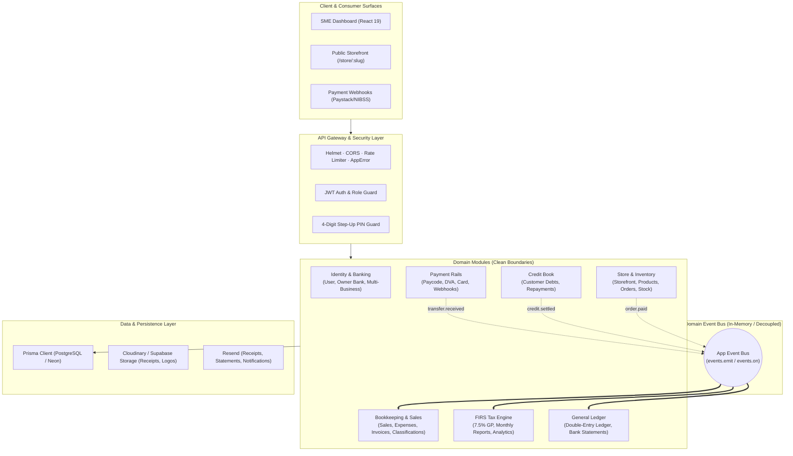
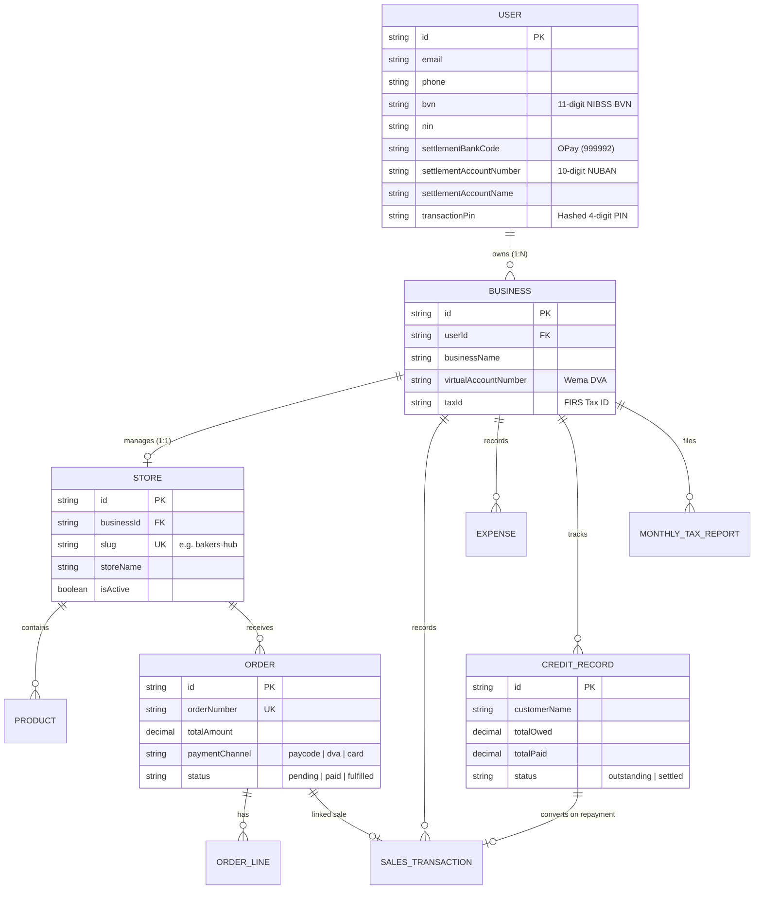
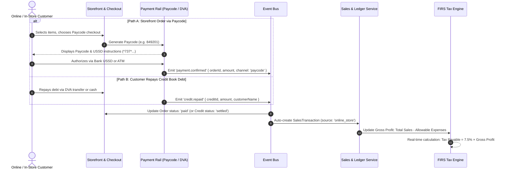

# PayMyTax Enterprise Architecture Blueprint (codebaserescture.md)

> **Document Status:** Official Architecture Masterplan & System Blueprint  
> **Target Audience:** Engineering Team, Future Developers, Technical Stakeholders  
> **Scope:** Modular Monolith Restructuring, Self-Serve Storefront & Inventory, Customer Credit Book, Multi-Rail Payments (Paycode/DVA/Card), Owner-Level Banking, and Automated FIRS Tax Compliance.

---

## 1. Executive Summary & Architectural Vision

PayMyTax by WallX is evolving from a standalone SME tax calculator into a comprehensive **SME Operating System**. As the business scales, it bridges:
1. **Multi-Tenant SME Identity & Owner-Level Banking**: Verified KYC (BVN/NIN) and unified settlement accounts owned by the individual, supporting multiple businesses.
2. **Core Bookkeeping & Invoicing**: Automated and manual cash, POS, and B2B invoice tracking.
3. **Customer Credit Book (Debtors Ledger)**: Managing customer tabs ("buy now, pay later"), partial repayments, and aging debt without premature tax liabilities.
4. **Self-Serve E-Commerce Storefront**: Publicly accessible web catalog (`paymytax.ng/store/:slug`), cart, inventory tracking, and checkout.
5. **Multi-Rail Payment Gateway**: Seamless checkout via Paycode (USSD/ATM), Virtual Bank Transfer (DVA), Debit Card, and Cash.
6. **The Statutory FIRS Tax Compliance Core**: Real-time aggregation of all realized revenue and allowable expenses into automated 7.5% Gross Profit tax calculations.

To support this growth while maintaining high developer velocity and friction-free onboarding, the backend is transitioning from a flat, layered architecture into an **Event-Driven Modular Monolith**.

---

## 2. High-Level System Architecture



---

## 3. Multi-Business Hierarchy & Owner-Level Banking

### 3.1 The Fintech Domain Reality
In the Nigerian SME ecosystem, an entrepreneur (e.g. *Yusuf*) has:
* **One Verified National Identity**: A single BVN and NIN registered with NIBSS.
* **One Primary Settlement Bank**: A personal or commercial account (e.g. OPay, GTBank).
* **Multiple Operating Businesses**:
  * Business A: *Findme Logistics* (Courier services)
  * Business B: *Yusuf's Bakery* (Bread and pastry store)

Under this model:
- **Identity & Settlement Banking live on the `User` (Owner)**: The BVN, NIN, and destination bank account are verified once at the user level.
- **Operations & Taxation live on the `Business`**: Each business has its own dedicated customer virtual account (DVA), its own public storefront, its own sales ledger, and its own FIRS tax returns.
- **Withdrawals**: When withdrawing available funds from *any* of the owner's businesses, the payout automatically settles to the owner's verified bank account without redundant KYC checks.



---

## 4. End-to-End Money & Tax Flow

A key architectural strength of PayMyTax is that **new commerce channels do not duplicate tax logic**. Whether revenue originates from an online storefront order, a credit tab repayment, or a direct virtual account transfer, it standardizes into the core accounting engine.



---

## 5. Domain Modules Breakdown

### 5.1 Identity & Banking Module (`modules/identity/`)
* **Responsibilities**: User authentication, session management, BVN/NIN resolution, Transaction PIN security, owner-level settlement bank accounts, and multi-business profiles.
* **Key Endpoints**:
  * `POST /auth/register`, `POST /auth/login`
  * `POST /auth/pin/setup`, `POST /auth/pin/verify`
  * `POST /auth/bank/verify`, `PUT /auth/settlement-account`
  * `GET /businesses`, `POST /businesses`

### 5.2 Store & Inventory Module (`modules/store/`)
* **Responsibilities**: Self-serve online store setup, product catalog, stock tracking, cart calculation, order fulfillment, and public storefront rendering.
* **Key Endpoints**:
  * *Public (Customer)*:
    * `GET /public/stores/:slug` — Store metadata, banners, categories
    * `GET /public/stores/:slug/products` — Catalog with real-time stock availability
    * `POST /public/stores/:slug/checkout` — Initiates multi-rail payment
  * *Merchant Admin*:
    * `GET /businesses/:id/store/settings`, `PUT /businesses/:id/store/settings`
    * `POST /businesses/:id/store/products`, `PUT /businesses/:id/store/products/:productId`
    * `GET /businesses/:id/store/orders`, `PATCH /businesses/:id/store/orders/:orderId/fulfill`

### 5.3 Customer Credit Book Module (`modules/credit-book/`)
* **Responsibilities**: Tracking customer debt ("buy now, pay later"), partial repayments, due date reminders, and debt aging.
* **Tax Invariant**: Uncollected credit is accounts receivable, **not realized revenue**. Only when cash is repaid does it convert into a `SalesTransaction` and enter FIRS tax calculations.
* **Key Endpoints**:
  * `POST /businesses/:id/credit-records` — Log credit tab
  * `POST /businesses/:id/credit-records/:id/repay` — Record repayment
  * `GET /businesses/:id/credit-records` — Filter by outstanding, settled, overdue

### 5.4 Multi-Rail Payment Gateway (`modules/payments/`)
* **Responsibilities**: Orchestrating various Nigerian payment channels.
  * **Paycode**: Generates numeric paycodes with bank USSD strings (*737*..., *919*...) and ATM withdrawal codes.
  * **DVA**: Dynamic virtual accounts for direct bank transfer.
  * **Cards**: Standard Paystack 3DS card processing.
  * **Cash**: In-person manual confirmation.

### 5.5 Core Bookkeeping & Invoicing (`modules/sales/`, `modules/expenses/`, `modules/invoicing/`)
* Records all business transactions across channels (POS, online, manual, transfer).
* Segregates deductible vs. non-deductible expenses per Nigerian tax regulations.
* Issues professional B2B invoices with PDF generation and WhatsApp/Email sharing.

### 5.6 Statutory FIRS Tax Engine (`modules/tax/`)
* Enforces Nigerian tax compliance:
  $$\text{Gross Profit} = \text{Total Sales} - \text{Allowable Expenses}$$
  $$\text{Tax Payable} = 7.5\% \times \text{Gross Profit}$$
* Handles monthly report generation, lock enforcement, analytics, and period statements.

---

## 6. Directory Structure (Optimized for Developer Onboarding)

```
backend/src/
│
├── core/                               # ⚙️ Infrastructure Plumbing
│   ├── config/                         # Environment & typed secrets
│   ├── database/                       # Prisma singleton, TxClient
│   ├── errors/                         # AppError & error handler
│   ├── events/                         # Typed Event Bus (eventBus.emit / eventBus.on)
│   ├── logger/                         # Winston structured logging
│   └── middleware/                     # Auth, Rate limiting, Helmet
│
├── modules/                            # 📦 Self-Contained Domain Modules
│   │
│   ├── identity/                       # Owner KYC, Multi-business, Bank linking
│   │   ├── identity.service.ts         # BVN verification, Owner-level bank account
│   │   └── business.service.ts         # Multi-business creation & switching
│   │
│   ├── store/                          # 🛍️ STOREFRONT & INVENTORY
│   │   ├── controllers/
│   │   │   ├── store-public.controller.ts # Public: Browse catalog, product detail, checkout
│   │   │   └── store-admin.controller.ts  # Merchant: Manage products, inventory, orders
│   │   ├── services/
│   │   │   ├── store.service.ts        # Slug generation (/store/:slug), store profiles
│   │   │   ├── product.service.ts      # Product CRUD, category, pricing, stock levels
│   │   │   ├── inventory.service.ts    # Stock reservation, decrement, low-stock alerts
│   │   │   └── order.service.ts        # Order lifecycle, line items, cart calculation
│   │   ├── routes/
│   │   │   ├── store-public.routes.ts  # Public endpoints (no login required)
│   │   │   └── store-admin.routes.ts   # Merchant endpoints (JWT protected)
│   │   └── validators/
│   │
│   ├── credit-book/                    # 📒 DEBTORS & CREDIT TRACKING
│   │   ├── credit-book.controller.ts
│   │   ├── credit-book.service.ts      # Log credit, track partial repayments, aging
│   │   └── credit-book.routes.ts
│   │
│   ├── payments/                       # 💳 MULTI-RAIL PAYMENT GATEWAY
│   │   ├── channels/
│   │   │   ├── paycode.channel.ts      # Paycode generation, USSD dial strings
│   │   │   ├── dva.channel.ts          # Virtual account bank transfers
│   │   │   └── card.channel.ts         # Paystack 3DS card checkout
│   │   └── payment-orchestrator.ts     # Routes checkout to selected payment channel
│   │
│   ├── sales/                          # 📈 Inflow tracking, bulk Excel import
│   ├── expenses/                       # 📉 Expense logging & tax deductibility
│   ├── invoicing/                      # 🧾 B2B Invoices & Customer CRM
│   ├── settlement/                     # 🏦 Wallet balance & payouts
│   ├── tax/                            # 🏛️ FIRS 7.5% Tax Engine & Reports
│   └── ledger/                         # 📑 Double-entry running balance ledger
│
└── shared/                             # 🌐 Shared Utilities
    ├── pdf/                            # Base PDF fonts, styling, canvas utils
    ├── email/                          # Resend templates
    └── helpers/                        # `toNumber()`, `assertMonthNotLocked()`, formatters
```

---

## 7. Prisma Database Schema Additions

```prisma
// ─── OWNER-LEVEL BANKING (Updates to User) ──────────────────────
// In User model:
// settlementBankCode      String?   @map("settlement_bank_code")
// settlementBankName      String?   @map("settlement_bank_name")
// settlementAccountNumber String?   @map("settlement_account_number")
// settlementAccountName   String?   @map("settlement_account_name")

// ─── STORE & E-COMMERCE MODELS ────────────────────────────────

model Store {
  id           String    @id @default(uuid())
  businessId   String    @unique @map("business_id")
  slug         String    @unique                    // paymytax.ng/store/{slug}
  storeName    String    @map("store_name")
  description  String?
  logoUrl      String?   @map("logo_url")
  bannerUrl    String?   @map("banner_url")
  isActive     Boolean   @default(true) @map("is_active")
  createdAt    DateTime  @default(now()) @map("created_at")
  updatedAt    DateTime  @updatedAt @map("updated_at")

  business     Business  @relation(fields: [businessId], references: [id], onDelete: Cascade)
  products     Product[]
  orders       Order[]

  @@map("stores")
}

model Product {
  id             String      @id @default(uuid())
  storeId        String      @map("store_id")
  name           String
  description    String?
  price          Decimal     @db.Decimal(14, 2)
  costPrice      Decimal?    @map("cost_price") @db.Decimal(14, 2)
  stockQuantity  Int         @default(0) @map("stock_quantity")
  trackInventory Boolean     @default(true) @map("track_inventory")
  imageUrl       String?     @map("image_url")
  isTaxable      Boolean     @default(true) @map("is_taxable")
  isActive       Boolean     @default(true) @map("is_active")
  createdAt      DateTime    @default(now()) @map("created_at")
  updatedAt      DateTime    @updatedAt @map("updated_at")

  store          Store       @relation(fields: [storeId], references: [id], onDelete: Cascade)
  orderLines     OrderLine[]

  @@index([storeId])
  @@map("products")
}

model Order {
  id             String       @id @default(uuid())
  storeId        String       @map("store_id")
  businessId     String       @map("business_id")
  orderNumber    String       @unique @map("order_number")   // ORD-2026-0001
  customerName   String       @map("customer_name")
  customerPhone  String?      @map("customer_phone")
  customerEmail  String?      @map("customer_email")
  deliveryAddress String?     @map("delivery_address")
  status         OrderStatus  @default(pending)
  subtotal       Decimal      @db.Decimal(14, 2)
  deliveryFee    Decimal      @default(0.00) @map("delivery_fee") @db.Decimal(14, 2)
  totalAmount    Decimal      @map("total_amount") @db.Decimal(14, 2)
  paymentChannel String?      @map("payment_channel")        // 'paycode' | 'dva' | 'card' | 'cash'
  paidAt         DateTime?    @map("paid_at")
  linkedSaleId   String?      @unique @map("linked_sale_id")

  store          Store        @relation(fields: [storeId], references: [id])
  business       Business     @relation(fields: [businessId], references: [id])
  linkedSale     SalesTransaction? @relation(fields: [linkedSaleId], references: [id])
  lines          OrderLine[]

  createdAt      DateTime     @default(now()) @map("created_at")
  updatedAt      DateTime     @updatedAt @map("updated_at")

  @@index([storeId])
  @@index([businessId])
  @@map("orders")
}

model OrderLine {
  id         String   @id @default(uuid())
  orderId    String   @map("order_id")
  productId  String   @map("product_id")
  quantity   Int
  unitPrice  Decimal  @map("unit_price") @db.Decimal(14, 2)
  lineTotal  Decimal  @map("line_total") @db.Decimal(14, 2)

  order      Order    @relation(fields: [orderId], references: [id], onDelete: Cascade)
  product    Product  @relation(fields: [productId], references: [id])

  @@map("order_lines")
}

enum OrderStatus {
  pending
  paid
  processing
  fulfilled
  cancelled
}

// ─── CUSTOMER CREDIT BOOK (DEBTORS) ───────────────────────────

model CreditRecord {
  id             String       @id @default(uuid())
  businessId     String       @map("business_id")
  customerName   String       @map("customer_name")
  customerPhone  String?      @map("customer_phone")
  description    String?
  totalOwed      Decimal      @map("total_owed") @db.Decimal(14, 2)
  totalPaid      Decimal      @default(0.00) @map("total_paid") @db.Decimal(14, 2)
  status         CreditStatus @default(outstanding)
  dueDate        DateTime?    @map("due_date") @db.Date
  linkedSaleId   String?      @unique @map("linked_sale_id")

  business       Business     @relation(fields: [businessId], references: [id])
  linkedSale     SalesTransaction? @relation(fields: [linkedSaleId], references: [id])

  createdAt      DateTime     @default(now()) @map("created_at")
  updatedAt      DateTime     @updatedAt @map("updated_at")

  @@index([businessId])
  @@index([status])
  @@map("credit_records")
}

enum CreditStatus {
  outstanding
  partial
  settled
  written_off
}
```

---

## 8. Pragmatic 3-Week Execution Roadmap

```
Week 1: Codebase Hygiene & Decoupling
├── Extract duplicate toNumber() and assertMonthNotLocked() into shared/helpers
├── Set up lightweight in-memory Typed Event Bus (core/events/event-bus.ts)
└── Decompose settlement.service.ts (1,249 lines) into preview, execution, and history

Week 2: Owner-Level Banking & Database Migration
├── Move settlement bank fields from Business model to User model in Prisma
├── Migrate existing business settlement bank data to owner user accounts
└── Update payout execution to settle directly to the verified owner bank

Week 3: Storefront & Credit Book Implementation (Feature Launch)
├── Deploy Store, Product, Order, OrderLine, and CreditRecord models
├── Build modules/store/ (Public catalog API + Merchant inventory management)
├── Build modules/credit-book/ (Debtor tracking & repayment flow)
└── Implement Paycode channel adapter in modules/payments/channels/
```
