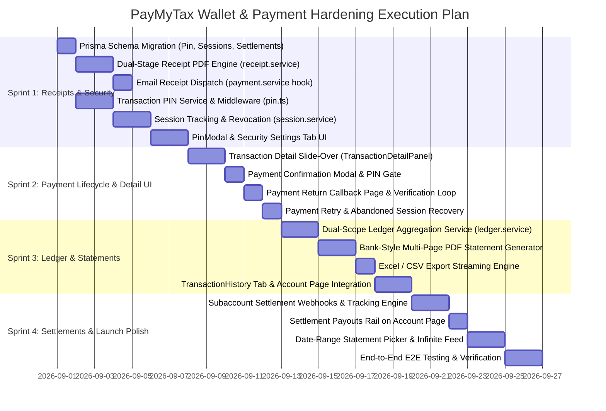

# PayMyTax Wallet & Payments — Senior Fintech Engineering Master Plan (v2.2 Production-Hardened)

> **Document Status:** Final Reviewed & Architecturally Verified Against Live Paystack API & Codebase  
> **Engineering Level:** Principal Fintech Engineer & Payment Infrastructure Architect (Paystack, Moniepoint, Flutterwave & CBN Compliance)  
> **Repository Context:** PayMyTax by WallX (PostgreSQL via Prisma, Express 5, React 19, Paystack API, PDFKit, Resend)  
> **Scope Guard:** 100% executable within existing infrastructure. No phantom APIs, no impossible webhook assumptions, zero regulatory/accounting hallucinations.

---

## Executive Summary & Architecture Gap Analysis

PayMyTax's Dedicated Virtual Account (DVA) and Tax Payment flows provide a solid foundation for automated sales capture and FIRS tax liability settlement. However, a deep audit of the wallet and payment infrastructure reveals **six critical architectural gaps** that must be resolved before handling production SME money movement:

```
┌─────────────────────────────────────────────────────────────────────────────────────────┐
│                                CURRENT GAPS & FINTECH RISKS                             │
├─────────────────────────────────────────────────────────────────────────────────────────┤
│ 1. Zero Proof-of-Payment: Transactions are flat rows; no downloadable/verifiable PDF     │
│    receipts or automated email confirmations for FIRS audit defense.                     │
│ 2. Fragmented Financial Feed: Inbound DVA transfers (/account), tax payments (/payments),│
│    and invoice settlements (/invoices) live in silos with no single general ledger view. │
│ 3. Flawed Running Balance Math: Treating all sales (cash, manual, pos) as digital bank │
│    balance creates false financial statements. Ledgers must separate DVA funds vs Sales.│
│ 4. Invisible Payouts / Settlements: Paystack auto-settles subaccounts on T+1, but the   │
│    app does not track payouts or sync with Paystack's Settlements API.                  │
│ 5. Single-Factor Financial Authorization: Critical mutations (tax pay, bank changes)   │
│    rely solely on JWT tokens. A compromised session allows unauthorized financial acts. │
│ 6. Disjointed Payment UX: Instant redirect without confirmation, missing callback       │
│    state machine, and unrecoverable failed payment states.                               │
└─────────────────────────────────────────────────────────────────────────────────────────┘
```

---

## Phase 1: Transaction Details, Slide-Over & Dual-Stage Receipts
**Priority:** 🔴 Critical (Compliance Blocker)  
**Effort:** ~3.5 Days  
**Target Milestone:** SME Audit Defense & Operational Transparency

### 1.1 Reusable Transaction Detail Slide-Over (Frontend)
- **Path:** `frontend/src/components/TransactionDetailPanel.tsx`
- **Pattern:** Slide-over sheet (`fixed inset-y-0 right-0 max-w-lg w-full bg-white shadow-2xl z-50 animate-slide-in-right`) mirroring Moniepoint/Kuda operations rather than disruptive center modals.
- **Context-Aware Metadata Display:**
  - **Header:** Type Pill (`DVA Inflow` | `Tax Payment` | `Invoice Settlement` | `Reversed`), Status Pill (`Settled` | `Pending Review` | `Processing` | `Failed`), Big Mono Amount (`+₦50,000.00` in emerald or `-₦3,750.00` in red).
  - **Audit Block:** Timestamp (ISO + localized), Reference ID, Paystack Reference (with one-click copy and toast).
  - **Counterparty & Channel:** Sender name / Customer hint, Bank name, Masked account number, Payment method (`Dedicated NUBAN`, `Card`, `Bank Transfer`).
  - **Tax & FIRS Status (for tax payments):** Tax period covered (`e.g., July 2026`), Collection status, FIRS Remittance Reference, and link to FIRS official receipt when remitted.
  - **Inline Classification Actions (for DVA inflows):** If `needsVerification === true`, render quick-action buttons for "Confirm as Sales Revenue" (`POST /sales/:id/verify`) or "Reclassify Non-Taxable" (`POST /sales/:id/reclassify` e.g., Director Loan, Equity, Transfer).
  - **Action Bar:** "Download Receipt" (PDF), "Share Details" (Web Share API / Copy), "Report Issue" (`mailto:support@paymytax.com?subject=Txn%20Issue%20PMT-xxx`).

### 1.2 Dual-Stage Payment Receipt Service (Backend)
- **Path:** `backend/src/services/receipt.service.ts`, `backend/src/controllers/receipt.controller.ts`, `backend/src/routes/receipt.routes.ts`
- **Regulatory Truth:** In Nigerian tax compliance, a platform cannot issue an "Official FIRS Tax Clearance Receipt" before funds are actually remitted to the government. We implement a **Dual-Stage Receipt Model**:
  1. **Stage 1 (Immediate Collection Receipt):** "PayMyTax Collection & Custody Receipt" — confirms funds were successfully debited and held in custody for FIRS remittance batching. Contains QR verification code, Paystack reference, and payment timestamp.
  2. **Stage 2 (FIRS Official Remittance Receipt):** "FIRS Electronic Tax Receipt" — available once the admin remittance batch is marked `remitted`, embedding the official `firsRemittanceRef` and linking to the FIRS treasury document.
  3. **Stage 3 (DVA Transfer Inflow Receipt):** "Customer Payment Transfer Receipt" — for SME customers who need proof of bank transfer to the business's virtual account.
- **Atomic Receipt Numbering:** Sequential sequence `RCT-{YYYY}-{NNN}` generated per-business per-year using an atomic database counter inside `$transaction` (preventing duplicates under concurrent downloads).
- **PDF Engine:** Rendered via PDFKit with business logo embedding via `@/lib/pdf-utils` (`fetchLogoForPdf`), diagonal security watermark ("COLLECTED" / "REMITTED"), and FIRS compliance legal disclaimer.

### 1.3 Asynchronous Post-Payment Receipt Delivery (Backend)
- **Path:** `backend/src/services/payment.service.ts`, `backend/src/lib/email/templates/payment-receipt.ts`
- **Execution Hook:** Inside `processWebhook` after `charge.success` confirms payment and locks the tax report:
  1. Generate Receipt PDF buffer in-memory via `receipt.service.ts`.
  2. Dispatch email via `@/lib/email` (`sendEmail` with Resend in production, Winston dev-log fallback) with the PDF attached:
     ```typescript
     attachments: [{
       filename: `Receipt-${payment.transactionReference}.pdf`,
       content: receiptPdfBuffer,
       contentType: 'application/pdf'
     }]
     ```
  3. **Strict Isolation:** Wrapped in a non-blocking `void sendReceiptEmail().catch(...)` fire-and-forget handler — network timeouts on email delivery must NEVER abort or rollback the database payment confirmation transaction.

---

## Phase 2: Dual-Ledger Architecture & Transaction History
**Priority:** 🔴 Critical (Financial Integrity)  
**Effort:** ~4.5 Days  
**Target Milestone:** Accurate Bookkeeping & Single-Pane Financial Visibility

### 2.1 The Two-Scope Ledger Problem & Solution
> ⚠️ **Principal Engineer Architectural Rule:** Conflating physical cash/manual sales with digital bank balances is the #1 mistake in naive fintech apps. Physical cash in a drawer does NOT increase the DVA bank account balance.

We implement **Two Distinct Ledger Scopes**:

```
                       ┌────────────────────────────────────────────────────────┐
                       │               BUSINESS FINANCIAL LEDGER                │
                       └────────────────────────────────────────────────────────┘
                                    │                              │
                   ┌────────────────┴──────────────┐  ┌────────────┴────────────────┐
                   ▼                               ▼  ▼                             ▼
       ┌──────────────────────────────┐              ┌──────────────────────────────┐
       │   DVA VIRTUAL BANK LEDGER    │              │    TOTAL INCOME & SALES      │
       │ (Actual Digital Money In/Out)│              │  (Comprehensive Accounting)  │
       ├──────────────────────────────┤              ├──────────────────────────────┤
       │ • DVA Inbound Bank Transfers │              │ • DVA Bank Transfers         │
       │ • Tax Card/Checkout Debits   │              │ • Cash Sales (Manual)        │
       │ • Paystack Bank Settlements  │              │ • Invoices (Paid / Credit)   │
       │ • Running Bank Balance (₦)   │              │ • POS / External Channels    │
       └──────────────────────────────┘              └──────────────────────────────┘
```

### 2.2 Unified Ledger Aggregation Service (Backend)
- **Path:** `backend/src/services/ledger.service.ts`, `backend/src/controllers/ledger.controller.ts`, `backend/src/validators/ledger.validator.ts`, `backend/src/routes/ledger.routes.ts`
- **Route:** `GET /api/v1/businesses/:businessId/ledger?scope=dva_bank|all_income&from=...&to=...&cursor=...&limit=50`
- **Data Model Normalization:**
  ```typescript
  export interface UnifiedLedgerRow {
    id: string;
    scope: 'dva_bank' | 'general_sales' | 'tax_outflow';
    entryType: 'credit' | 'debit';
    sourceType: 'dva_transfer' | 'manual_sale' | 'invoice_payment' | 'pos' | 'tax_payment' | 'refund';
    amount: number;
    runningBalance: number; // Accurately scoped to the requested ledger view
    classification: string;  // revenue, capital, loan, tax_payment, refund, etc.
    description: string;
    reference: string;
    date: string;
    status: 'settled' | 'pending' | 'reversed' | 'refunded';
    counterparty: string;
    isTaxable: boolean;
    metadata: Record<string, unknown>;
  }
  ```
- **Cursor Pagination & Accumulation:** Uses cursor pagination on `(transactionDate, id)` with an initial opening balance query for the window (`SELECT SUM(credits) - SUM(debits) WHERE date < fromDate`) to compute accurate running balances across pages without loading millions of historical rows into memory.

### 2.3 Account Page Multi-Tab UI & Store (Frontend)
- **Path:** `frontend/src/pages/TransactionHistory.tsx`, `frontend/src/stores/ledger.store.ts`, `frontend/src/pages/Account.tsx`
- **Tabbed Interface:** `/account?tab=wallet` (Hero Card + NUBAN + Quick Inflows) vs `/account?tab=ledger` (Full General Ledger & Bank Feeds).
- **Scope Toggle:** Switch between "Digital Bank Account (DVA)" and "All Business Sales & Invoices".
- **Date Stream Grouping:** Sticky headers grouping transactions by date (`Today`, `Yesterday`, `August 24, 2026`).
- **Infinite Virtual Scroll:** Cursor-based automatic fetch as user scrolls down.

---

## Phase 3: Bank-Style Statements & Universal Data Export
**Priority:** 🟡 High (Accountant & Tax Practitioner Hand-Off)  
**Effort:** ~3 Days  
**Target Milestone:** Standard Bank Reconciliation Statements

### 3.1 Formal Bank-Style PDF Statement Engine (Backend)
- **Path:** `backend/src/services/bank-statement.service.ts`, `backend/src/controllers/bank-statement.controller.ts`, `backend/src/routes/statement.routes.ts`
- **Endpoints:**
  - `GET /api/v1/businesses/:businessId/tax/statements/bank?month=8&year=2026`
  - `GET /api/v1/businesses/:businessId/tax/statements/bank?from=2026-01-01&to=2026-08-31`
- **Statement Structure:**
  - **Institution Header:** Business Logo, Business Name, Merchant ID, Registered TIN, Official DVA NUBAN (Wema Bank), Statement Period, Generation Timestamp.
  - **Account Summary Box:** Opening Balance (₦), Total Credits (₦), Total Debits (₦), Net Movement (₦), Closing Balance (₦).
  - **Multi-Page Ledger Table:** Columns: `Value Date`, `Narration / Description`, `Reference`, `Credit (₦)`, `Debit (₦)`, `Balance (₦)`.
  - **Pagination & Carried Forward Balance:** Automatic page breaks via PDFKit with table headers and "Balance Brought Forward" at the top of subsequent pages.
  - **Official Footer:** Page X of Y, Hash integrity verification token, FIRS compliance record stamp.

### 3.2 Excel (XLSX) & CSV Streaming Engine (Backend + Frontend)
- **Path:** `backend/src/services/export.service.ts`
- **Technology:** ExcelJS for `.xlsx` (matching existing sales template patterns) and streaming CSV RFC4180 writer.
- **Security Cap:** Hard cap at 15,000 rows per export request to prevent denial-of-service memory pressure.
- **Frontend Export Dropdown:** Split button on Account / Ledger page (`[Download PDF Statement ▾]` with options for Current Month, Last 3 Months, Year-to-Date, Custom Date Range, CSV, and Excel).

---

## Phase 4: Security Hardening (PIN, Sessions, Lockout & Alerts)
**Priority:** 🔴 Critical (CBN Regulatory Requirement & Anti-Fraud)  
**Effort:** ~5.5 Days  
**Target Milestone:** Tier-2 Fintech Security Standard

### 4.1 Transaction PIN Infrastructure
- **Prisma Schema Update (`User` model):**
  ```prisma
  transactionPin       String?   @map("transaction_pin")
  transactionPinSetAt  DateTime? @map("transaction_pin_set_at")
  pinAttempts          Int       @default(0) @map("pin_attempts")
  pinLockedUntil       DateTime? @map("pin_locked_until")
  pinResetTokenHash    String?   @map("pin_reset_token_hash")
  pinResetExpiresAt    DateTime? @map("pin_reset_expires_at")
  ```
- **Service & Middleware:** `backend/src/services/pin.service.ts`, `backend/src/middleware/pin.ts`
- **Protected Endpoints:**
  - `POST /api/v1/businesses/:businessId/tax/pay` (Tax Payment Authorization)
  - `POST /api/v1/businesses/:businessId/dva/settlement/connect` (Payout Bank Link/Change)
  - `POST /api/v1/businesses/:businessId/dva/setup-virtual-account` (Virtual Account Generation)
  - *(Note: `POST /dva/settlement/resolve` is deliberately EXCLUDED from PIN checks — name inquiry is read-only validation and must not block the user typing an account number).*
- **Concurrency & Anti-Brute-Force:**
  - Atomic database increment for failed attempts: `UPDATE "users" SET "pin_attempts" = "pin_attempts" + 1, "pin_locked_until" = CASE WHEN "pin_attempts" >= 4 THEN NOW() + INTERVAL '30 minutes' ELSE NULL END WHERE id = $1`.
  - Returns HTTP 423 `PIN_LOCKED` with remaining lock seconds when locked.
  - 4-digit PIN setup/change/reset flow protected via secure email reset token (consistent with `forgotPassword` architecture).
- **Frontend Component:** `frontend/src/components/PinModal.tsx` — 4-box auto-focusing numeric input with keyboard navigation and WebAuthn biometric shortcut where available.

### 4.2 Multi-Device Session Management & Audit Trails
- **Prisma Schema Update:**
  ```prisma
  model Session {
    id          String    @id @default(uuid())
    userId      String    @map("user_id")
    deviceInfo  String    @map("device_info")
    ipAddress   String    @map("ip_address")
    location    String?
    lastActive  DateTime  @default(now()) @map("last_active")
    isRevoked   Boolean   @default(false) @map("is_revoked")
    revokedAt   DateTime? @map("revoked_at")
    createdAt   DateTime  @default(now()) @map("created_at")

    user        User      @relation(fields: [userId], references: [id], onDelete: Cascade)
    @@index([userId, isRevoked])
    @@map("sessions")
  }

  model LoginHistory {
    id          String    @id @default(uuid())
    userId      String    @map("user_id")
    ipAddress   String    @map("ip_address")
    deviceInfo  String    @map("device_info")
    location    String?
    success     Boolean
    failReason  String?   @map("fail_reason")
    createdAt   DateTime  @default(now()) @map("created_at")

    user        User      @relation(fields: [userId], references: [id], onDelete: Cascade)
    @@index([userId, createdAt(sort: Desc)])
    @@map("login_histories")
  }
  ```
- **JWT Session Binding:** Embed `sessionId` inside the JWT access and refresh token payloads. In `backend/src/middleware/auth.ts`, check session revocation status (cached in-memory with a 60s TTL for zero-latency lookups).
- **Session API Endpoints:**
  - `GET /api/v1/auth/sessions` — List active sessions (device, IP, location, current device indicator).
  - `DELETE /api/v1/auth/sessions/:sessionId` — Remote revoke a specific device.
  - `DELETE /api/v1/auth/sessions` — "Log out of all other devices".
  - `GET /api/v1/auth/login-history` — Recent authentication logs.
- **Frontend Management UI:** Embedded in `frontend/src/pages/Settings.tsx` (Security tab).

### 4.3 Account Lockout & Security Threat Notifications
- **Account Lockout:** In `auth.service.ts`, track `failedLoginAttempts` on the `User` record:
  ```prisma
  failedLoginAttempts  Int       @default(0) @map("failed_login_attempts")
  lockedUntil          DateTime? @map("locked_until")
  lastFailedLoginAt    DateTime? @map("last_failed_login_at")
  ```
  5 consecutive password failures lock the account for 30 minutes; 10 failures require an email password reset.
- **Security Alerts (`security-notification.service.ts`):** Trigger automated high-priority email alerts for:
  - New device login detected.
  - Transaction PIN changed or reset.
  - Settlement payout bank account changed.
  - Password modified.

---

## Phase 5: Payment Lifecycle State Machine & UX
**Priority:** 🟡 High (Conversion & Error Recovery)  
**Effort:** ~2.5 Days  
**Target Milestone:** Fault-Tolerant Payment Journey

```
┌─────────────────┐       ┌─────────────────┐       ┌─────────────────┐       ┌─────────────────┐
│ Tax Report Ready│ ────► │  Confirmation   │ ────► │   PIN Auth      │ ────► │ Paystack Direct │
│  (Finalized)    │       │     Modal       │       │  Verification   │       │    Checkout     │
└─────────────────┘       └─────────────────┘       └─────────────────┘       └─────────────────┘
                                                                                       │
                                                                                       ▼
┌─────────────────┐       ┌─────────────────┐       ┌─────────────────┐       ┌─────────────────┐
│ Verified / Done │ ◄──── │  Auto-Receipt   │ ◄──── │ Webhook/Verify  │ ◄──── │ Return Callback │
│  (Report Locked)│       │    Generated    │       │ (Dual Confirm)  │       │  (/callback)    │
└─────────────────┘       └─────────────────┘       └─────────────────┘       └─────────────────┘
```

### 5.1 Pre-Payment Confirmation Modal (Frontend)
- **Path:** `frontend/src/components/PaymentConfirmationModal.tsx`
- **Fintech Standard:** Never send a user to an external gateway without an in-app confirmation bill.
- **Contents:** Breakdown of Tax Month, Gross Profit calculation, 7.5% Tax Payable, FIRS Assessment notice, and Payment Channel picker. On "Proceed to Pay", prompts for Transaction PIN (§4.1), then calls `initiatePayment`.

### 5.2 Dedicated Payment Return & Verification Page (Frontend)
- **Path:** `frontend/src/pages/PaymentCallback.tsx`
- **Route:** `/payments/callback?reference=PMT-xxx` (configured as Paystack `callback_url`).
- **State Machine:**
  1. Calls `GET /businesses/:businessId/tax/payments/:paymentId/verify` with exponential backoff (retrying up to 4 times over 15s to allow Paystack webhooks to race ahead).
  2. **Success View:** Animated checkmark, payment reference, "Receipt Downloaded" button, "View Remittance Tracking" CTA.
  3. **Pending View:** Clear explanation that the bank is processing the transfer, with a direct link to the `/payments` status tracker.
  4. **Failed View:** Human-readable gateway failure reason with instant "Try Again" recovery button.

### 5.3 Stale & Failed Payment Recovery Actions
- **Path:** `frontend/src/pages/Payments.tsx`
- **Actions:** Replace static "failed" badges with active "Retry Payment" buttons (calling backend idempotency recovery in `payment.service.ts`). For payments stuck in `pending` > 1 hour, provide an "Abandon & Start New Payment" action to clear dead locks.

---

## Phase 6: Subaccount Settlement & Payout Visibility
**Priority:** 🟡 High (Merchant Trust & "Where Is My Money?")  
**Effort:** ~2 Days  
**Target Milestone:** End-to-End Fund Settlement Tracking

### 6.1 Real Paystack Subaccount Settlement Mechanics
> 🔍 **Paystack Architecture Truth:** In Paystack split-settlement with subaccounts, Paystack clears accumulated funds directly into the SME's Nigerian bank account during its automated daily settlement run (T+1).
> 
> Integration Mechanism:
> - Paystack delivers transfer notification events: `transfer.success`, `transfer.failed`, `transfer.reversed`.
> - Transaction-level split payload is captured in `charge.success` (contains `data.subaccount` and `data.split`).
> - To sync historical and scheduled subaccount settlement payouts, Paystack exposes the **Settlements API** (`GET https://api.paystack.co/settlement?subaccount={subaccount_code}`).

### 6.2 Settlement Tracking Engine (Backend & Database)
- **Prisma Schema (`Settlement` model):**
  ```prisma
  model Settlement {
    id                    String    @id @default(uuid())
    businessId            String    @map("business_id")
    amount                Decimal   @db.Decimal(15, 2)
    status                String    @default("pending") // pending, success, failed, reversed
    settlementDate        DateTime? @map("settlement_date")
    bankName              String    @map("bank_name")
    accountNumberMasked   String    @map("account_number_masked") // e.g. "•••• 1234" (PII safe)
    reference             String    @unique
    paystackSettlementId  String?   @map("paystack_settlement_id")
    metadata              Json?
    createdAt             DateTime  @default(now()) @map("created_at")
    updatedAt             DateTime  @updatedAt @map("updated_at")

    business              Business  @relation(fields: [businessId], references: [id], onDelete: Cascade)
    @@index([businessId, createdAt(sort: Desc)])
    @@map("settlements")
  }
  ```
- **Webhook & Sync Processing (`settlement.service.ts` & `payment.service.ts`):**
  - Listen for `transfer.success` / `transfer.failed` payout events.
  - Implement on-demand / daily sync via Paystack's `GET /settlement?subaccount={subaccountCode}` API to record settlement batches into the `Settlement` table.
- **Settlement Service (`settlement.service.ts`):**
  - `getSettlements(userId, businessId, query)` — Paginated list of daily bank settlements.
  - `getSettlementSummary(userId, businessId)` — Month-to-date total settled, last settlement date/amount.
  - `syncSettlements(userId, businessId)` — Sync with Paystack Settlement API.
- **Frontend Settlement Widget:** Added to the right-rail of `Account.tsx` showing "Recent Bank Payouts" with bank logo, settled amount, and date.

---

## Phase 7: Polish, Pagination & UX Refinements
**Priority:** 🟢 Nice to Have (Pre-Launch Polish)  
**Effort:** ~2 Days  

1. **Date-Range Statement Picker:** Replace the one-click statement button with an interactive popover supporting standard presets (This Month, Last Month, Q1-Q4, Full Year, Custom Dates).
2. **Infinite Pagination on Transfer Feed:** Replace the 50-item hardcap on `Account.tsx` with cursor-based pagination and smooth intersection observer loading.
3. **Action-Oriented Empty States:** Replace generic "No transfers yet" with interactive onboarding cards containing QR code shortcuts and WhatsApp sharing links.
4. **Notification Preferences:** Add fine-grained email alert toggles in Settings (Inbound Transfer Alerts, Tax Payment Receipts, Payout Confirmations, Security Warnings).

---

## Complete File Inventory & Implementation Map

```
================================================================================
COMPONENT                  FILE PATH                                    STATUS
================================================================================
[Security / Database]      backend/prisma/schema.prisma                 MODIFY
[Security / Middleware]    backend/src/middleware/pin.ts                NEW
[Security / Middleware]    backend/src/middleware/auth.ts               MODIFY
[Security / Service]       backend/src/services/pin.service.ts          NEW
[Security / Service]       backend/src/services/session.service.ts      NEW
[Security / Service]       backend/src/services/security-notification.tsNEW
[Security / Controller]    backend/src/controllers/auth.controller.ts   MODIFY
[Security / Routes]        backend/src/routes/auth.routes.ts            MODIFY
[Security / UI]            frontend/src/components/PinModal.tsx        NEW

[Receipts / Service]       backend/src/services/receipt.service.ts      NEW
[Receipts / Controller]    backend/src/controllers/receipt.controller.tsNEW
[Receipts / Routes]        backend/src/routes/receipt.routes.ts        NEW
[Receipts / Template]      backend/src/lib/email/templates/payment-receipt.ts NEW
[Receipts / Hook]          backend/src/services/payment.service.ts      MODIFY

[Ledger / Service]         backend/src/services/ledger.service.ts       NEW
[Ledger / Controller]      backend/src/controllers/ledger.controller.ts NEW
[Ledger / Validator]       backend/src/validators/ledger.validator.ts   NEW
[Ledger / Routes]          backend/src/routes/ledger.routes.ts          NEW
[Ledger / Store]           frontend/src/stores/ledger.store.ts          NEW
[Ledger / UI Page]         frontend/src/pages/TransactionHistory.tsx    NEW

[Statements / Service]     backend/src/services/bank-statement.service.tsNEW
[Statements / Service]     backend/src/services/export.service.ts       NEW
[Statements / Controller]  backend/src/controllers/statement.controller.tsMODIFY
[Statements / Routes]      backend/src/routes/statement.routes.ts       MODIFY

[Payments / Modal]         frontend/src/components/PaymentConfirmationModal.tsx NEW
[Payments / Page]          frontend/src/pages/PaymentCallback.tsx       NEW
[Payments / Detail Panel]  frontend/src/components/TransactionDetailPanel.tsx NEW
[Payments / UI Updates]    frontend/src/pages/Payments.tsx              MODIFY
[Payments / UI Updates]    frontend/src/pages/Account.tsx               MODIFY

[Settlements / Service]    backend/src/services/settlement.service.ts   NEW
[Settlements / Webhook]    backend/src/services/payment.service.ts      MODIFY
[Settlements / UI]         frontend/src/pages/Account.tsx               MODIFY
================================================================================
```

---

## Detailed Execution Schedule (Gantt)



---

## Explicit Out-of-Scope Declarations (V1 Boundaries)

| Feature | Technical & Regulatory Reason for Postponing to V2 |
| :--- | :--- |
| **Direct P2P Wallet-to-Wallet Transfers** | Requires a Central Bank of Nigeria (CBN) Mobile Money Operator (MMO) or Switching License. PayMyTax is a tax compliance platform, not a deposit-taking bank. |
| **Manual Wallet Withdrawals via Transfers API** | Paystack Split-Settlement automatically clears 100% of SME funds to their linked commercial bank account on T+1. Holding merchant balances in-app creates escrow liabilities. |
| **Debit Card Issuance (Virtual / Physical)** | Requires integration with card processors (Interswitch / Mastercard / Visa / Bridgecard) and PCI-DSS Level 1 certification. |
| **Multi-Currency (USD/GBP) Accounts** | PayMyTax is specifically built for Nigerian SME local tax laws (FIRS Company Income Tax & VAT under the 7.5% gross profit formula). |
| **Direct Wallet-to-FIRS Sweep** | FIRS Remittance is executed in batched regulatory schedules via the government Remita / TaxPro Max portal by authorized platform operators. |

---

## Architectural Verification Checklist

- [x] **No Phantom Webhooks:** Corrected webhook events (`charge.success`, `transfer.success`/`failed`, `dedicatedaccount.assign.success`/`failed`, `customeridentification.success`/`failed`) plus Paystack `GET /settlement` API sync for subaccount settlements.
- [x] **No DB Locks During IO:** All PDF builds, email sends via Resend, and Paystack API calls execute outside PostgreSQL transactions.
- [x] **Strict PII Protection:** BVN and full 10-digit NUBAN account numbers are never logged in audit logs (only masked `accountLast4`).
- [x] **Backward Compatible Migration:** All new columns in `User` and new models (`Session`, `LoginHistory`, `Settlement`) use `@map("...")` with snake_case column names and table names matching Prisma conventions.
- [x] **Exact Codebase Alignment:** Matches `@/middleware/auth.ts`, `@/lib/prisma.ts`, `@/lib/pdf-utils.ts`, `@/lib/email/templates/`, and Zustand store patterns.
