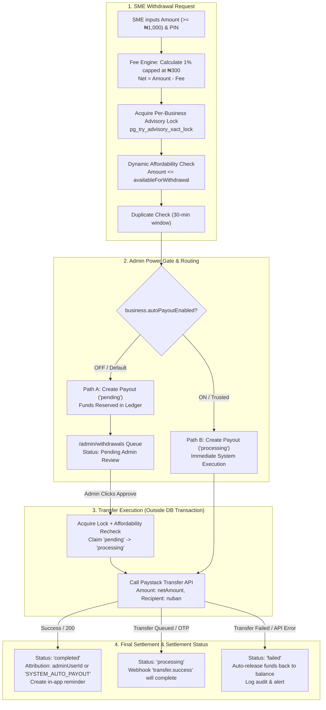

# WallX Payment Split, Settlement & Withdrawal Monetization — Authoritative Implementation Blueprint (v3.0 Production-Grade)

> **Document Status:** Authoritative Financial Architecture & Implementation Blueprint  
> **Engineering Level:** Principal Fintech Systems Architect (CBN Compliance, NIBSS Clearing, Paystack Core Integrations, High-Concurrency Safety)  
> **Repository Context:** PayMyTax by WallX (`backend/`, `frontend/`, PostgreSQL via Prisma, Express 5, React 19)  
> **Scope:** 1% Capped at ₦300 Withdrawal Monetization, Per-Business Admin Auto-Payout Gate (ON/OFF), Concurrency Protections, and Dynamic Balance Aggregation.

---

## 1. Executive Overview & Core Architectural Pillars

This document specifies the exact accounting equations, state machines, database models, and operational workflows governing fund movements within PayMyTax by WallX.

### 1.1 Core Architectural Pillars
1. **Dynamic Single Source of Truth Ledger**: Available balances are dynamically computed in `getPayoutPreview()` from `SalesTransaction` and `SettlementPayout` aggregates. No duplicate or static `Wallet` table is introduced.
2. **Gross Revenue Inflow Booking**: All incoming customer transfers via Dedicated Virtual Accounts (DVAs) are recorded at **100% Gross Value** in `SalesTransaction` to guarantee statutory compliance with FIRS guidelines.
3. **Outflow Monetization (1% Capped at ₦300)**: WallX charges **1% of the withdrawal amount, capped at ₦300.00 max**. A minimum floor of **₦1,000.00** guarantees that the WallX fee (minimum ₦10.00) always covers Paystack's underlying clearing cost (₦10.00).
4. **Per-Business Admin Power Gate (Dual-Path)**:
   - **Manual Review (Toggle = OFF, Default)**: Withdrawal enters `status: 'pending'`, reserves funds against the available balance, and waits in `/admin/withdrawals` for admin approval.
   - **Instant Transfer (Toggle = ON)**: Trusted businesses bypass manual admin approval. Withdrawal enters `status: 'processing'` and initiates an immediate Paystack transfer.
5. **Triple-Fence Concurrency & Anti-Double-Spend**: Every withdrawal and approval is guarded by:
   - Transaction-scoped per-business advisory lock (`pg_try_advisory_xact_lock`)
   - Inside-transaction dynamic affordability check
   - 30-minute duplicate request detector
   - Network I/O strictly outside database transactions

---

## 2. Fee Engine & Commercial Spread Specification

### 2.1 Formula
Let $A$ be the requested withdrawal amount in Naira ($A \ge 1,000.00$):

$$\text{WallX Fee } (F) = \min\left(\text{round2}(A \times 0.01), \, 300.00\right)$$

$$\text{Net Transferred to SME Bank } (N) = A - F$$

$$\text{WallX Net Margin} = F - \text{Paystack NIP Cost} - \text{Stamp Duty (if applicable)}$$

### 2.2 Spread & Profit Matrix
| Withdrawal Amount ($A$) | WallX Fee ($F$) | Net to Bank ($N$) | Paystack NIP Cost | EMTL Stamp Duty | WallX Net Profit | WallX Margin % |
| :--- | :--- | :--- | :--- | :--- | :--- | :--- |
| **₦1,000.00** (Min Floor) | **₦10.00** (1%) | ₦990.00 | ₦10.00 | ₦0.00 | **₦0.00** | 0.0% (Break-even) |
| **₦2,500.00** | **₦25.00** (1%) | ₦2,475.00 | ₦10.00 | ₦0.00 | **+₦15.00** | 60.0% |
| **₦5,000.00** | **₦50.00** (1%) | ₦4,950.00 | ₦10.00 | ₦0.00 | **+₦40.00** | 80.0% |
| **₦10,000.00** | **₦100.00** (1%) | ₦9,900.00 | ₦25.00 | ₦50.00 | **+₦25.00** | 25.0% |
| **₦20,000.00** | **₦200.00** (1%) | ₦19,800.00 | ₦25.00 | ₦50.00 | **+₦125.00** | 62.5% |
| **₦30,000.00+** (Cap Hit)| **₦300.00** (Cap) | ₦29,700.00 | ₦25.00 | ₦50.00 | **+₦225.00** | 75.0% |
| **₦50,000.00** | **₦300.00** (Cap) | ₦49,700.00 | ₦25.00 | ₦50.00 | **+₦225.00** | 75.0% |
| **₦100,000.00** | **₦300.00** (Cap) | ₦99,700.00 | ₦50.00 | ₦50.00 | **+₦200.00** | 66.7% |

*Notice: Enforcing the minimum floor at ₦1,000.00 ensures the 1% fee is never lower than ₦10.00, meaning WallX never subsidizes payouts on any transaction.*

---

## 3. End-to-End System Flow (Dual-Path Architecture)



---

## 4. Database Schema Changes

### 4.1 Schema Definition (`backend/prisma/schema.prisma`)
Add `autoPayoutEnabled` to `Business`, and add `adminApprovedBy` and `adminApprovedAt` to `SettlementPayout`:

```prisma
model Business {
  id                      String             @id @default(uuid())
  userId                  String             @map("user_id")
  businessName            String             @map("business_name")
  // ... existing fields ...
  settlementBankCode      String?            @map("settlement_bank_code")
  settlementBankName      String?            @map("settlement_bank_name")
  settlementAccountNumber String?            @map("settlement_account_number")
  settlementAccountName   String?            @map("settlement_account_name")
  autoSplitEnabled        Boolean            @default(false) @map("auto_split_enabled")
  taxSplitPercentage      Decimal            @default(7.50) @map("tax_split_percentage") @db.Decimal(5, 2)
  
  // NEW: Admin gate toggle for outbound auto-payout
  autoPayoutEnabled       Boolean            @default(false) @map("auto_payout_enabled")

  createdAt               DateTime           @default(now()) @map("created_at")
  updatedAt               DateTime           @updatedAt @map("updated_at")
  // ... relations ...
  settlementPayouts       SettlementPayout[]

  @@map("businesses")
}

model SettlementPayout {
  id                    String        @id @default(uuid())
  businessId            String        @map("business_id")
  amount                Decimal       @map("amount") @db.Decimal(15, 2)
  fee                   Decimal       @default(0) @map("fee") @db.Decimal(15, 2)
  netAmount             Decimal       @map("net_amount") @db.Decimal(15, 2)
  destinationBankCode   String        @map("destination_bank_code")
  destinationBankName   String        @map("destination_bank_name")
  destinationAccountNum String        @map("destination_account_num")
  destinationAccountName String       @map("destination_account_name")
  transferReference     String        @unique @map("transfer_reference")
  paystackTransferCode  String?       @map("paystack_transfer_code")
  status                PaymentStatus @default(pending) @map("payment_status")
  initiatedAt           DateTime      @default(now()) @map("initiated_at")
  completedAt           DateTime?     @map("completed_at")
  failureReason         String?       @map("failure_reason")
  narration             String?

  // NEW: Admin approval attribution
  adminApprovedBy       String?       @map("admin_approved_by")
  adminApprovedAt       DateTime?     @map("admin_approved_at")

  createdAt             DateTime      @default(now()) @map("created_at")
  updatedAt             DateTime      @updatedAt @map("updated_at")
  business              Business      @relation(fields: [businessId], references: [id], onDelete: Cascade)

  @@index([businessId])
  @@index([status])
  @@index([transferReference])
  @@map("settlement_payouts")
}
```

### 4.2 SQL Migration
```sql
-- AlterTable businesses
ALTER TABLE "businesses" ADD COLUMN "auto_payout_enabled" BOOLEAN NOT NULL DEFAULT false;

-- AlterTable settlement_payouts
ALTER TABLE "settlement_payouts" ADD COLUMN "admin_approved_by" TEXT;
ALTER TABLE "settlement_payouts" ADD COLUMN "admin_approved_at" TIMESTAMP(3);
```

---

## 5. Implementation Code & Service Specifications

### 5.1 Fee Engine (`backend/src/lib/paystack-fees.ts`)
```typescript
import config from '@/config';

export type WithdrawalFeeBearer = 'merchant' | 'platform';

const round2 = (n: number): number => Math.round((n + Number.EPSILON) * 100) / 100;

export const MIN_WITHDRAWAL_AMOUNT = 1000.00;
export const WALLX_WITHDRAWAL_PCT = 1.0; // 1%
export const WALLX_WITHDRAWAL_CAP = 300.00; // ₦300 cap

export interface WithdrawalQuote {
  requested: number;
  amount: number;
  fee: number;
  netAmount: number;
  paystackAmount: number;
  bearer: WithdrawalFeeBearer;
}

export function quoteWithdrawal(requestedNaira: number): WithdrawalQuote {
  const bearer: WithdrawalFeeBearer = 'merchant';
  const requested = round2(Number(requestedNaira) || 0);

  if (requested < MIN_WITHDRAWAL_AMOUNT) {
    throw new Error(
      `Minimum withdrawal amount is ₦${MIN_WITHDRAWAL_AMOUNT.toLocaleString('en-NG', { minimumFractionDigits: 2 })}`
    );
  }

  // 1% capped at ₦300
  const calculatedFee = round2((requested * WALLX_WITHDRAWAL_PCT) / 100);
  const fee = Math.min(calculatedFee, WALLX_WITHDRAWAL_CAP);
  const netAmount = round2(requested - fee);

  return {
    requested,
    amount: requested,
    fee,
    netAmount,
    paystackAmount: netAmount, // Transferred via Paystack
    bearer,
  };
}

export function feeSchedule() {
  return {
    currency: 'NGN',
    minWithdrawal: MIN_WITHDRAWAL_AMOUNT,
    withdrawal: {
      ratePct: WALLX_WITHDRAWAL_PCT,
      cap: WALLX_WITHDRAWAL_CAP,
      bearer: 'merchant' as const,
      note: 'WallX charges 1% capped at ₦300.00 per withdrawal.',
    },
  };
}

export { round2 };
```

### 5.2 Dual-Path `withdrawBalance()` (`backend/src/services/settlement.service.ts`)
```typescript
export async function withdrawBalance(
  userId: string,
  businessId: string,
  params: WithdrawBalanceInput
) {
  const business = await verifyBusinessOwnership(userId, businessId);

  // 1. Settlement bank check
  if (!business.settlementAccountNumber || !business.settlementBankCode) {
    throw new AppError(
      400,
      'No settlement bank connected. Please connect your commercial bank account first.',
      'SETTLEMENT_ACCOUNT_REQUIRED'
    );
  }

  // 2. PIN verification
  if (params.stepUpToken) {
    pinService.verifyStepUpToken(userId, params.stepUpToken);
  } else if (params.pin) {
    await pinService.verifyPin(userId, params.pin);
  } else {
    throw new AppError(400, 'Transaction PIN is required', 'PIN_REQUIRED');
  }

  // 3. Price withdrawal (1% capped at ₦300)
  const quote = quoteWithdrawal(params.amount);
  const now = new Date();
  const dateStr = now.toISOString().slice(0, 10).replace(/-/g, '');
  const transferReference = `PO-${dateStr}-${crypto.randomBytes(5).toString('hex').toUpperCase()}`;

  const isAutoPayout = Boolean(business.autoPayoutEnabled);
  const initialStatus = isAutoPayout ? 'processing' : 'pending';

  // 4. Atomic database reservation with triple-fence
  const payout = await prisma.$transaction(async (tx) => {
    // Fence 1: Per-business advisory lock
    const [{ locked }] = await tx.$queryRaw<Array<{ locked: boolean }>>`
      SELECT pg_try_advisory_xact_lock(hashtextextended(${businessId}::text, 0)) AS locked
    `;
    if (!locked) {
      throw new AppError(
        409,
        'A withdrawal request is already being processed. Please wait a few seconds and try again.',
        'WITHDRAWAL_IN_PROGRESS'
      );
    }

    // Fence 2: Affordability check
    const preview = await getPayoutPreview(userId, businessId, tx);
    if (quote.amount > preview.availableForWithdrawal) {
      throw new AppError(
        400,
        `Insufficient available funds. Maximum withdrawable balance is ₦${preview.availableForWithdrawal.toLocaleString(
          'en-NG',
          { minimumFractionDigits: 2 }
        )}.`,
        'INSUFFICIENT_FUNDS',
        { available: preview.availableForWithdrawal, requested: params.amount, required: quote.amount, fee: quote.fee }
      );
    }

    // Fence 3: Duplicate check (30 min)
    const dup = await tx.settlementPayout.findFirst({
      where: {
        businessId,
        amount: quote.amount,
        status: { in: ['pending', 'processing'] },
        createdAt: { gte: new Date(Date.now() - 30 * 60 * 1000) },
      },
    });
    if (dup) {
      throw new AppError(
        409,
        'You already have a withdrawal request for this exact amount awaiting approval or processing.',
        'DUPLICATE_WITHDRAWAL_REQUEST'
      );
    }

    return tx.settlementPayout.create({
      data: {
        businessId,
        amount: quote.amount,
        fee: quote.fee,
        netAmount: quote.netAmount,
        destinationBankCode: business.settlementBankCode!,
        destinationBankName: business.settlementBankName || 'Commercial Bank',
        destinationAccountNum: business.settlementAccountNumber!,
        destinationAccountName: business.settlementAccountName || business.businessName,
        transferReference,
        status: initialStatus,
        narration: params.narration,
      },
    });
  }, { maxWait: 10000, timeout: 20000 });

  // PATH A: Manual Admin Review (autoPayoutEnabled === false)
  if (!isAutoPayout) {
    logAudit({
      userId,
      businessId,
      action: 'settlement.payout_requested',
      resourceType: 'settlement_payout',
      resourceId: payout.id,
      newData: { amount: quote.amount, fee: quote.fee, netAmount: quote.netAmount, mode: 'manual_approval' },
    });

    void createReminderOnce({
      businessId,
      reminderType: 'payout_requested',
      scheduledDate: new Date(),
      message: `Withdrawal request for ${formatNaira(quote.netAmount)} submitted for admin review.`,
      referenceType: 'settlement_payout',
      referenceId: payout.id,
    });

    return {
      id: payout.id,
      amount: toNumber(payout.amount),
      fee: toNumber(payout.fee),
      netAmount: toNumber(payout.netAmount),
      transferReference: payout.transferReference,
      status: payout.status,
      message: `Withdrawal request for ${formatNaira(toNumber(payout.netAmount))} submitted. It will be processed once approved by an admin.`,
    };
  }

  // PATH B: Instant Payout (autoPayoutEnabled === true)
  try {
    const provider = getPaymentProvider();

    const recipient = await provider.createTransferRecipient({
      type: 'nuban',
      name: payout.destinationAccountName,
      accountNumber: payout.destinationAccountNum,
      bankCode: payout.destinationBankCode,
      currency: 'NGN',
      description: `Auto-payout for ${business.businessName}`,
    });

    const transferResult = await provider.initiateTransfer({
      source: 'balance',
      amount: toNumber(payout.netAmount),
      recipient: recipient.recipientCode,
      reason: payout.narration || `Payout for ${business.businessName}`,
      reference: payout.transferReference,
    });

    const isComplete = transferResult.status === 'success' || transferResult.status === 'completed';

    const updated = await prisma.settlementPayout.update({
      where: { id: payout.id },
      data: {
        paystackTransferCode: transferResult.transferCode,
        ...(isComplete ? { status: 'completed', completedAt: new Date() } : {}),
        adminApprovedBy: 'SYSTEM_AUTO_PAYOUT',
        adminApprovedAt: new Date(),
      },
    });

    logAudit({
      userId,
      businessId,
      action: 'settlement.auto_payout_executed',
      resourceType: 'settlement_payout',
      resourceId: payout.id,
      newData: { transferCode: transferResult.transferCode, netAmount: quote.netAmount },
    });

    void createReminderOnce({
      businessId,
      reminderType: 'payout_approved',
      scheduledDate: new Date(),
      message: `Your withdrawal of ${formatNaira(quote.netAmount)} has been processed to your bank account.`,
      referenceType: 'settlement_payout',
      referenceId: payout.id,
    });

    return {
      id: updated.id,
      amount: toNumber(updated.amount),
      fee: toNumber(updated.fee),
      netAmount: toNumber(updated.netAmount),
      transferReference: updated.transferReference,
      status: updated.status,
      message: `Withdrawal of ${formatNaira(toNumber(updated.netAmount))} successfully initiated.`,
    };
  } catch (err) {
    await prisma.settlementPayout.update({
      where: { id: payout.id },
      data: {
        status: 'failed',
        failureReason: err instanceof Error ? err.message : String(err),
      },
    });

    logAudit({
      userId,
      businessId,
      action: 'settlement.auto_payout_failed',
      resourceType: 'settlement_payout',
      resourceId: payout.id,
      newData: { error: err instanceof Error ? err.message : String(err) },
    });

    throw new AppError(
      502,
      `Transfer failed: ${err instanceof Error ? err.message : 'Gateway error'}. Your balance has been restored.`,
      'TRANSFER_FAILED'
    );
  }
}
```

### 5.3 Admin Auto-Payout Toggle Service (`backend/src/services/settlement.service.ts`)
```typescript
export async function adminToggleAutoPayout(
  adminUserId: string,
  businessId: string,
  enabled: boolean
) {
  const business = await prisma.business.findUnique({
    where: { id: businessId },
    select: { id: true, businessName: true, autoPayoutEnabled: true, settlementAccountNumber: true },
  });

  if (!business) {
    throw new AppError(404, 'Business not found', 'BUSINESS_NOT_FOUND');
  }

  if (enabled && !business.settlementAccountNumber) {
    throw new AppError(
      400,
      'Cannot enable auto-payout: business has no connected settlement bank account',
      'SETTLEMENT_ACCOUNT_REQUIRED'
    );
  }

  const updated = await prisma.business.update({
    where: { id: businessId },
    data: { autoPayoutEnabled: enabled },
    select: { id: true, businessName: true, autoPayoutEnabled: true },
  });

  logAudit({
    userId: adminUserId,
    businessId,
    action: 'admin.business_auto_payout_toggled',
    resourceType: 'business',
    resourceId: businessId,
    oldData: { autoPayoutEnabled: business.autoPayoutEnabled },
    newData: { autoPayoutEnabled: enabled },
  });

  return updated;
}
```

### 5.4 Admin Controller & Route Wiring
**Controller** (`backend/src/controllers/admin.controller.ts`):
```typescript
export async function toggleBusinessAutoPayout(req: Request, res: Response) {
  const { businessId } = req.params;
  const { enabled } = req.body;
  const adminUserId = req.user!.userId;

  const result = await settlementService.adminToggleAutoPayout(adminUserId, businessId, enabled);
  res.json({ success: true, data: result });
}
```

**Route** (`backend/src/routes/admin.routes.ts`):
```typescript
router.patch(
  '/businesses/:businessId/auto-payout',
  requireAdmin,
  validate(z.object({ body: z.object({ enabled: z.boolean() }) })),
  asyncHandler(adminController.toggleBusinessAutoPayout)
);
```

### 5.5 Frontend Client Fee Estimation (`frontend/src/lib/fees.ts`)
```typescript
export const MIN_WITHDRAWAL_AMOUNT = 1000.00;
export const WALLX_WITHDRAWAL_PCT = 1.0;
export const WALLX_WITHDRAWAL_CAP = 300.00;

export function estimateWithdrawal(requestedNaira: number) {
  const requested = Math.round((Number(requestedNaira) || 0) * 100) / 100;
  if (requested < MIN_WITHDRAWAL_AMOUNT) return null;

  const fee = Math.min(Math.round(requested * 0.01 * 100) / 100, WALLX_WITHDRAWAL_CAP);
  const netAmount = Math.round((requested - fee) * 100) / 100;

  return {
    requested,
    fee,
    netAmount,
    debitAmount: requested,
  };
}
```

---

## 6. Implementation Steps

| Step | Action | Files Impacted | Dependencies |
| :--- | :--- | :--- | :--- |
| **0** | Delete untracked duplicate directory `bckend/` | `c:\Users\pc\Desktop\tax by wallx\bckend\` | None |
| **1** | Add fields to Prisma schema & generate client | `backend/prisma/schema.prisma` | None |
| **2** | Create and execute SQL migration | `backend/prisma/migrations/` | Step 1 |
| **3** | Update fee engine with 1% capped at ₦300 formula | `backend/src/lib/paystack-fees.ts`, `frontend/src/lib/fees.ts` | None |
| **4** | Implement dual-path `withdrawBalance()` & `adminToggleAutoPayout()` | `backend/src/services/settlement.service.ts` | Step 1, Step 3 |
| **5** | Wire admin controller and router | `admin.controller.ts`, `admin.routes.ts` | Step 4 |
| **6** | Update Admin UI with auto-payout toggle switch | `frontend/src/pages/admin/AdminWithdrawals.tsx` | Step 5 |
| **7** | Update SME withdrawal modal UI | `frontend/src/components/PayoutWithdrawalModal.tsx` | Step 3 |
| **8** | Run unit & E2E tests | `tests/e2e/settlement-payout.e2e.test.ts` | Step 4–7 |

---

## 7. Acceptance Criteria

- [ ] **1% Capped at ₦300 Fee**:
  - Request ₦1,000 $\rightarrow$ Fee = ₦10.00, Disbursed = ₦990.00
  - Request ₦10,000 $\rightarrow$ Fee = ₦100.00, Disbursed = ₦9,900.00
  - Request ₦50,000 $\rightarrow$ Fee = ₦300.00, Disbursed = ₦49,700.00
  - Request ₦100,000 $\rightarrow$ Fee = ₦300.00, Disbursed = ₦99,700.00
- [ ] **Floor Enforcement**: Requests below ₦1,000.00 reject with `400 Bad Request: Minimum withdrawal amount is ₦1,000.00`.
- [ ] **Manual Approval Flow (Toggle OFF)**:
  - Payout enters `status: 'pending'`.
  - Available balance reflects reservation.
  - Sits in `/admin/withdrawals` queue until admin clicks "Approve".
- [ ] **Instant Payout Flow (Toggle ON)**:
  - Admin toggles Auto-Payout ON for a business.
  - SME submits withdrawal $\rightarrow$ Paystack transfer initiates immediately.
  - Payout transitions directly to `completed` (or `processing`).
- [ ] **Concurrency & Idempotency**:
  - Simultaneous requests for the same business serialize on advisory lock.
  - Identical amount requested within 30 minutes rejects with `409 DUPLICATE_WITHDRAWAL_REQUEST`.
