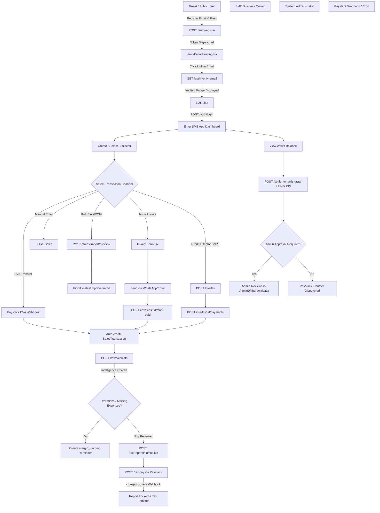

# CODEBASE-TO-USER-STORY REVERSE ENGINEERING REPORT
**Platform:** PayMyTax by WallX  
**Analysis Target:** Core Repository (`backend/` & `frontend/`)  
**Analyst:** Senior Product Analyst & Full-Stack Systems Engineer  
**Date:** September 27, 2026  
**Baseline Standard:** Evidence-based reverse engineering (strictly derived from implemented source code)

---

## 1. Executive Summary

**PayMyTax by WallX** is an automated bookkeeping, tax intelligence, and compliance remittance platform built for Nigerian Small and Medium Enterprises (SMEs). 

At its core, the platform automates Nigerian tax compliance centered on the statutory formula:
$$\text{Tax Payable} = 7.5\% \times \text{Gross Profit}$$
$$\text{Gross Profit} = \text{Taxable Sales} - \text{Deductible Expenses}$$

Rather than functioning as a passive calculation calculator, the codebase implements an operational financial engine:
1. **Automated & Manual Inflow Capture:** Captures revenue through Dedicated Virtual Accounts (DVA via Wema/Titan Paystack integration), bulk Excel/CSV statement imports (with normalizers and deduplication caches), pre-sale invoicing with WhatsApp/Email dispatch, and Trade Debtor tracking (Buy Now, Pay Later) that enforces cash-basis tax recognition upon receipt of payment.
2. **Expense & Anomaly Intelligence:** Tracks operating expenses across 8 statutory categories and automatically fires warnings during monthly tax computation if no expenses are recorded or if the business's actual profit margin deviates by more than 15 percentage points from its expected margin.
3. **Tax Finalization, PDF Statements & Paystack Remittance:** Freezes accounting periods to prevent retroactive tampering (`assertMonthNotLocked`), renders FIRS-compliant PDF statements and tax computation slips via PDFKit, and initiates tax remittances through Paystack webhooks.
4. **Treasury Wallet, Auto-Split & PIN-Protected Settlement:** Routes non-tax commercial revenue to an integrated central wallet balance with automated or on-demand commercial bank withdrawals, secured by an encrypted 4-digit transaction PIN with lockout enforcement, BVN/NIN identity verification, and administrative withdrawal approvals.
5. **Administrative Back-Office:** Empowers system administrators with real-time treasury analytics, user and business lifecycle management, immutable audit logging, manual FIRS batch remittance reconciliation, dynamic AI provider configuration (Groq, OpenAI, Gemini, DeepSeek), and one-time 24-hour payout account modification overrides.

---

## 2. User Roles & Personas Identified

Based strictly on authorization guards (`backend/src/middleware/auth.ts`), database role enums (`backend/prisma/schema.prisma:462-465`), and route wrappers (`frontend/src/routes/`), the codebase distinguishes **5 operational actors**:

```
+--------------------------------------------------------------------------------------------------+
|                                    ACTOR TAXONOMY IN CODEBASE                                    |
+--------------------------------------------------------------------------------------------------+
|  1. Guest / Public Visitor          -->  Unauthenticated visitor, landing page, auth forms       |
|  2. Customer / Invoice Recipient    -->  Unauthenticated third-party receiving public share token|
|  3. SME Business Owner (User)       -->  Authenticated user (`role: 'user'`), owns businesses    |
|  4. System Administrator (Admin)    -->  Privileged user (`role: 'admin'`), platform supervisor  |
|  5. Automated System Actors         -->  Scheduled cron jobs & inbound webhook processors        |
+--------------------------------------------------------------------------------------------------+
```

### Persona 1: Guest / Unregistered Visitor
- **Authentication State:** Unauthenticated (`req.user === undefined`).
- **Code Evidence:** `frontend/src/routes/GuestRoute.tsx`, `backend/src/routes/auth.routes.ts`.
- **Scope of Access:** Public landing page (`Landing.tsx`), login (`Login.tsx`), registration (`Register.tsx`), forgot password (`ForgotPassword.tsx`), reset password (`ResetPassword.tsx`), email pending verification screen (`VerifyEmailPending.tsx`), and token verification (`VerifyEmail.tsx`).

### Persona 2: External Customer / Debtor (Token Recipient)
- **Authentication State:** Unauthenticated, but presents an unguessable cryptographic URL token (`shareToken`).
- **Code Evidence:** `backend/src/routes/public.routes.ts`, `backend/src/controllers/invoice.controller.ts:downloadPublicPdf`.
- **Scope of Access:** Can view/download generated invoice PDFs inline in mobile and desktop browsers via `GET /api/v1/public/invoices/:token/pdf` without an account.

### Persona 3: SME Business Owner (`role: 'user'`)
- **Authentication State:** Authenticated via JWT Access Token (15-min expiry) with `role: 'user'`.
- **Code Evidence:** `backend/src/middleware/auth.ts:authenticate`, `frontend/src/routes/ProtectedRoute.tsx`, `backend/prisma/schema.prisma:73-135`.
- **Ownership Verification:** Every business service strictly enforces data isolation via `business.userId === req.user.userId`.
- **Scope of Access:** Multi-business creation, DVA assignment, manual sales/expense entry, Excel bulk upload, invoicing, trade debt/debtor recovery, FIRS tax computation, tax reports, PDF statement exports, wallet payout requests, transaction PIN configuration, AI advisory assistant.

### Persona 4: System Administrator (`role: 'admin'`)
- **Authentication State:** Authenticated via JWT Access Token with `role: 'admin'`.
- **Code Evidence:** `backend/src/middleware/auth.ts:authorize('admin')`, `backend/src/routes/admin.routes.ts`, `frontend/src/routes/AdminRoute.tsx`, `AdminLayout.tsx`.
- **Scope of Access:** Platform KPI overview, user active/suspension management, audit log inspections, withdrawal request approval/rejection/requery, platform withdrawal fee configurations, dynamic AI provider selection & testing, 24-hour one-time bank payout unlock permissions, FIRS batch remittance entry.

### Persona 5: Automated Background System Actors
- **Execution State:** Headless system processes running via `node-cron` or inbound webhook signatures.
- **Code Evidence:**
  - Inbound webhook handler: `backend/src/routes/webhook.routes.ts`, HMAC-SHA512 verification in `payment.controller.ts:handleWebhook`.
  - Reminders cron: `backend/src/jobs/reminders.cron.ts` (00:30 Lagos time, advisory lock `947362`).
  - Payout reconciliation cron: `backend/src/jobs/payout-reconciliation.cron.ts`.
  - Wallet auto-sweep cron: `backend/src/jobs/wallet-auto-sweep.cron.ts`.
  - Wallet ledger audit cron: `backend/src/jobs/wallet-reconciliation.cron.ts`.

---

## 3. Real Journey Maps



### Journey 1: Guest Signup, Verification & Initial Access
1. **Entry:** Visitor loads `/register` (`Register.tsx`).
2. **Form Submission:** Visitor inputs email, Nigerian 10-digit mobile number, and password (enforcing uppercase, lowercase, number, 8+ characters).
3. **Execution:** Submits to `POST /api/v1/auth/register` (`auth.controller.ts:register`).
4. **Backend Processing:** Creates user with `isVerified: false`. Hashes a random 32-byte verification token (`verificationTokenHash`), sets 24-hour expiry, and dispatches email via Resend (or dev console fallback).
5. **Pending State:** Frontend redirects to `/verify-email-pending` (`VerifyEmailPending.tsx`) displaying recipient email and a 60-second cooldown timer before `POST /api/v1/auth/resend-verification` can be pressed.
6. **Token Verification:** User opens email and clicks `https://.../verify-email?token=...`.
7. **Verification Screen:** Renders `VerifyEmail.tsx`, calls `POST /api/v1/auth/verify-email`, sets `isVerified = true` and `verifiedAt = now()`. Displays a large bespoke verified badge and "Log in to your account" button.
8. **Authentication:** User logs in at `/login` (`Login.tsx`), receiving access and refresh tokens, and is routed to `/dashboard`.

### Journey 2: Dedicated Virtual Account (DVA) Automated Inflow Capture
1. **Entry:** User navigates to `/account` (`Account.tsx`) or Sales banner.
2. **Setup Request:** Triggers `POST /api/v1/businesses/:id/dva/setup-virtual-account` (`dva.controller.ts:setupVirtualAccount`).
3. **Gateway Dispatch:** Server creates customer on Paystack and requests a dedicated virtual account (Titan/Wema).
4. **Assignment Webhook:** Paystack sends `dedicatedaccount.assign.success` -> `payment.controller.ts:handleWebhook` updates `Business.virtualAccountNumber` and `Business.virtualAccountBank`.
5. **Customer Bank Transfer:** An SME customer transfers money to this account number.
6. **Inbound Webhook Execution:** Paystack fires `charge.success` with `channel: 'dedicated_nuban'`.
7. **Automated Bookkeeping:** `dva.service.ts:handleDvaTransferWebhook`:
   - Auto-creates `SalesTransaction` (`source: 'bank_transfer'`, `status: 'confirmed'`, `dvaOrigin: true`).
   - If `autoSplitEnabled` on business, splits gross amount: credits 92.5% to `WalletBalance` and reserves 7.5% for tax.
   - Creates an event-driven `Reminder` of type `dva_received`.
   - Dispatches `dva.transfer_received` domain event triggering wallet credit email alert.

### Journey 3: Excel / CSV Bulk Sales Import
1. **Entry:** User navigates to `/sales` (`Sales.tsx`) and clicks "Import Excel / CSV".
2. **Template Download:** User clicks "Download Template", calling `GET /api/v1/businesses/:id/sales/import/template` (`sales-import.controller.ts:template`), receiving an ExcelJS-generated `.xlsx` template with data validation dropdowns on sources.
3. **File Upload & Preview:** User uploads file to `POST /api/v1/businesses/:id/sales/import/preview`:
   - Enforces 2MB cap and max 100 rows.
   - Parses Excel serial dates or `DD/MM/YYYY`. Cleans currency symbols (`₦`, `NGN`, commas).
   - Classifies each row into: `valid`, `invalid`, `duplicate_in_file`, `duplicate_in_db` (matching `(businessId, source, referenceId)`), or `locked` (month already finalized).
   - Stores valid parsed rows in an in-memory cache mapped by a 15-minute UUID `fileToken`.
4. **Modal Review:** `SalesImportModal.tsx` shows status counts and error diagnostics.
5. **Commit:** User clicks "Import Valid Rows", sending `POST /api/v1/businesses/:id/sales/import/commit` with `fileToken`.
6. **Execution:** Server re-verifies month-locks and calls Prisma `createMany({ skipDuplicates: true })` inside a transaction, writing an audit log `sales.imported`.

### Journey 4: Pre-Sale Billing (Invoicing) via WhatsApp & Direct Settlement
1. **Entry:** User navigates to `/invoices/new` (`InvoiceForm.tsx`).
2. **Invoice Composition:** User selects or enters customer details, line items, and optional discount.
3. **Creation:** `POST /api/v1/businesses/:id/invoices` generates invoice sequence `INV-{YYYY}-{NNN}`, computes subtotal, 7.5% VAT, and total, saving as `draft`.
4. **Distribution via WhatsApp:** User clicks "Send via WhatsApp" (`InvoiceDetail.tsx`):
   - Calls `POST /api/v1/businesses/:id/invoices/:id/send-whatsapp` (`invoice.controller.ts:sendByWhatsApp`).
   - Generates a PDF via PDFKit, persists a unique `shareToken`, flips status to `sent`, and generates a `wa.me/234...?text=...` deep link with the public invoice URL.
   - Opens WhatsApp with prefilled message.
5. **Recipient View:** Customer opens the public link `GET /api/v1/public/invoices/:token/pdf` and reviews the PDF inline.
6. **Settlement:** Customer pays the business. SME clicks "Mark as Paid" in `InvoiceDetail.tsx`:
   - Calls `POST /api/v1/businesses/:id/invoices/:id/mark-paid` with payment method and date.
   - Enforces `assertMonthNotLocked`.
   - Atomically updates `Invoice.status = 'paid'` and creates a `SalesTransaction` (`source: 'invoice'`, `status: 'confirmed'`) linked via `invoice.linkedSaleId`.

### Journey 5: Customer Credit (BNPL Debtors) & Cash-Basis Tax Recognition
1. **Entry:** User navigates to `/debtors` (`Debtors.tsx`).
2. **Record Debt:** Clicks "Record Credit Sale" -> `POST /api/v1/businesses/:id/credits` (`credit.controller.ts:create`).
   - **Cash-Basis Rule:** No `SalesTransaction` is created at this point! FIRS tax liability is strictly deferred until money is received.
3. **Reminders:** User can trigger WhatsApp reminders via `POST /api/v1/businesses/:id/credits/:id/whatsapp-reminder`.
4. **Payment Recording:** Debtor pays partially or fully:
   - User inputs payment on `DebtorDetail.tsx` -> `POST /api/v1/businesses/:id/credits/:id/payments`.
   - Backend deducts balance, sets status to `partially_paid` or `paid`.
   - **Revenue Recognition:** Atomically creates a linked `SalesTransaction` for the exact amount paid. Tax liability is now recognized in that specific transaction month.
5. **Alternate Path (Write-Off):** If debtor defaults, user submits `WriteOffModal.tsx` -> `POST /api/v1/businesses/:id/credits/:id/write-off`. Status changes to `written_off` without generating taxable revenue.

### Journey 6: Monthly FIRS Tax Calculation, Intelligence Checks & Finalization
1. **Entry:** User navigates to `/tax` (`TaxReports.tsx`).
2. **Calculation:** User selects month/year and submits `POST /api/v1/businesses/:id/tax/calculate` (`tax.controller.ts:calculate`):
   - Aggregates confirmed taxable sales and deductible expenses within UTC boundaries.
   - Calculates `Gross Profit = Sales - Expenses`.
   - Applies `Tax Payable = 7.5% * Gross Profit` (or 0 if negative).
3. **Intelligence Checks (`tax.service.ts#L127-L145`):**
   - If `totalSales > 0 && totalExpenses === 0`: fires `no_expenses` warning and upserts a `margin_warning` reminder.
   - If $|actualMargin - defaultMargin| > 15\%$: fires `margin_deviation` warning and upserts a `margin_warning` reminder.
4. **Analytics Inspection:** User clicks `?tab=analytics` (`TaxAnalytics.tsx`) to evaluate 6m/12m/24m/YoY charts, payment distributions, and trends.
5. **Finalization:** User reviews numbers and clicks "Finalize Report":
   - Calls `POST /api/v1/businesses/:id/tax/reports/:id/finalize`.
   - Sets `isFinalized = true`. The month is locked; subsequent sales or expenses cannot be created or modified for this period (`assertMonthNotLocked` throws HTTP 423).

### Journey 7: Tax Payment Remittance via Paystack
1. **Entry:** User views finalized report and clicks "Pay Tax Now" (`/tax`).
2. **Initiate Payment:** Calls `POST /api/v1/businesses/:id/tax/pay` (`payment.controller.ts:initiatePayment`):
   - Verifies report is finalized and tax payable > 0.
   - Creates a `TaxPayment` record (`status: 'pending'`).
   - Calls Paystack Initialize API with callback URL pointing to `/payments/callback`.
   - Returns Paystack authorization URL.
3. **Gateway Checkout:** User is redirected to Paystack and enters card/bank transfer details.
4. **Webhook Confirmation:** Paystack sends `charge.success` to `/api/webhooks/paystack`:
   - Validates HMAC-SHA512 signature against `PAYSTACK_SECRET_KEY`.
   - Records webhook event in `PaystackWebhookEvent` (preventing replay attacks within 5 min).
   - Atomically updates `TaxPayment.paymentStatus = 'completed'`, `MonthlyTaxReport.paymentStatus = 'completed'`, and sets `isLocked = true`.
   - Generates an event-driven `Reminder` of type `payment_successful`.
5. **Receipt:** User downloads official tax payment receipt via `GET /api/v1/businesses/:id/receipts/tax-payments/:paymentId`.

### Journey 8: Wallet Balance Withdrawal & PIN Step-Up Security
1. **Entry:** User navigates to `/account` (`Account.tsx`) and clicks "Withdraw Funds".
2. **Pre-requisite Verification:** User must have verified BVN/NIN and set up a 4-digit transaction PIN.
3. **Withdrawal Request:** User enters destination account and amount -> modal opens for PIN input (`PinModal.tsx`).
4. **Execution:** Submits `POST /api/v1/businesses/:id/settlement/withdraw` (`settlement.controller.ts:withdrawBalance`):
   - Checks `pinLockedUntil`: if user exceeded 3 failed attempts, request is blocked for 30 minutes.
   - Verifies bcrypt hash of PIN.
   - Enforces `minWithdrawalAmount` (default ₦1,000 from `PlatformFeeConfig`).
   - Computes platform fee (`withdrawalFeePct` capped at `withdrawalFeeCap`).
   - Deducts available `WalletBalance` and increments `lockedBalance`.
   - Creates `SettlementPayout` (`status: 'pending'`) and `WalletTransaction`.
5. **Settlement Dispatch:** If auto-approval threshold is met, dispatches Paystack Transfer API; otherwise, flags payout as `pending` awaiting Admin approval in `AdminWithdrawals.tsx`.

### Journey 9: System Administrator Governance & Oversight
1. **Entry:** Admin accesses `/admin/login` (`AdminLogin.tsx`) and signs in.
2. **Dashboard Overview:** Views platform KPIs at `/admin` (`AdminDashboard.tsx`) via `GET /api/v1/admin/dashboard`.
3. **Withdrawal Approvals:** Navigates to `/admin/withdrawals` (`AdminWithdrawals.tsx`):
   - Inspects pending SME payout requests.
   - Clicks "Approve" -> `POST /api/v1/admin/settlement/withdrawals/:id/approve` initiates transfer on Paystack.
4. **AI Provider Management:** Navigates to `/admin/ai-settings` (`AdminAISettings.tsx`):
   - Switches between Groq, OpenAI, xAI, Gemini, or DeepSeek.
   - Tests provider latency and token limits via `POST /api/v1/admin/settings/ai/test`.
5. **One-Time Bank Account Unlock:** When an SME requests to change their settlement bank, admin grants a one-time 24-hour unlock via `POST /api/v1/admin/businesses/:id/payout-change-permit`.

---

## 4. Grounded User Stories

*Stories are grouped by capability. Benefits are marked `[DOCUMENTED]` if explicitly stated in comments/docs or `[INFERRED]` if deduced from implementation logic.*

### Auth & Security
- **US-01 [IMPLEMENTED]:** As a **Guest**, I want to register with my email, phone number, and password, so that I can create an isolated account to manage my businesses `[DOCUMENTED: AGENTS.md]`.
- **US-02 [IMPLEMENTED]:** As a **New User**, I want to receive an email verification link and see a verification screen, so that my email ownership is verified before I log in `[DOCUMENTED: user request / schema.prisma:25]`.
- **US-03 [IMPLEMENTED]:** As an **Authenticated User**, I want to set up and change a 4-digit transaction PIN, so that my wallet balance cannot be withdrawn if my session is compromised `[DOCUMENTED: schema.prisma:36, pin.service.ts]`.
- **US-04 [IMPLEMENTED]:** As an **Authenticated User**, I want to view my active login sessions across devices and revoke other sessions, so that I can secure my account from unauthorized hardware `[INFERRED: session.controller.ts]`.

### Inflow & Sales Capture
- **US-05 [IMPLEMENTED]:** As an **SME Owner**, I want to generate a Dedicated Virtual Account (DVA) for my business, so that incoming bank transfers from customers are automatically recorded as confirmed sales without manual entry `[DOCUMENTED: AGENTS.md]`.
- **US-06 [IMPLEMENTED]:** As an **SME Owner**, I want to upload sales spreadsheets (.xlsx or .csv) and preview row validations and duplicate warnings before committing, so that I can bulk-load historical sales without creating duplicate accounting records `[DOCUMENTED: AGENTS.md, sales-import.service.ts]`.
- **US-07 [IMPLEMENTED]:** As an **SME Owner**, I want to create draft invoices with custom line items and 7.5% VAT, so that I can provide professional billing documents to my clients `[DOCUMENTED: AGENTS.md]`.
- **US-08 [IMPLEMENTED]:** As an **SME Owner**, I want to send invoices via WhatsApp with an automatic deep link and public PDF link, so that Nigerian clients can review their invoices instantly on mobile `[DOCUMENTED: invoice.service.ts]`.
- **US-09 [IMPLEMENTED]:** As an **SME Owner**, I want to mark an invoice as paid, so that the system automatically records a linked confirmed sales transaction and marks the revenue in that accounting period `[DOCUMENTED: AGENTS.md, invoice.service.ts]`.
- **US-10 [IMPLEMENTED]:** As an **SME Owner**, I want to record credit sales (trade debtors) and log subsequent payments, so that my tax liability is only incurred when cash is actually received (cash-basis accounting) `[DOCUMENTED: schema.prisma:572-574]`.

### Expenditure & Tax Computation
- **US-11 [IMPLEMENTED]:** As an **SME Owner**, I want to log business expenses with receipts and assign them to statutory categories, so that they are deducted from my taxable revenue `[DOCUMENTED: AGENTS.md, expense.service.ts]`.
- **US-12 [IMPLEMENTED]:** As an **SME Owner**, I want to calculate my monthly tax report using the 7.5% FIRS Gross Profit formula, so that I know my exact tax liability for the month `[DOCUMENTED: AGENTS.md, tax.service.ts]`.
- **US-13 [IMPLEMENTED]:** As an **SME Owner**, I want to receive proactive warnings if I report zero expenses or if my margin deviates by more than 15%, so that I can correct omission errors before filing `[DOCUMENTED: AGENTS.md, tax.service.ts:127]`.
- **US-14 [IMPLEMENTED]:** As an **SME Owner**, I want to finalize my monthly tax report, so that the period is locked against further edits and ready for payment `[DOCUMENTED: AGENTS.md, assertMonthNotLocked]`.
- **US-15 [IMPLEMENTED]:** As an **SME Owner**, I want to view multi-month tax analytics and YoY performance metrics in interactive charts, so that I can understand my business tax burden over time `[INFERRED: TaxAnalytics.tsx]`.
- **US-16 [IMPLEMENTED]:** As an **SME Owner**, I want to download FIRS-compliant PDF tax statements, tax slips, and P&L statements, so that I have physical and digital records for audit purposes `[DOCUMENTED: statement.service.ts]`.

### Remittance & Treasury
- **US-17 [IMPLEMENTED]:** As an **SME Owner**, I want to pay my finalized tax liability via Paystack, so that my tax payment is remitted and my report is marked as paid `[DOCUMENTED: AGENTS.md, payment.service.ts]`.
- **US-18 [IMPLEMENTED]:** As an **SME Owner**, I want to withdraw my available wallet balance to my verified commercial bank account, so that I can access my business sales earnings `[DOCUMENTED: settlement.service.ts]`.
- **US-19 [IMPLEMENTED]:** As an **SME Owner**, I want to enable auto-split on my virtual account, so that 7.5% tax is automatically reserved from every customer transfer while 92.5% is credited to my withdrawable balance `[DOCUMENTED: schema.prisma:96, dva.service.ts]`.

### Reminders & Notifications
- **US-20 [IMPLEMENTED]:** As an **SME Owner**, I want to see an in-app notification bell with active reminders for tax deadlines, overdue invoices, and received transfers, so that I never miss compliance deadlines or payment alerts `[DOCUMENTED: AGENTS.md, NotificationBell.tsx]`.
- **US-21 [IMPLEMENTED]:** As the **System**, I want to run a daily sweep cron job at 00:30 Lagos time under a Postgres advisory lock, so that tax deadlines and overdue invoice reminders are automatically generated across all businesses `[DOCUMENTED: AGENTS.md, reminders.cron.ts]`.

### AI Assistance
- **US-22 [IMPLEMENTED]:** As an **SME Owner**, I want to ask questions to an integrated AI assistant, so that I can get immediate advice on Nigerian tax rules, allowable deductions, and bookkeeping `[DOCUMENTED: ai.service.ts, AIAssistant.tsx]`.

### System Administration
- **US-23 [IMPLEMENTED]:** As a **System Administrator**, I want to view platform-wide user counts, business counts, and treasury volume on an admin dashboard, so that I can monitor platform health `[DOCUMENTED: admin.controller.ts:getDashboard]`.
- **US-24 [IMPLEMENTED]:** As a **System Administrator**, I want to review, approve, or reject SME withdrawal requests, so that fraudulent or high-risk transfers are halted before execution `[DOCUMENTED: admin.controller.ts:approveWithdrawalRequest]`.
- **US-25 [IMPLEMENTED]:** As a **System Administrator**, I want to grant a 24-hour one-time permission for an SME to change their settlement bank account, so that accounts cannot be hijacked without admin clearance `[DOCUMENTED: schema.prisma:108-112, admin.controller.ts]`.
- **US-26 [IMPLEMENTED]:** As a **System Administrator**, I want to configure the active AI provider, model, and API keys, so that the platform can switch LLM backends dynamically without redeployment `[DOCUMENTED: schema.prisma:813, admin.controller.ts]`.

---

## 5. Detailed Structured Use Cases

### UC-01: Bulk Excel/CSV Sales Import
- **Actor:** SME Business Owner.
- **Preconditions:** User is logged in, has an active business, and has a `.xlsx` or `.csv` spreadsheet of transactions.
- **Trigger:** User clicks "Import Excel / CSV" on the Sales page.
- **Main Flow:**
  1. Frontend opens `SalesImportModal.tsx`.
  2. User selects file and clicks "Preview".
  3. Frontend sends multipart POST to `/api/v1/businesses/:businessId/sales/import/preview`.
  4. Backend middleware validates mime type and file size ($\le 2\text{ MB}$).
  5. `sales-import.service.ts` parses buffer, cleans amounts (`₦`, commas), standardizes dates, and checks database uniqueness against `(businessId, source, referenceId)`.
  6. Backend generates a 15-minute UUID `fileToken`, caches valid parsed rows, and returns summary diagnostics.
  7. Frontend displays status counts (`valid`, `duplicate_in_db`, `invalid`, etc.).
  8. User clicks "Confirm Import".
  9. Frontend calls `POST /api/v1/businesses/:businessId/sales/import/commit` with `fileToken`.
  10. Backend inserts rows via `prisma.salesTransaction.createMany({ skipDuplicates: true })` inside a transaction and records an audit log.
  11. Frontend updates sales list and displays success toast.
- **Alternate Flows:**
  - *4a. User has no file:* User clicks "Download Template" -> Backend streams a dynamically constructed `.xlsx` workbook via ExcelJS with data validation dropdowns.
- **Exception Flows:**
  - *5a. File exceeds 100 rows:* Backend throws `IMPORT_ROW_CAP_EXCEEDED` (HTTP 400).
  - *5b. Missing required columns:* Backend throws `IMPORT_MISSING_COLUMNS` listing missing headers.
  - *9a. Token expired (>15 mins):* Backend throws `IMPORT_TOKEN_EXPIRED` (HTTP 400).
  - *9b. Month locked:* If a report for any row's month was finalized between preview and commit, row is rejected under `PERIOD_LOCKED` (HTTP 423).
- **Postconditions:** Valid sales transactions are created in the database; audit trail is logged; active month gross sales metrics update.

### UC-02: Issue Invoice and Settle via WhatsApp
- **Actor:** SME Business Owner & External Customer.
- **Preconditions:** SME has created an invoice in `draft` status with a valid customer phone number.
- **Trigger:** SME clicks "Send via WhatsApp" on `InvoiceDetail.tsx`.
- **Main Flow:**
  1. Frontend calls `POST /api/v1/businesses/:businessId/invoices/:id/send-whatsapp`.
  2. Backend validates that `customerPhone` exists.
  3. Server formats phone to E.164 (`234...`), generates a unique `shareToken`, renders PDF via PDFKit, and sets `Invoice.status = 'sent'` and `sentAt = now()`.
  4. Backend constructs a WhatsApp deep link: `https://wa.me/234...?text=...` including the public PDF URL `https://.../api/v1/public/invoices/{shareToken}/pdf`.
  5. Controller returns the URL in JSON response.
  6. Frontend launches the WhatsApp link in a new browser tab/app.
  7. Customer receives message and taps link.
  8. Customer's browser calls `GET /api/v1/public/invoices/:token/pdf` and displays the invoice inline with status pill and line item breakdowns.
  9. Customer transfers money to SME.
  10. SME returns to `InvoiceDetail.tsx` and clicks "Mark as Paid".
  11. Frontend calls `POST /api/v1/businesses/:businessId/invoices/:id/mark-paid` with payment channel and date.
  12. Backend checks that target month is not locked via `assertMonthNotLocked`.
  13. Backend updates `Invoice.status = 'paid'` and creates a linked `SalesTransaction` (`source: 'invoice'`).
  14. Backend emits `invoice.paid` event, sending payment confirmation email.
- **Alternate Flows:**
  - *3a. SME prefers Email:* SME clicks "Send via Email" -> Calls `POST /:id/send-email`. Backend attaches PDF and dispatches email via Resend.
- **Exception Flows:**
  - *2a. Missing phone:* Backend throws `INVOICE_NO_PHONE` (HTTP 400).
  - *12a. Month is locked:* Target month already has a finalized tax report -> Backend throws `PERIOD_LOCKED` (HTTP 423).
  - *13a. Duplicate payment attempt:* If `invoice.linkedSaleId` is already set, backend throws `INVOICE_ALREADY_PAID` (HTTP 400).
- **Postconditions:** Invoice is marked `paid`; confirmed sale exists in ledger; sales revenue reflects in current month's tax calculations.

### UC-03: On-Demand Wallet Withdrawal with PIN Security
- **Actor:** SME Business Owner.
- **Preconditions:** User has a positive `WalletBalance`, verified BVN, and a connected commercial settlement bank account.
- **Trigger:** User clicks "Withdraw" on `Account.tsx`.
- **Main Flow:**
  1. Frontend displays payout preview via `GET /api/v1/businesses/:businessId/settlement/preview`.
  2. User enters amount and submits.
  3. Frontend opens `PinModal.tsx` requesting the 4-digit transaction PIN.
  4. User enters PIN and clicks "Confirm Withdrawal".
  5. Frontend sends `POST /api/v1/businesses/:businessId/settlement/withdraw` with `{ amount, pin }`.
  6. Backend retrieves user record:
     - Verifies `pinLockedUntil` is null or in the past.
     - Verifies bcrypt hash of PIN. On match, resets `pinAttempts = 0`.
  7. Backend checks amount against `minWithdrawalAmount` (₦1,000) and available `WalletBalance.balance`.
  8. Calculates fee based on `PlatformFeeConfig` (`1%` capped at `₦300`).
  9. Deducts `amount` from `WalletBalance.balance` and credits `WalletBalance.lockedBalance`.
  10. Creates `SettlementPayout` (`status: 'pending'`).
  11. If auto-sweep threshold allows, server calls Paystack Transfer API.
  12. If Paystack returns `success` or `pending`, records transfer reference.
  13. When Paystack webhook `transfer.success` arrives:
     - Deducts `lockedBalance`.
     - Updates `SettlementPayout.status = 'completed'`.
     - Dispatches `payout.completed` event sending email notification.
- **Exception Flows:**
  - *6a. Invalid PIN:* Backend increments `pinAttempts`. If attempts reach 3, sets `pinLockedUntil = now() + 30 minutes` and throws `PIN_LOCKED` (HTTP 423).
  - *7a. Insufficient funds:* Backend throws `INSUFFICIENT_FUNDS` (HTTP 400).
  - *7b. Amount below minimum:* Backend throws `AMOUNT_BELOW_MINIMUM` (HTTP 400).
  - *11a. Paystack transfer failure:* Webhook `transfer.failed` triggers reversal: moves money from `lockedBalance` back to `balance`, marks payout `failed`, and emails user.
- **Postconditions:** Available wallet balance is debited; funds arrive at commercial bank; double-entry transaction record is logged in `WalletTransaction`.

---

## 6. Gaps, Discrepancies & Code Realities

This section highlights differences between documentation/comments and what the code actually does:

### 1. Partially Implemented Features
- **FIRS Remittance Automation (`firs-remittance.controller.ts`, `schema.prisma:297`):**
  - *Reality:* While the database model `FirsRemittance` and admin endpoints exist (`/api/v1/admin/remittances`), FIRS does **not** provide a public API. Remittances are recorded manually by an admin via `transport: 'manual'`. There is no electronic clearinghouse connection to FIRS servers.
- **Store Order Payment Event (`register-listeners.ts#L71`):**
  - *Reality:* Code listens for `order.payment_confirmed`, with an explicit comment noting `Phase 4 Foundation`. No store checkout or e-commerce ordering module is currently mounted in the HTTP routes.

### 2. Planned, Not Built (or In-Memory Limitations)
- **Sales Import Token Cache (`sales-import/cache.ts`):**
  - *Reality:* The `fileToken` store used between Excel upload preview and commit is held in an in-memory JavaScript `Map` with a 15-minute TTL. In a multi-instance production cluster (e.g. Render/Fly with 2+ containers), a preview hitting Instance A followed by a commit hitting Instance B will return `IMPORT_TOKEN_EXPIRED`. It is single-instance ready, but needs Redis before horizontal scaling.
- **Cron Jobs in Multi-Instance Environments:**
  - *Reality:* While `reminders.cron.ts` is protected with Postgres advisory lock `947362`, other cron jobs (`wallet-reconciliation.cron.ts`, `payout-reconciliation.cron.ts`) do not consistently share advisory locks, meaning duplicate runs could trigger if multiple backend containers are spawned.

### 3. Orphaned or Dev-Only Routes
- **Test Transfer Simulator (`/test/transfer-simulator`):**
  - *Reality:* Exists in both frontend (`TestTransferSimulator.tsx`) and backend (`test.routes.ts`). It generates synthetic `charge.success` Paystack webhook payloads. It is explicitly blocked in production (`process.env.NODE_ENV === 'production'`), but remains visible in frontend navigation if loaded in test environments.

---

## 7. What Wasn't Verifiable from Code Alone

1. **Third-Party Paystack Production DVA Approval:**  
   The code implements Wema/Titan Paystack Dedicated NUBAN creation (`dva.service.ts`). Whether Paystack production approvals, corporate KYC, and live NUBAN pool allocations are active depends on Paystack live account approval, which cannot be verified via source code alone.
2. **Resend Production Domain Verification:**  
   `backend/src/lib/email.ts` checks for `RESEND_API_KEY`. If absent or unverified, it falls back to logging emails to the Winston console. Live inbox deliverability depends on external DNS SPF/DKIM records.
3. **FIRS Legal Recognition of PDF Slips:**  
   The PDF generator in `taxStatement.pdf.ts` formats tax calculation slips with standard FIRS-compatible tax breakdown schedules. Whether a specific local FIRS tax office accepts this printout in lieu of an official FIRS portal e-filing receipt depends on regional tax officer discretion.

---

## 8. Summary Table: Core Routes & Component Matrix

| Domain | Frontend Component | Backend Route | Primary Handler / Service | Status |
| :--- | :--- | :--- | :--- | :--- |
| **Auth** | `Register.tsx` | `POST /api/v1/auth/register` | `auth.controller.ts:register` | `IMPLEMENTED` |
| **Auth** | `VerifyEmail.tsx` | `POST /api/v1/auth/verify-email` | `auth.controller.ts:verifyEmail` | `IMPLEMENTED` |
| **Auth** | `Login.tsx` | `POST /api/v1/auth/login` | `auth.controller.ts:login` | `IMPLEMENTED` |
| **Sales** | `Sales.tsx` | `POST /api/v1/businesses/:id/sales` | `sales.controller.ts:create` | `IMPLEMENTED` |
| **Sales Import** | `SalesImportModal.tsx` | `POST /.../sales/import/commit` | `sales-import.controller.ts:commit` | `IMPLEMENTED` |
| **Invoicing** | `InvoiceDetail.tsx` | `POST /.../invoices/:id/send-whatsapp`| `invoice.controller.ts:sendByWhatsApp` | `IMPLEMENTED` |
| **Public Invoice**| Browser (PDF Viewer) | `GET /api/v1/public/invoices/:t/pdf` | `invoice.controller.ts:downloadPublicPdf`| `IMPLEMENTED` |
| **Invoicing** | `InvoiceDetail.tsx` | `POST /.../invoices/:id/mark-paid` | `invoice.controller.ts:markPaid` | `IMPLEMENTED` |
| **Debtors / BNPL**| `Debtors.tsx` | `POST /.../credits/:id/payments` | `credit.controller.ts:recordPayment` | `IMPLEMENTED` |
| **Expenses** | `Expenses.tsx` | `POST /.../expenses` | `expense.controller.ts:create` | `IMPLEMENTED` |
| **Tax Engine** | `TaxReports.tsx` | `POST /.../tax/calculate` | `tax.controller.ts:calculate` | `IMPLEMENTED` |
| **Tax Analytics**| `TaxAnalytics.tsx` | `GET /.../tax/analytics` | `tax.controller.ts:analytics` | `IMPLEMENTED` |
| **Tax Payments** | `Payments.tsx` | `POST /.../tax/pay` | `payment.controller.ts:initiatePayment` | `IMPLEMENTED` |
| **Webhooks** | Headless Listener | `POST /api/webhooks/paystack` | `payment.controller.ts:handleWebhook` | `IMPLEMENTED` |
| **Settlement** | `Account.tsx` | `POST /.../settlement/withdraw` | `settlement.controller.ts:withdrawBalance`| `IMPLEMENTED` |
| **Admin** | `AdminWithdrawals.tsx` | `POST /admin/settlement/withdrawals/:id/approve` | `admin.controller.ts:approveWithdrawalRequest` | `IMPLEMENTED` |
| **AI Assistant** | `AIAssistant.tsx` | `POST /.../ai/chat` | `ai.controller.ts:chat` | `IMPLEMENTED` |
| **Reminders** | `NotificationBell.tsx` | `GET /.../reminders/active` | `reminder.controller.ts:getActive` | `IMPLEMENTED` |
| **Background** | Cron Job (00:30 Lagos) | Headless Background Job | `reminders.cron.ts:runDailySweep` | `IMPLEMENTED` |
