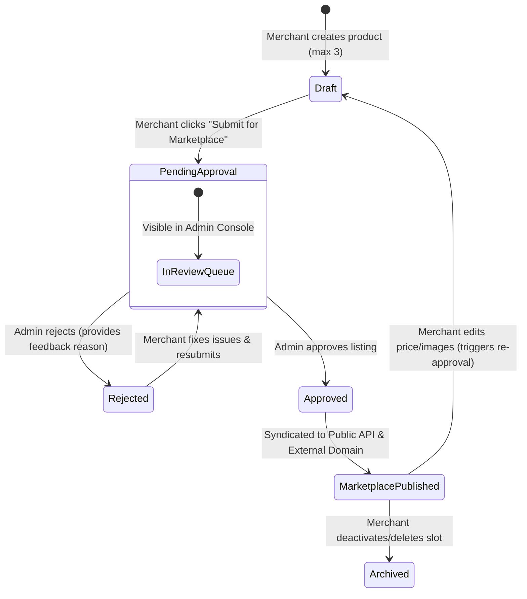

# Feature Specification: Merchant Inventory & Syndicated Marketplace

## 1. Executive Summary & Senior Architectural Assessment

### The Vision
Merchants on **PayMyTax by WallX** will have an **Inventory & Product Showcase** inside their ERP portal where they can list up to **3 featured products or services** (e.g., apparel, leather goods, books, food, or professional services). Once created, merchants submit their items for review. Following admin moderation and approval, these listings are syndicated to WallX's consumer-facing **Marketplace Website** hosted on a separate domain.

### Senior Engineering Evaluation ("What do you think about that?")
From an engineering and business growth perspective, this initiative is **exceptionally strong**:

1. **Strategic Value & Merchant Engagement**:
   - Small businesses often treat tax and accounting software as a passive compliance chore. Providing a built-in public showcase transforms WallX into a **revenue and customer acquisition engine** for merchants.
   - High merchant retention: sellers log in regularly to update stock, manage listings, and monitor visibility.

2. **The 3-Product Constraint is a Brilliant Product Decision**:
   - **Spam & Clutter Prevention**: Enforcing a strict 3-item ceiling prevents low-quality bulk dumping and keeps the platform manageable.
   - **Freemium Upsell Lever**: 3 products are included in the Free Trial & Starter plans. In future phases, higher subscription tiers (Business, Scale-Up) can unlock 10, 25, or unlimited slots.
   - **Low Storage & Moderation Overhead**: Admins only need to review up to 3 curated flagship items per verified merchant.

3. **Admin Moderation Gate is Mandatory**:
   - Because the marketplace runs publicly on a WallX-affiliated domain, open unmoderated posting would expose the company to counterfeit goods, prohibited substances, fraudulent bank details, and NSFW material.
   - The `draft` $\rightarrow$ `pending_approval` $\rightarrow$ `approved` (or `rejected`) state machine guarantees brand safety.

4. **Multi-Domain Architecture is Clean and Scalable**:
   - Keeping the transactional ERP (`app.wallx.co`) separate from the public marketplace (`marketplace.wallx.co` or independent storefront domain) ensures that high consumer browsing traffic, indexing web crawlers, and DDoS vectors never degrade critical tax filing or invoice generation performance.
   - The marketplace consumes product feeds through a high-speed, cached, public Read-API (`/api/v1/public/marketplace/products`).

---

## 2. Core Architectural Invariants

1. **Strict 3-Product Hard Limit**:
   - An account/business can have at most **3 active inventory products** across any status (`draft`, `pending_approval`, `approved`).
   - The limit is guarded both at the Zod validator layer and atomically via database count check inside a short Prisma transaction.
2. **Accrual & Tax Engine Non-Interference**:
   - Adding or listing inventory does **not** create revenue, invoice, or tax liability until a confirmed sale occurs.
   - When a sale occurs via the marketplace, it enters through the existing `SalesTransaction` pipeline (`source: 'online_store'` or `'marketplace'`) with 7.5% tax reserve calculation and central user wallet settlement.
3. **Admin Moderation Boundary**:
   - Only platform `admin` users can transition a product to `approved` or `rejected`.
   - Any merchant modification to critical public fields (Price, Title, Images) on an already `approved` item automatically flags the item for re-moderation or moves it back to `pending_approval` to prevent bait-and-switch modifications.
4. **Physical vs. Service Polymorphism**:
   - `productType: 'physical'`: Tracks inventory units (`stockQuantity`), requires delivery/pickup specifications.
   - `productType: 'service'`: `trackInventory: false`, `stockQuantity: null`, includes booking lead times or direct WhatsApp consultation links.

---

## 3. Data Model & Database Schema

### Prisma Schema (`backend/prisma/schema.prisma`)

```prisma
enum ProductType {
  physical
  service
}

enum ProductListingStatus {
  draft
  pending_approval
  approved
  rejected
  archived
}

model MarketplaceProduct {
  id              String               @id @default(uuid())
  businessId      String               @map("business_id")
  name            String               @map("name")
  slug            String               @unique @map("slug")
  category        String               @map("category") // e.g. "fashion", "books", "electronics", "services", "food"
  productType     ProductType          @default(physical) @map("product_type")
  description     String               @db.Text
  price           Decimal              @db.Decimal(15, 2)
  compareAtPrice  Decimal?             @map("compare_at_price") @db.Decimal(15, 2)
  currency        String               @default("NGN")
  
  // Stock & Inventory
  stockQuantity   Int?                 @default(1) @map("stock_quantity")
  trackInventory  Boolean              @default(true) @map("track_inventory")
  
  // Media & Assets
  images          String[]             @default([]) // URLs to Cloudinary / CDN
  
  // Direct Action / Purchase Link
  contactPhone    String?              @map("contact_phone")
  contactWhatsapp String?              @map("contact_whatsapp")
  purchaseUrl     String?              @map("purchase_url")
  
  // Moderation & Governance
  status          ProductListingStatus @default(draft)
  rejectionReason String?              @map("rejection_reason") @db.Text
  approvedAt      DateTime?            @map("approved_at")
  approvedBy      String?              @map("approved_by")
  
  // Audit Timestamps
  createdAt       DateTime             @default(now()) @map("created_at")
  updatedAt       DateTime             @updatedAt @map("updated_at")

  // Relations
  business        Business             @relation(fields: [businessId], references: [id], onDelete: Cascade)

  @@index([businessId])
  @@index([status, createdAt(sort: Desc)])
  @@index([category])
  @@index([slug])
  @@map("marketplace_products")
}
```

---

## 4. Product Lifecycle State Machine



### State Definitions:
1. `draft`: Merchant is configuring product details, pricing, and images. Not visible to the public or admin review queue.
2. `pending_approval`: Merchant submitted the product. Locked from casual tampering; listed in the admin moderation dashboard.
3. `approved`: Reviewed and certified by WallX admins. Broadcast via public API to the marketplace website.
4. `rejected`: Product failed review (e.g. prohibited item, poor image, incorrect category). Returned to merchant with an actionable `rejectionReason` and email explanation.
5. `archived`: Product taken down by merchant or slot emptied.

---

## 5. User & Merchant Experience (`/inventory`)

### A. 3-Slot Inventory Showcase UI
Instead of an infinite table, the merchant portal presents a clean **3-Slot Showcase Deck**:
- **Slot Card 1**: Active / Approved Product (Live badge, View on Marketplace link, Stock count, Edit/Delete).
- **Slot Card 2**: Pending Approval Product (Yellow pill with "Under Admin Review" tooltip, Edit disabled or cancel submission).
- **Slot Card 3**: Empty Slot ("+ Add Product 3 of 3 Available").

### B. Product Creation / Edit Modal
- **Step 1: Product Classification**:
  - Name (e.g. *"Handmade Leather Briefcase"*, *"Tax Advisory Consultation"*).
  - Product Type: Toggle between **Physical Good** (requires stock count) and **Service / Digital** (unlimited stock, duration/consultation).
  - Category Dropdown: *Fashion & Apparel*, *Bags & Accessories*, *Books & Stationery*, *Electronics*, *Groceries & Food*, *Health & Beauty*, *Professional Services*, *Other*.
- **Step 2: Pricing & Inventory**:
  - Price in Naira (`₦`).
  - Optional Compare-at / Discount Price (`₦`).
  - Stock quantity (if physical) with "Track stock" toggle.
- **Step 3: Media & Images**:
  - Up to 3 high-resolution product photos uploaded via Cloudinary with image compression.
- **Step 4: Contact & Purchase Route**:
  - WhatsApp Order Number (pre-filled from merchant profile).
  - Phone Number.
  - Optional Direct Checkout / Website URL.
- **Action**: Save as Draft OR Save & Submit for Marketplace Approval.

---

## 6. Admin Moderation & Approval Console (`/admin/marketplace`)

A dedicated administrative workspace in the WallX Admin portal:
1. **Tabs**:
   - `Pending Approval (Count)`: Primary queue for items awaiting review.
   - `Live on Marketplace`: All active approved listings.
   - `Rejected / Flagged`: Items rejected with reason logs.
2. **Review Modal / Drawer**:
   - Full photo carousel.
   - Merchant profile card: Business Name, Owner, Verification status, Tax ID, Account status.
   - Pricing sanity check (flags zero or extreme prices).
   - Category and description preview.
3. **Actions**:
   - **Approve Product**: One-click action. Dispatches `marketplace.product_approved` email to merchant and updates status to `approved`.
   - **Reject Product**: Opens dialog requiring `rejectionReason` (e.g., *"Images are low resolution. Please upload clear photos of the physical bag."*). Dispatches `marketplace.product_rejected` email to merchant.
   - **Remove / Take Down**: For active products reported by consumers.

---

## 7. External Marketplace Domain Integration & Public API

The external marketplace domain (`marketplace.wallx.co` or third-party site) accesses catalog data through dedicated public read endpoints.

### API Contracts

#### 1. Public Feed: `GET /api/v1/public/marketplace/products`
* **Query Parameters**:
  - `page`: default 1
  - `limit`: default 24
  - `category`: optional filter
  - `type`: `physical` | `service`
  - `search`: string search across title, description, and business name
* **Cache Header**: `Cache-Control: public, s-maxage=300, stale-while-revalidate=600` (Fast CDN delivery).
* **Response**:
```json
{
  "success": true,
  "data": [
    {
      "id": "prd_abc123",
      "slug": "luxury-leather-briefcase-apex-ltd",
      "name": "Luxury Leather Briefcase",
      "category": "bags",
      "productType": "physical",
      "description": "Full-grain genuine Nigerian leather briefcase with brass fittings.",
      "price": 65000,
      "compareAtPrice": 80000,
      "currency": "NGN",
      "stockQuantity": 8,
      "images": ["https://res.cloudinary.com/.../bag1.jpg"],
      "seller": {
        "businessName": "Apex Leatherworks",
        "city": "Ikeja",
        "state": "Lagos",
        "isVerified": true
      },
      "contactWhatsapp": "+2348012345678",
      "purchaseUrl": "https://marketplace.wallx.co/checkout/prd_abc123"
    }
  ],
  "pagination": {
    "page": 1,
    "limit": 24,
    "total": 142,
    "totalPages": 6
  }
}
```

#### 2. Single Product Detail: `GET /api/v1/public/marketplace/products/:slug`
Returns full product specifications, seller contact details, and related products from the same merchant.

#### 3. Real-Time Webhook Feed (Optional for instant sync):
Dispatches events to the external marketplace:
- `marketplace.product.approved`
- `marketplace.product.updated`
- `marketplace.product.removed`
- `marketplace.product.out_of_stock`

---

## 8. Step-by-Step Implementation Roadmap

### Phase 1: Database Schema & Backend Core (Estimated: 1-2 Days)
- Add `MarketplaceProduct`, `ProductType`, `ProductListingStatus` to `prisma/schema.prisma`.
- Run Prisma migration (`npm run prisma:migrate`).
- Implement `marketplace.validator.ts` with strict Zod schemas and 3-item ceiling validation.
- Implement `marketplace.service.ts` with transactional count locks:
  ```ts
  const count = await prisma.marketplaceProduct.count({ where: { businessId } });
  if (count >= 3) throw new AppError(400, 'Maximum of 3 products permitted per business', 'PRODUCT_LIMIT_REACHED');
  ```
- Implement unit tests for service validation and limit enforcement.

### Phase 2: Merchant Portal UI (`/inventory`) (Estimated: 2 Days)
- Add `Inventory & Marketplace` to `frontend/src/components/layout/Sidebar.tsx` with `Package` icon.
- Build `Inventory.tsx` page with 3 showcase card slots.
- Build `ProductModal.tsx` for creation, photo upload, category selection, and pricing.
- Add "Submit for Approval" action with live confirmation.

### Phase 3: Admin Moderation Console (`/admin/marketplace`) (Estimated: 1-2 Days)
- Add `/admin/marketplace` route and navigation link.
- Build queue with status filtering: Pending, Approved, Rejected.
- Build review modal with image previews, merchant credentials, Approve button, and Reject-with-reason form.
- Automated email dispatch on approval/rejection via `email-dispatch.service.ts`.

### Phase 4: Public API & Cross-Domain Syndication (Estimated: 1 Day)
- Build public controller `public-marketplace.controller.ts` with open CORS for the marketplace domain.
- Add pagination, category filtering, and Redis/HTTP caching headers.
- Build integration test suite for cross-domain public consumption.

---

## 9. Security, Guardrails & Edge Cases

| Scenario | Risk | Architectural Mitigation |
| :--- | :--- | :--- |
| **Race Condition on 3rd Product** | Merchant sends 2 concurrent POST requests to bypass 3-product cap | Service uses `prisma.$transaction` with row locking or strict pre-count check to reject the 4th item. |
| **Bait-and-Switch Pricing** | Merchant gets low-cost product approved, then changes price to ₦10,000,000 or replaces photo with illicit material | Mutating core fields (`price`, `images`, `name`) automatically resets `status` to `pending_approval` and removes it from public feed until re-approved. |
| **Zero Stock Selling** | Customer buys physical item when stock is 0 | Marketplace frontend disables checkout when `trackInventory && stockQuantity <= 0`. If webhook arrives post-depletion, order is accepted as `backordered` per `AGENTS.md` Invariant 2. |
| **Image Hosting Costs** | Merchant uploads 50MB raw PNG files | Frontend compresses images client-side before Cloudinary upload; max 3 images per product, 5MB ceiling per image. |
| **Marketplace Scrapers & DDoS** | External bots hammering public catalog API | Public routes enforce rate-limiting (e.g. 100 req/min/IP) and HTTP cache headers (`s-maxage=300`). |

---

## 10. Summary Recommendation
This feature is **feasible, commercially compelling, and fits into the existing WallX architecture**. We recommend proceeding with **Phase 1 (Database & Backend Core)** and **Phase 2 (Merchant UI)** as the initial milestone.
