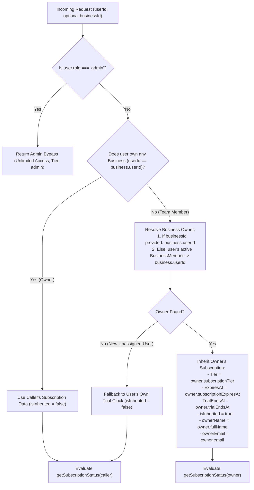
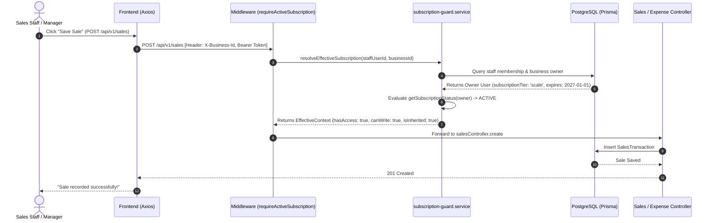

# Architectural Implementation Plan: Shared Organization Subscription & Multi-Role Alignment

**Document File:** `subscriptionplan.md`  
**Author:** Senior Systems Architect & Principal Software Engineer  
**Status:** Approved Architectural Specification & Phased Implementation Plan  
**Target Platform:** PayMyTax by WallX (WallXERP Monorepo)  
**Governing Documents:** `AGENTS.md`, `docs/architecture.md`, `docs/security.md`, `specs/team-rbac-and-invitations.md`  

---

## 1. Executive Summary & Root Cause Analysis

In WallXERP, a business owner registers an organization and purchases a subscription plan (or activates a 30-day trial) covering their business operations. The owner invites team members with specialized operational roles:
- `manager` (Branch operations, team management, customer credits, store vouchers)
- `sales_staff` (Cashiering, sales recording, counter POS receipts, voucher issuance)
- `accountant` (Bookkeeping, expense records, tax computation)
- `viewer` (Auditing, read-only analytics)

### 1.1. Why Was This Missed Historically?
An honest architectural post-mortem reveals two decoupled development factors:
1. **Decoupled Architecture Evolution**:
   - In early releases of WallXERP, the application was strictly single-user. Subscription attributes (`subscriptionTier`, `subscriptionExpiresAt`, `trialEndsAt`) were placed directly on the `User` table.
   - When Multi-User RBAC & Team Invitations were introduced later (`BusinessMember`, `Invitation`), development focused on granular route permissions (`verifyBusinessAccess`, masking expenses for cashiers, blocking staff from bank payouts).
   - Although `checkTeamLimit()` in `subscription-guard.service.ts` resolved the business owner to enforce team seat limits, `requireActiveSubscription` in `middleware/subscription.ts`, `ai.service.ts`, and `getMe()` in `auth.service.ts` were left querying `req.user.userId`.
2. **The "Fresh User" Automated Testing Blindspot**:
   - Automated test fixtures generate new user records on the fly.
   - Because every newly created user record is stamped with a default 30-day free trial from `user.createdAt`, every newly invited staff member in tests had `hasAccess: true` by accident of being in day 1 of their own personal trial.
   - Automated suites never simulated a scenario where an owner on an active paid plan invites a staff member whose own registration age exceeded 30 days.

---

## 2. Core Deductions & System Audit Findings

Our comprehensive audit across all system boundaries uncovered five specific discrepancies that must be resolved:

### Notice 1: AI Assistant CFO Quota & Tier Leakage (`ai.service.ts` & `subscription-guard.service.ts`)
- **Defect**: In `ai.service.ts` (lines 96–133), when any user chats with the AI CFO, the service queries `prisma.user.findUnique({ where: { id: userId } })` and calls `checkAiQueryLimit(userId, tier)`.
- **Consequence**: If an owner pays for the Scale-Up plan (unlimited AI queries), but their store manager chats with the AI CFO, the manager is treated as a `free` tier user and locked out after 10 queries (or locked out completely after 30 days).
- **Resolution**: `generateAIResponse` and `checkAiQueryLimit` must resolve the business owner, evaluate the owner's plan limits, and pool AI queries across the entire organization.

### Notice 2: Write Guard Lockout for Non-Owners (`requireActiveSubscription` in `middleware/subscription.ts`)
- **Defect**: `requireActiveSubscription` inspects `req.user.userId` rather than the organization owner.
- **Consequence**: When an invited cashier or manager's personal 30-day clock ends, `requireActiveSubscription` blocks `POST /sales`, `POST /invoices`, and `POST /expenses`, despite the business owner holding an active paid subscription.
- **Resolution**: Middleware must extract `X-Business-Id` (or route parameter `businessId`), resolve the business owner, and evaluate the owner's active/grace/expired status.

### Notice 3: Profile Endpoint Incomplete Context (`getMe` in `auth.service.ts`)
- **Defect**: `/auth/me` returns `user.subscriptionTier` ('free') and `user.trialEndsAt` directly from the caller's row.
- **Consequence**: The SME frontend (`useSubscriptionStatus`) derives subscription status from `useAuthStore.getState().user`. It displays "Free Trial - X Days Left" to cashiers and prompts operational staff to pay for subscriptions.
- **Resolution**: `getMe` must dynamically inject the owner's active tier, expiration dates, and metadata (`isSubscriptionInherited: true`, `subscriptionOwner: { id, name, email }`).

### Notice 4: Missing Business Context in Client Transport Layer (`frontend/src/lib/axios.ts`)
- **Defect**: Axios requests only transmit the Bearer JWT token; they do not automatically transmit the active business context on routes without `:businessId` (such as `/auth/me`, `/ai/chat`, `/subscription/proof`).
- **Consequence**: The backend cannot deterministically infer which business/owner organization the staff member is operating under.
- **Resolution**: The Axios request interceptor must automatically inject `X-Business-Id: activeBusiness.id` from `useBusinessStore`.

### Notice 5: Frontend Page Confusion & Non-Owner Proof Submission (`Subscription.tsx` & `subscription.controller.ts`)
- **Defect**: Navigating to `/subscription` renders pricing tiers (₦5,000, ₦15,000, ₦45,000) and bank proof upload forms for all users, including cashiers. Furthermore, `POST /subscription/proof` and `POST /subscription/start-trial` accept requests from non-owners.
- **Consequence**: Operational staff might assume they need to pay personal subscription fees, creating confusion or duplicate bank transfer proofs.
- **Resolution**:
  - Backend: Restrict `startTrial` and `submitProof` to `isOwnerAccount = true` with `403 ONLY_OWNER_CAN_MANAGE_SUBSCRIPTION`.
  - Frontend: When `!user.isOwnerAccount`, render a read-only **Team Member Subscription Overview** detailing their shared coverage and explaining that billing is managed by the account owner.

---

## 3. Core Architectural Invariants & Business Rules

1. **Single Source of Truth (Zero-Copy Live Resolution)**:
   - Subscription data remains authoritatively on the business owner's `User` record.
   - We **do not** duplicate subscription dates into staff user rows or maintain brittle cron synchronization jobs.
   - Team members resolve the owner's subscription live on every request via `resolveEffectiveSubscription(userId, businessId)`.
2. **Single-Owner Boundary Enforcement (`AGENTS.md` Invariant 4)**:
   - A non-owner user belongs exclusively to businesses owned by one owner.
   - If a request specifies a `businessId` (via `X-Business-Id` header, route params, or body), the subscription is resolved from `business.userId` (the owner).
   - If no `businessId` is specified (e.g., initial `/auth/me` bootstrap), the system resolves the owner from the user's active `BusinessMember` record.
3. **Owner-Only Money & Billing Isolation (`AGENTS.md` Invariant 5)**:
   - Endpoints `POST /subscription/proof` and `POST /subscription/start-trial` are guarded so only the business owner (`isOwnerAccount = true`) can trigger billing submissions or trials.
   - Staff members navigating to `/subscription` are presented with a **Team Member Subscription Overview** showing their inherited plan benefits and a clear notice that billing is managed by the account owner.
4. **Coordinated Grace & Expiry Lifecycle**:
   - If the business owner enters the 2-day read-only grace period, all team members simultaneously enter the read-only grace period (GETs allowed, mutating POST/PUT/DELETE blocked).
   - If the business owner expires, all team members are blocked from mutating operations with a friendly, informative message: *"The account owner's subscription has expired. Please contact [Owner Name] to renew."*
5. **Shared Organization Resource Quotas**:
   - Monthly AI CFO query quotas (`AiQueryLog`) for team members pool under the business owner's account limit.

---

## 4. Architecture & Data Flow Diagrams

### 4.1. Effective Subscription Resolution Flowchart



### 4.2. Request Interception Sequence Diagram (`requireActiveSubscription`)



---

## 5. Detailed Component Specifications & Code Blueprints

### 5.1. Backend Service Layer: Canonical Resolution Helper
**File:** `backend/src/services/subscription/subscription-guard.service.ts`

Introduce `resolveEffectiveSubscription`:

```typescript
export interface EffectiveSubscriptionContext {
  effectiveUserId: string;       // Owner ID if inherited, else caller ID
  isInherited: boolean;          // true if caller is a team member
  ownerName: string | null;      // Owner display name
  ownerEmail: string | null;     // Owner email address
  businessId?: string;           // Associated business ID
  subscriptionTier: string;      // Canonical tier (starter, business, scale, free)
  subscriptionExpiresAt: Date | null;
  trialEndsAt: Date | null;
  createdAt: Date;
  status: SubscriptionStatusResult;
}

export async function resolveEffectiveSubscription(
  userId: string,
  businessId?: string,
  tx?: TxClient | typeof prisma
): Promise<EffectiveSubscriptionContext> {
  const db = tx ?? prisma;

  // 1. Fetch caller user record
  const caller = await db.user.findUnique({
    where: { id: userId },
    select: {
      id: true,
      role: true,
      fullName: true,
      email: true,
      createdAt: true,
      subscriptionTier: true,
      subscriptionExpiresAt: true,
      trialEndsAt: true,
    },
  });

  if (!caller) {
    throw new AppError(404, 'User not found', 'USER_NOT_FOUND');
  }

  // 2. Admin bypass
  if (caller.role === 'admin') {
    return {
      effectiveUserId: caller.id,
      isInherited: false,
      ownerName: caller.fullName,
      ownerEmail: caller.email,
      businessId,
      subscriptionTier: 'admin',
      subscriptionExpiresAt: null,
      trialEndsAt: null,
      createdAt: caller.createdAt,
      status: {
        tier: 'admin',
        planName: 'System Administrator',
        hasAccess: true,
        isReadOnlyGrace: false,
        isExpired: false,
        isPaid: true,
        expiresAt: null,
        reason: 'ACTIVE',
      },
    };
  }

  // 3. Check if caller owns at least one business
  const ownedBusiness = await db.business.findFirst({
    where: { userId },
    select: { id: true },
  });

  if (ownedBusiness) {
    // Caller is an owner — evaluate their own subscription directly
    return {
      effectiveUserId: caller.id,
      isInherited: false,
      ownerName: caller.fullName,
      ownerEmail: caller.email,
      businessId,
      subscriptionTier: caller.subscriptionTier || 'free',
      subscriptionExpiresAt: caller.subscriptionExpiresAt,
      trialEndsAt: caller.trialEndsAt,
      createdAt: caller.createdAt,
      status: getSubscriptionStatus(caller),
    };
  }

  // 4. Caller is a non-owner team member — resolve business owner
  let ownerUser: typeof caller | null = null;
  let resolvedBusinessId = businessId;

  if (businessId) {
    const biz = await db.business.findUnique({
      where: { id: businessId },
      select: {
        id: true,
        user: {
          select: {
            id: true,
            role: true,
            fullName: true,
            email: true,
            createdAt: true,
            subscriptionTier: true,
            subscriptionExpiresAt: true,
            trialEndsAt: true,
          },
        },
      },
    });
    if (biz?.user) {
      ownerUser = biz.user;
      resolvedBusinessId = biz.id;
    }
  }

  if (!ownerUser) {
    // Fallback: look up caller's active business membership
    const membership = await db.businessMember.findFirst({
      where: { userId, isActive: true },
      select: {
        business: {
          select: {
            id: true,
            user: {
              select: {
                id: true,
                role: true,
                fullName: true,
                email: true,
                createdAt: true,
                subscriptionTier: true,
                subscriptionExpiresAt: true,
                trialEndsAt: true,
              },
            },
          },
        },
      },
    });
    if (membership?.business?.user) {
      ownerUser = membership.business.user;
      resolvedBusinessId = membership.business.id;
    }
  }

  if (ownerUser) {
    // Team member inherits the owner's plan and dates
    return {
      effectiveUserId: ownerUser.id,
      isInherited: true,
      ownerName: ownerUser.fullName,
      ownerEmail: ownerUser.email,
      businessId: resolvedBusinessId,
      subscriptionTier: ownerUser.subscriptionTier || 'free',
      subscriptionExpiresAt: ownerUser.subscriptionExpiresAt,
      trialEndsAt: ownerUser.trialEndsAt,
      createdAt: ownerUser.createdAt,
      status: getSubscriptionStatus(ownerUser),
    };
  }

  // 5. Fallback for new standalone users not yet assigned to any organization
  return {
    effectiveUserId: caller.id,
    isInherited: false,
    ownerName: caller.fullName,
    ownerEmail: caller.email,
    businessId,
    subscriptionTier: caller.subscriptionTier || 'free',
    subscriptionExpiresAt: caller.subscriptionExpiresAt,
    trialEndsAt: caller.trialEndsAt,
    createdAt: caller.createdAt,
    status: getSubscriptionStatus(caller),
  };
}
```

### 5.2. Backend User Profile Endpoint (`/auth/me`)
**File:** `backend/src/services/auth/auth.service.ts`

Update `getMe(userId)`:

```typescript
export async function getMe(userId: string) {
  const user = await prisma.user.findUnique({
    where: { id: userId },
  });

  if (!user) {
    throw new AppError(404, 'User not found', 'USER_NOT_FOUND');
  }

  const [ownedCount, nonOwnerMemberships] = await Promise.all([
    prisma.business.count({ where: { userId } }),
    prisma.businessMember.count({ where: { userId, role: { not: 'owner' }, isActive: true } }),
  ]);
  const isOwnerAccount = !(ownedCount === 0 && nonOwnerMemberships > 0);

  // Dynamically resolve effective subscription (inherits owner's subscription for team members)
  const effectiveSub = await resolveEffectiveSubscription(userId);

  const pendingSubmission = await prisma.subscriptionSubmission.findFirst({
    where: { userId: effectiveSub.effectiveUserId, status: 'pending' },
    orderBy: { createdAt: 'desc' },
    select: { plan: true, status: true },
  });

  return {
    ...sanitizeUser(user),
    // Effective subscription metadata
    subscriptionTier: effectiveSub.subscriptionTier,
    subscriptionExpiresAt: effectiveSub.subscriptionExpiresAt,
    trialEndsAt: effectiveSub.trialEndsAt,
    isSubscriptionInherited: effectiveSub.isInherited,
    subscriptionOwner: effectiveSub.isInherited
      ? {
          id: effectiveSub.effectiveUserId,
          name: effectiveSub.ownerName,
          email: effectiveSub.ownerEmail,
        }
      : null,
    pendingInvitationCount,
    isOwnerAccount,
    pendingPlan: pendingSubmission?.plan ?? null,
    hasPendingSubmission: !!pendingSubmission,
  };
}
```

### 5.3. Backend Middleware: `requireActiveSubscription` & `requireFeature`
**File:** `backend/src/middleware/subscription.ts`

Update `requireActiveSubscription`:
```typescript
export async function requireActiveSubscription(
  req: AuthenticatedRequest,
  res: Response,
  next: NextFunction
): Promise<void> {
  const userId = req.user?.userId;
  if (!userId) {
    return next(new AppError(401, 'Unauthorized', 'UNAUTHORIZED'));
  }

  try {
    const businessId =
      (req.headers['x-business-id'] as string) ||
      req.params.businessId ||
      req.params.id ||
      req.body?.businessId;

    const effectiveSub = await resolveEffectiveSubscription(userId, businessId);

    // Admin users bypass all checks
    if (effectiveSub.status.tier === 'admin') {
      req.subscription = effectiveSub.status;
      return next();
    }

    const enforcementEnabled = config.subscription?.enforcementEnabled ?? false;
    if (!enforcementEnabled) {
      req.subscription = effectiveSub.status;
      return next();
    }

    const isReadMethod = ['GET', 'HEAD', 'OPTIONS'].includes(req.method.toUpperCase());

    if (!effectiveSub.status.hasAccess || effectiveSub.status.isReadOnlyGrace) {
      if (!isReadMethod) {
        if (isFundAccessExempt(req)) {
          req.subscription = effectiveSub.status;
          return next();
        }

        const isGrace =
          effectiveSub.status.reason === 'TRIAL_IN_GRACE_PERIOD' ||
          effectiveSub.status.reason === 'SUBSCRIPTION_IN_GRACE_PERIOD';

        const msg = effectiveSub.isInherited
          ? isGrace
            ? `Your organization's subscription is in a 2-day read-only grace period. Please contact your account owner (${effectiveSub.ownerName || 'Owner'}) to renew.`
            : `Your organization's subscription has expired. Please contact your account owner (${effectiveSub.ownerName || 'Owner'}) to renew.`
          : isGrace
          ? 'Your account is in a 2-day read-only grace period. Upgrade your plan to create or modify records.'
          : 'Your trial or subscription has expired. Please upgrade to continue using WallXERP.';

        return next(
          new AppError(403, msg, effectiveSub.status.reason, {
            tier: effectiveSub.status.tier,
            expiresAt: effectiveSub.status.expiresAt,
            readOnlyGrace: effectiveSub.status.isReadOnlyGrace,
            isInherited: effectiveSub.isInherited,
            ownerName: effectiveSub.ownerName,
          })
        );
      }
    }

    req.subscription = effectiveSub.status;
    return next();
  } catch (err) {
    logger.error('Failed to evaluate subscription status in middleware', { err, userId });
    next(err);
  }
}
```

### 5.4. Backend AI CFO Quota & Scope Pooling
**Files:** `backend/src/services/ai/ai.service.ts` & `backend/src/services/subscription/subscription-guard.service.ts`

In `ai.service.ts`:
```typescript
export async function generateAIResponse(
  businessId: string,
  userId: string,
  userMessage: string,
  history: ChatMessage[] = []
): Promise<AIResponse> {
  // Resolve effective organization subscription
  const effectiveSub = await resolveEffectiveSubscription(userId, businessId);

  const enforcementEnabled = config.subscription?.enforcementEnabled ?? false;
  if (enforcementEnabled && !effectiveSub.status.hasAccess) {
    throw new AppError(
      403,
      effectiveSub.isInherited
        ? `The organization's subscription has expired. Please contact ${effectiveSub.ownerName || 'your business owner'} to continue using the AI CFO.`
        : 'Your trial or subscription has expired. Please upgrade to continue using the AI CFO.',
      'SUBSCRIPTION_EXPIRED',
      { tier: effectiveSub.status.tier, expiresAt: effectiveSub.status.expiresAt }
    );
  }

  // Check quota against the effective owner's organization pool
  const tier = effectiveSub.status.tier;
  const aiLimit = await checkAiQueryLimit(effectiveSub.effectiveUserId, tier);
  if (enforcementEnabled && !aiLimit.allowed) {
    const limits = getPlanLimits(tier);
    throw new AppError(
      403,
      `Your organization has reached its monthly AI query limit (${limits.maxMonthlyAiQueries}). Please contact the account owner to upgrade.`,
      'AI_QUERY_LIMIT_REACHED',
      { currentPlan: tier, maxQueries: limits.maxMonthlyAiQueries, currentQueries: aiLimit.current }
    );
  }

  const recordAndReturn = (response: AIResponse): AIResponse => {
    void logAiQuery(effectiveSub.effectiveUserId, businessId, userMessage, response.reply.length).catch((err) => {
      logger.warn('[AI Service] Failed to log AI query usage:', { error: err.message, userId, businessId });
    });
    return response;
  };
  // ... proceed to generate response ...
}
```

### 5.5. Backend Billing Ownership Guards
**File:** `backend/src/controllers/subscription.controller.ts`

```typescript
export const startTrial = asyncHandler(async (req: AuthenticatedRequest, res: Response) => {
  const userId = req.user!.userId;
  
  // Guard: Only owners can trigger free trials
  const [ownedCount, nonOwnerMemberships] = await Promise.all([
    prisma.business.count({ where: { userId } }),
    prisma.businessMember.count({ where: { userId, role: { not: 'owner' }, isActive: true } }),
  ]);
  if (ownedCount === 0 && nonOwnerMemberships > 0) {
    throw new AppError(
      403,
      'Only the business owner can manage or activate subscription trials.',
      'ONLY_OWNER_CAN_MANAGE_SUBSCRIPTION'
    );
  }

  const result = await subscriptionService.startFreeTrial(userId);
  const user = await authService.getMe(userId);
  res.status(200).json({ success: true, data: { trialEndsAt: result.trialEndsAt, user }, message: 'Free trial activated' });
});

export const submitProof = asyncHandler(async (req: AuthenticatedRequest, res: Response) => {
  const userId = req.user!.userId;

  // Guard: Only owners can submit payment proofs
  const [ownedCount, nonOwnerMemberships] = await Promise.all([
    prisma.business.count({ where: { userId } }),
    prisma.businessMember.count({ where: { userId, role: { not: 'owner' }, isActive: true } }),
  ]);
  if (ownedCount === 0 && nonOwnerMemberships > 0) {
    throw new AppError(
      403,
      'Subscription billing and payment proof submissions are managed exclusively by the business owner.',
      'ONLY_OWNER_CAN_MANAGE_SUBSCRIPTION'
    );
  }

  // ... proceed with processPaymentProof ...
});
```

### 5.6. SME Frontend: Automatic Business Context in Axios
**File:** `frontend/src/lib/axios.ts`

```typescript
api.interceptors.request.use((config) => {
  const token = localStorage.getItem('accessToken');
  if (token) {
    config.headers.Authorization = `Bearer ${token}`;
  }

  // Inject active business ID header for backend context resolution
  try {
    const activeBizId = localStorage.getItem('activeBusinessId');
    if (activeBizId && !config.headers['X-Business-Id']) {
      config.headers['X-Business-Id'] = activeBizId;
    }
  } catch {
    // LocalStorage read error fallback
  }

  if (config.data instanceof FormData) {
    delete config.headers['Content-Type'];
  }
  return config;
});
```

### 5.7. SME Frontend: Hook Enhancement
**File:** `frontend/src/hooks/useSubscriptionStatus.ts`

```typescript
export interface SubscriptionStatus {
  tier: SubscriptionTier;
  planName: string;
  isPaid: boolean;
  isTrial: boolean;
  hasAccess: boolean;
  isReadOnlyGrace: boolean;
  isExpired: boolean;
  canWrite: boolean;
  expiresAt: Date | null;
  daysRemaining: number;
  graceHoursRemaining: number;
  formattedCountdown: string;
  isInherited: boolean;
  ownerName: string | null;
  ownerEmail: string | null;
}
```

In the memoized return:
```typescript
const isInherited = Boolean(user?.isSubscriptionInherited);
const ownerName = user?.subscriptionOwner?.name || null;
const ownerEmail = user?.subscriptionOwner?.email || null;

return {
  tier: effectiveTier,
  planName: TIER_DISPLAY_NAMES[effectiveTier] || 'Starter',
  isPaid,
  isTrial,
  hasAccess,
  isReadOnlyGrace,
  isExpired,
  canWrite,
  expiresAt,
  daysRemaining,
  graceHoursRemaining,
  formattedCountdown,
  isInherited,
  ownerName,
  ownerEmail,
};
```

### 5.8. SME Frontend: UI Role Adaptation
1. **`frontend/src/components/subscription/SubscriptionGraceBanner.tsx`**:
   - If `status.isInherited`:
     - Render: *"Your organization's subscription is in a 2-day read-only grace period. Please contact your account owner ({status.ownerName || 'Owner'}) to renew."*
     - Hide the "Upgrade Plan" CTA button from non-owner staff, or change it to "Contact Account Owner".
2. **`frontend/src/pages/Subscription.tsx`**:
   - Inspect `user?.isOwnerAccount`:
     - **If Owner (`isOwnerAccount === true`)**: Render full pricing matrix, billing frequency switcher, manual bank transfer upload form, receipt modal.
     - **If Staff (`isOwnerAccount === false`)**:
       - Render a dedicated **Team Member Subscription Overview**:
         - Header badge: *"Team Member Access — Covered by {ownerName || 'Account Owner'}"*
         - Card: Current Plan name, badge (`Active`), remaining days or expiration date.
         - Grid: List of features available to the team on this tier.
         - Callout: *"Subscription renewals, tier changes, and official invoice receipts are managed exclusively by your business owner ({ownerName || 'Account Owner'})."*
         - Completely hide the payment proof upload form and plan selection cards.

---

## 6. Phased Implementation Roadmap

```
┌────────────────────────────────────────────────────────────────────────┐
│ PHASE 1: Canonical Domain Resolution Helper & /auth/me Profile         │
│          • Add resolveEffectiveSubscription in subscription-guard      │
│          • Update getMe in auth.service to return effective plan       │
├────────────────────────────────────────────────────────────────────────┤
│ PHASE 2: Backend Middleware, AI CFO & Billing Ownership Guards         │
│          • Update requireActiveSubscription to resolve effective user  │
│          • Update generateAIResponse to pool organization quotas       │
│          • Guard startTrial and submitProof to owner-only              │
├────────────────────────────────────────────────────────────────────────┤
│ PHASE 3: Frontend Client Interceptor & Subscription Hook               │
│          • Inject X-Business-Id in axios request interceptor           │
│          • Extend useSubscriptionStatus with isInherited & ownerName   │
├────────────────────────────────────────────────────────────────────────┤
│ PHASE 4: Frontend UI Role Adaptation                                   │
│          • Update SubscriptionGraceBanner for team roles               │
│          • Update /subscription page with dedicated Team Member View   │
├────────────────────────────────────────────────────────────────────────┤
│ PHASE 5: Automated QA Verification & Regression Testing                │
│          • Comprehensive Unit & Integration tests                      │
│          • End-to-end verification of Sales Staff & Manager flows      │
└────────────────────────────────────────────────────────────────────────┘
```

---

## 7. Test Strategy & QA Verification Matrix (QA Hunter Standard)

Following `prompts/qahunter.md`, all changes must be verified against this test matrix:

| Test ID | Test Scenario | Expected Outcome | Tier |
| :--- | :--- | :--- | :--- |
| **SUB-01** | Owner on active `business` plan invites `sales_staff` | `sales_staff` resolves tier `business` with owner's `subscriptionExpiresAt` | Unit |
| **SUB-02** | Owner on 30-day trial invites `manager` | `manager` resolves tier `free` with owner's `trialEndsAt` countdown | Unit |
| **SUB-03** | Owner subscription expires past 2-day grace period | `sales_staff` write (`POST /sales`) is blocked with 403 `SUBSCRIPTION_EXPIRED` | Integration |
| **SUB-04** | Owner in 2-day read-only grace period | `sales_staff` read (`GET /sales`) succeeds; write (`POST /sales`) is blocked | Integration |
| **SUB-05** | Staff calls `/auth/me` | Returns `isSubscriptionInherited: true` and `subscriptionOwner` details | Integration |
| **SUB-06** | Staff attempts `POST /subscription/start-trial` | Rejected with 403 `ONLY_OWNER_CAN_MANAGE_SUBSCRIPTION` | Integration |
| **SUB-07** | Staff attempts `POST /subscription/proof` | Rejected with 403 `ONLY_OWNER_CAN_MANAGE_SUBSCRIPTION` | Integration |
| **SUB-08** | Staff chats with AI CFO assistant | Quota pooled and counted under owner's allowance | Unit / Integration |
| **SUB-09** | Admin user calls any endpoint or accesses dashboard | Bypasses all subscription checks (`hasAccess: true`, unlimited) | Unit |
| **SUB-10** | Staff visits `/subscription` on frontend | Shows Team Member View; payment proof upload is hidden | Frontend Component |
| **SUB-11** | Staff switches active business in multi-business org | Subscription remains identical across businesses of the same owner | Integration |

---

## 8. Definition of Done (DoD) Checklist

- [ ] `backend/src/services/subscription/subscription-guard.service.ts` implements `resolveEffectiveSubscription`.
- [ ] `backend/src/services/auth/auth.service.ts` returns inherited subscription metadata in `getMe`.
- [ ] `backend/src/middleware/subscription.ts` enforces subscription checks against the owner's status.
- [ ] `backend/src/services/ai/ai.service.ts` pools AI query limits under the business owner's organization allowance.
- [ ] `backend/src/controllers/subscription.controller.ts` enforces owner-only guards on trial and proof endpoints.
- [ ] `frontend/src/lib/axios.ts` sends `X-Business-Id` header on authenticated requests.
- [ ] `frontend/src/hooks/useSubscriptionStatus.ts` exposes `isInherited` and `ownerName`.
- [ ] `frontend/src/components/subscription/SubscriptionGraceBanner.tsx` shows staff-tailored copy.
- [ ] `frontend/src/pages/Subscription.tsx` renders dedicated Team Member View for non-owners.
- [ ] All unit, integration, and frontend tests pass (`npm run test`, `npm run typecheck`, `npm run build` = 0 errors).
- [ ] Adheres strictly to `AGENTS.md` and preserves existing database migrations and financial invariants.
