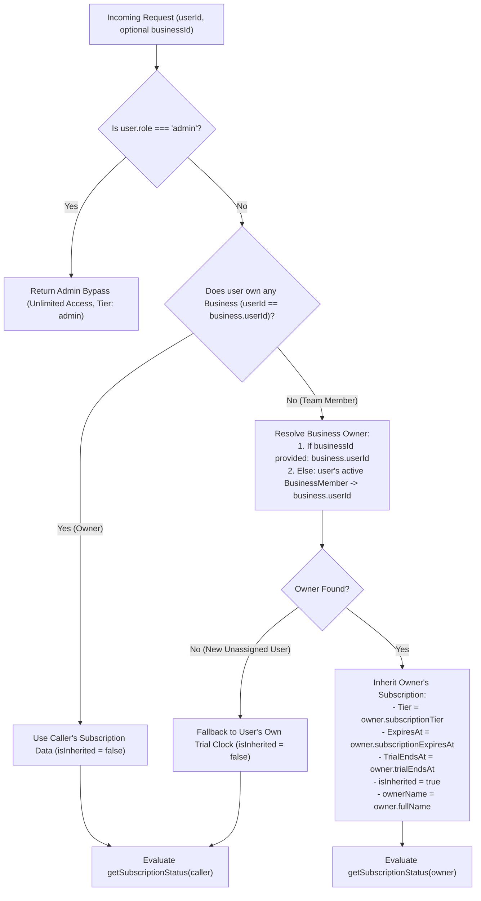
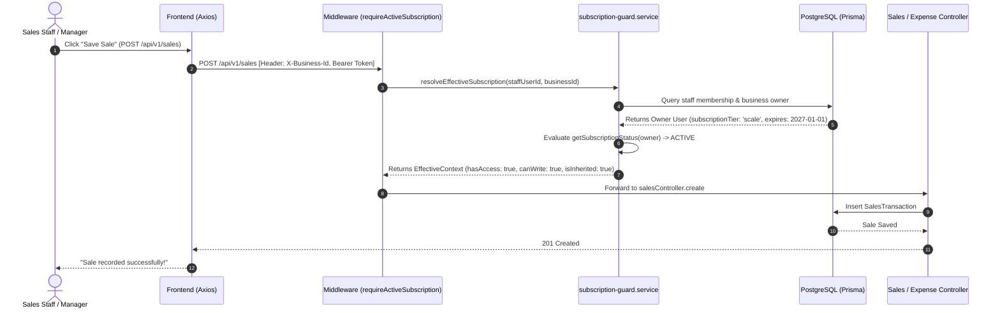

# Architectural Implementation Plan: Shared Organization Subscription for Team Roles

**Document File:** `subscriptionplan.md`  
**Author:** Senior Systems Architect & Principal Software Engineer  
**Status:** Approved Architectural Specification & Implementation Plan  
**Target Platform:** PayMyTax by WallX (WallXERP Monorepo)  
**Governing Documents:** `AGENTS.md`, `docs/architecture.md`, `docs/security.md`, `specs/team-rbac-and-invitations.md`  

---

## 1. Executive Summary & Problem Analysis

In WallXERP, a business owner registers an organization and purchases a subscription plan (or activates a 30-day trial) covering their business operations. The owner then invites team members with specialized operational roles:
- `manager` (Branch operations, team management, customer credits, store vouchers)
- `sales_staff` (Cashiering, sales recording, counter POS receipts, voucher issuance)
- `accountant` (Bookkeeping, expense records, tax computation)
- `viewer` (Auditing, read-only analytics)

### Current Architecture Defect
Currently, subscription metadata (`subscriptionTier`, `subscriptionExpiresAt`, `trialEndsAt`) is stored directly on individual `User` database records:
1. **Isolated Trial Clocks**: When an invited team member accepts an invitation, a separate `User` record is created for them with default `subscriptionTier = 'free'` and their own independent 30-day `trialEndsAt` countdown.
2. **Artificial Lockouts**: When the staff member's individual 30-day trial clock expires, the backend `requireActiveSubscription` middleware blocks them from recording sales, issuing invoices, or logging expenses—**even if the business owner is on an active 1-year Scale-Up paid plan**.
3. **Misleading User Experience**: The SME frontend (`useSubscriptionStatus`) reads `user.subscriptionTier` from `/auth/me`, showing the staff member "Free Trial - X Days Left" or displaying an upgrade banner prompting an operational cashier to purchase an ERP subscription.
4. **Disjointed Quotas**: AI CFO queries and feature gates evaluate the staff member's individual tier rather than the business owner's organization pool.

### Architectural Solution: Dynamic Organization Subscription Inheritance
Under WallXERP's strict **Single-Owner Organization Boundary** (`AGENTS.md` Invariant 4), a team member can **never** belong to businesses owned by different owners. Every invited staff member operates strictly within a single business owner's organization.

Therefore, subscription entitlement is an **Organization-Level Property** owned by the Business Owner:
- Team members (`sales_staff`, `manager`, `accountant`, `viewer`) dynamically inherit the **exact subscription tier, expiration date, trial status, and read-only grace period** of their business owner.
- When an owner upgrades from Starter to Scale-Up, or renews their subscription, **all team members immediately inherit the active plan without manual sync, data duplication, or database schema migration**.
- Billing and subscription management remain strictly owner-only guards (`AGENTS.md` Invariant 5). Staff members see their active plan privileges in read-only mode and are never asked to pay.

---

## 2. Core Architectural Invariants & Business Rules

1. **Single Source of Truth (Zero-Copy Dynamic Resolution)**:
   - Subscription data remains authoritatively on the business owner's `User` record.
   - We **do not** duplicate subscription dates into staff user rows or maintain brittle cron synchronization jobs.
   - Team members resolve the owner's subscription live on every request via `resolveEffectiveSubscription(userId, businessId)`.
2. **Single-Owner Boundary Enforcement (`AGENTS.md` Invariant 4)**:
   - A non-owner user belongs exclusively to businesses owned by one owner.
   - If a request specifies a `businessId` (via `X-Business-Id` header, route params, or body), the subscription is resolved from `business.userId` (the owner).
   - If no `businessId` is specified (e.g., initial `/auth/me` bootstrap), the system resolves the owner from the user's active `BusinessMember` record.
3. **Owner-Only Money & Billing Isolation (`AGENTS.md` Invariant 5)**:
   - Endpoints `POST /subscription/proof` and `POST /subscription/start-trial` are guarded so only the business owner (`isOwnerAccount = true`) can trigger billing submissions or trials.
   - Staff members navigating to `/subscription` are presented with a **Team Member Subscription Overview** showing their inherited plan benefits and a clear notice that billing is managed by the account owner.
4. **Coordinated Grace & Expiry Lifecycle**:
   - If the business owner enters the 2-day read-only grace period, all team members simultaneously enter the read-only grace period (GETs allowed, mutating POST/PUT/DELETE blocked).
   - If the business owner expires, all team members are blocked from mutating operations with a friendly, informative message: *"The account owner's subscription has expired. Please contact [Owner Name] to renew."*
5. **Shared Organization Resource Quotas**:
   - Monthly AI CFO query quotas (`AiQueryLog`) for team members pool under the business owner's account limit.

---

## 3. Architecture & Data Flow Diagrams

### 3.1. Effective Subscription Resolution Flowchart



### 3.2. Team Member Write Request Interception (`requireActiveSubscription`)



---

## 4. Component-by-Component Specifications

### 4.1. Backend Service Layer: Canonical Resolution Helper
**File:** `backend/src/services/subscription/subscription-guard.service.ts`

Introduce `resolveEffectiveSubscription`:
```typescript
export interface EffectiveSubscriptionContext {
  effectiveUserId: string;       // Owner ID if inherited, else caller ID
  isInherited: boolean;          // true if caller is a team member
  ownerName: string | null;      // Owner display name
  ownerEmail: string | null;     // Owner email address
  businessId?: string;           // Associated business ID
  subscriptionTier: string;      // Canonical tier (starter, business, scale, free)
  subscriptionExpiresAt: Date | null;
  trialEndsAt: Date | null;
  createdAt: Date;
  status: SubscriptionStatusResult;
}

export async function resolveEffectiveSubscription(
  userId: string,
  businessId?: string,
  tx?: TxClient | typeof prisma
): Promise<EffectiveSubscriptionContext>
```

**Implementation Invariants:**
1. Check `user.role === 'admin'` first: return immediate admin bypass.
2. Check if user owns at least one business (`db.business.findFirst({ where: { userId } })`). If yes, return their own subscription directly (`isInherited: false`).
3. If user owns 0 businesses, query their active membership:
   - If `businessId` is given, query `db.business.findUnique({ where: { id: businessId }, include: { user: true } })`.
   - If no `businessId`, query `db.businessMember.findFirst({ where: { userId, isActive: true }, include: { business: { include: { user: true } } } })`.
4. If owner user found, evaluate `getSubscriptionStatus(ownerUser)` and package into `EffectiveSubscriptionContext`.
5. If neither owned business nor membership exists (e.g. brand-new standalone signup), evaluate caller's own trial info.

### 4.2. Backend User Profile Endpoint (`/auth/me`)
**File:** `backend/src/services/auth/auth.service.ts`

Update `getMe(userId)`:
```typescript
// Resolve effective subscription across owner boundary
const effectiveSub = await resolveEffectiveSubscription(userId);

return {
  ...sanitizeUser(user),
  // Override subscription fields with effective owner entitlement
  subscriptionTier: effectiveSub.subscriptionTier,
  subscriptionExpiresAt: effectiveSub.subscriptionExpiresAt,
  trialEndsAt: effectiveSub.trialEndsAt,
  isSubscriptionInherited: effectiveSub.isInherited,
  subscriptionOwner: effectiveSub.isInherited
    ? {
        id: effectiveSub.effectiveUserId,
        name: effectiveSub.ownerName,
        email: effectiveSub.ownerEmail,
      }
    : null,
  pendingInvitationCount,
  isOwnerAccount,
  pendingPlan: pendingSubmission?.plan ?? null,
  hasPendingSubmission: !!pendingSubmission,
};
```

**Impact**: When the frontend boots and calls `fetchMe()`, the `useAuthStore.getState().user` object immediately contains the owner's active subscription tier and countdown dates.

### 4.3. Backend Middleware: `requireActiveSubscription` & `requireFeature`
**File:** `backend/src/middleware/subscription.ts`

1. **`requireActiveSubscription`**:
   - Extract `businessId` from `req.headers['x-business-id']`, `req.params.businessId`, `req.params.id`, or `req.body.businessId`.
   - Call `resolveEffectiveSubscription(userId, businessId)`.
   - Attach `req.subscription = effectiveSub.status`.
   - Attach `req.subscriptionContext = effectiveSub`.
   - If access is blocked or in read-only grace on a mutating HTTP verb (POST/PUT/PATCH/DELETE) and not fund-exempt:
     - If `effectiveSub.isInherited`:
       Return friendly error:
       `"The account owner's subscription has expired. Please contact ${effectiveSub.ownerName || 'your business owner'} to renew."`
     - Else: standard message for owners.
2. **`requireFeature(feature)`**:
   - Uses `req.subscription?.tier` (which is now guaranteed to be the effective organization tier).

### 4.4. Backend Shared Quota: AI CFO Queries
**File:** `backend/src/services/subscription/subscription-guard.service.ts`

In `checkAiQueryLimit`:
- When caller is a team member (`isInherited: true`), count queries created by all users belonging to that owner's organization during the current UTC month against the owner's plan limit.
- Both owner and staff queries are pooled under the organization's monthly allowance (e.g. 10 queries on Starter, 50 queries on Business, unlimited on Scale-Up).

### 4.5. Backend Billing Ownership Guards
**File:** `backend/src/controllers/subscription.controller.ts`

- In `startTrial`: Guard that only owners (`isOwnerAccount = true`) can trigger free trials. Non-owners return `403 ONLY_OWNER_CAN_MANAGE_SUBSCRIPTION`.
- In `submitProof`: If a staff member attempts to submit proof, reject with `403 ONLY_OWNER_CAN_MANAGE_SUBSCRIPTION` directing them to have the owner submit payment proofs.

### 4.6. SME Frontend: Automatic Business Context in Axios
**File:** `frontend/src/lib/axios.ts`

In `api.interceptors.request`:
- Retrieve active business ID from `useBusinessStore.getState().activeBusiness?.id` or `localStorage.getItem('activeBusinessId')`.
- If present, inject header:
  `config.headers['X-Business-Id'] = activeBusinessId;`
- This ensures all background and explicit API requests carry the business context seamlessly.

### 4.7. SME Frontend: Hook Enhancement
**File:** `frontend/src/hooks/useSubscriptionStatus.ts`

Extend `SubscriptionStatus`:
```typescript
export interface SubscriptionStatus {
  // Existing fields:
  tier: SubscriptionTier;
  planName: string;
  isPaid: boolean;
  isTrial: boolean;
  hasAccess: boolean;
  isReadOnlyGrace: boolean;
  isExpired: boolean;
  canWrite: boolean;
  expiresAt: Date | null;
  daysRemaining: number;
  graceHoursRemaining: number;
  formattedCountdown: string;

  // New shared organization fields:
  isInherited: boolean;
  ownerName: string | null;
  ownerEmail: string | null;
}
```

Populate `isInherited: Boolean(user?.isSubscriptionInherited)`, `ownerName: user?.subscriptionOwner?.name || null`.

### 4.8. SME Frontend: Grace Banner & Subscription Page UX
1. **`frontend/src/components/subscription/SubscriptionGraceBanner.tsx`**:
   - If `status.isInherited`:
     - Display: *"Your organization's subscription is in a 2-day read-only grace period. Please contact your account owner ({status.ownerName}) to renew."*
     - Hide the "Upgrade Plan" CTA button from non-owner staff, or change it to "Contact Account Owner".
2. **`frontend/src/pages/Subscription.tsx`**:
   - Check `user?.isOwnerAccount`:
     - **If Owner (`isOwnerAccount === true`)**: Full subscription management, plan cards, billing cycle toggle, manual bank transfer proof upload, receipt upload modal.
     - **If Staff (`isOwnerAccount === false`)**:
       - Render **"Team Member Subscription Access"** banner:
         *"You are accessing WallXERP as part of {ownerName}'s team under the {planName} plan."*
       - Display active plan benefits and remaining access period.
       - Display notice: *"Plan upgrades, renewals, and invoice receipts are managed exclusively by the business owner."*
       - Hide the bank transfer payment proof submission form to prevent accidental duplicate payments.

---

## 5. Phased Implementation Roadmap

```
┌────────────────────────────────────────────────────────────────────────┐
│ PHASE 1: Canonical Domain Resolution Helper & /auth/me Profile         │
│          • Add resolveEffectiveSubscription in subscription-guard      │
│          • Update getMe in auth.service to return effective plan       │
├────────────────────────────────────────────────────────────────────────┤
│ PHASE 2: Backend Middleware & Billing Ownership Guards                 │
│          • Update requireActiveSubscription to resolve effective user  │
│          • Pool AI query limit across organization                     │
│          • Guard startTrial and submitProof to owner-only              │
├────────────────────────────────────────────────────────────────────────┤
│ PHASE 3: Frontend Client Interceptor & Subscription Hook               │
│          • Inject X-Business-Id in axios interceptor                   │
│          • Extend useSubscriptionStatus with isInherited & ownerName   │
├────────────────────────────────────────────────────────────────────────┤
│ PHASE 4: Frontend UI Role Adaptation                                   │
│          • Update SubscriptionGraceBanner for team roles               │
│          • Update /subscription page with dedicated Team Member View   │
├────────────────────────────────────────────────────────────────────────┤
│ PHASE 5: Automated QA Verification & Regression Testing                │
│          • Comprehensive Unit & Integration tests                      │
│          • End-to-end verification of Sales Staff & Manager flows      │
└────────────────────────────────────────────────────────────────────────┘
```

### Phase 1: Canonical Domain Resolution Helper & `/auth/me` Profile
- Implement `resolveEffectiveSubscription(userId, businessId, tx)` in `backend/src/services/subscription/subscription-guard.service.ts`.
- Integrate `resolveEffectiveSubscription` into `getMe(userId)` in `backend/src/services/auth/auth.service.ts`.
- Ensure `isSubscriptionInherited` and `subscriptionOwner` are returned in the response payload.

### Phase 2: Backend Middleware & Billing Ownership Guards
- Update `requireActiveSubscription` in `backend/src/middleware/subscription.ts` to use `resolveEffectiveSubscription`.
- Ensure mutating writes for team members reflect the owner's active/grace/expired status.
- Update `checkAiQueryLimit` to pool query logs by owner or organization.
- Guard `startTrial` and `submitProof` in `backend/src/controllers/subscription.controller.ts` with `isOwnerAccount` check.

### Phase 3: Frontend Client Interceptor & Subscription Hook
- In `frontend/src/lib/axios.ts`, add dynamic `X-Business-Id` header injection from active business.
- In `frontend/src/hooks/useSubscriptionStatus.ts`, consume `user.isSubscriptionInherited` and `user.subscriptionOwner`.

### Phase 4: Frontend UI Role Adaptation
- Update `frontend/src/components/subscription/SubscriptionGraceBanner.tsx` to display role-tailored messaging when `isInherited: true`.
- Update `frontend/src/pages/Subscription.tsx` to render the clean **Team Member Overview** when `!user.isOwnerAccount`.

### Phase 5: Automated QA Verification & Regression Testing
- Write automated tests:
  - Unit test: Owner with Scale-Up plan invites Sales Staff -> Staff resolves Scale-Up tier and owner expiration date.
  - Unit test: Owner trial expires -> Staff write requests receive 403 with owner notification message.
  - Integration test: Staff login -> `/auth/me` returns inherited subscription details.
  - Integration test: Non-owner blocked from `POST /subscription/proof` and `POST /subscription/start-trial`.
- Run full typecheck and build across backend and frontends.

---

## 6. Test Strategy & QA Verification Matrix (QA Hunter Standard)

Following `prompts/qahunter.md`, the implementation must be validated against the following test matrix:

| Test ID | Test Scenario | Expected Outcome | Tier |
| :--- | :--- | :--- | :--- |
| **SUB-01** | Owner on active `business` plan invites `sales_staff` | `sales_staff` resolves tier `business` with owner's `subscriptionExpiresAt` | Unit |
| **SUB-02** | Owner on 30-day trial invites `manager` | `manager` resolves tier `free` with owner's `trialEndsAt` countdown | Unit |
| **SUB-03** | Owner subscription expires past 2-day grace period | `sales_staff` write (`POST /sales`) is blocked with 403 `SUBSCRIPTION_EXPIRED` | Integration |
| **SUB-04** | Owner in 2-day read-only grace period | `sales_staff` read (`GET /sales`) succeeds; write (`POST /sales`) is blocked | Integration |
| **SUB-05** | Staff calls `/auth/me` | Returns `isSubscriptionInherited: true` and `subscriptionOwner` details | Integration |
| **SUB-06** | Staff attempts `POST /subscription/start-trial` | Rejected with 403 `ONLY_OWNER_CAN_MANAGE_SUBSCRIPTION` | Integration |
| **SUB-07** | Staff attempts `POST /subscription/proof` | Rejected with 403 `ONLY_OWNER_CAN_MANAGE_SUBSCRIPTION` | Integration |
| **SUB-08** | Staff queries AI CFO assistant | Query counts against owner's plan quota pool | Unit / Integration |
| **SUB-09** | Admin user calls any endpoint or accesses dashboard | Bypasses all subscription checks (`hasAccess: true`, unlimited) | Unit |
| **SUB-10** | Staff visits `/subscription` on frontend | Shows Team Member View; payment proof upload is hidden | Frontend Component |

---

## 7. Definition of Done (DoD) Checklist

- [ ] `backend/src/services/subscription/subscription-guard.service.ts` implements `resolveEffectiveSubscription`.
- [ ] `backend/src/services/auth/auth.service.ts` returns inherited subscription metadata in `getMe`.
- [ ] `backend/src/middleware/subscription.ts` enforces subscription checks against the owner's status.
- [ ] `backend/src/controllers/subscription.controller.ts` enforces owner-only guards on trial and proof endpoints.
- [ ] `frontend/src/lib/axios.ts` sends `X-Business-Id` header on authenticated requests.
- [ ] `frontend/src/hooks/useSubscriptionStatus.ts` exposes `isInherited` and `ownerName`.
- [ ] `frontend/src/components/subscription/SubscriptionGraceBanner.tsx` shows staff-tailored copy.
- [ ] `frontend/src/pages/Subscription.tsx` renders dedicated Team Member View for non-owners.
- [ ] All unit, integration, and frontend tests pass (`npm run test`, `npm run typecheck`, `npm run build` = 0 errors).
- [ ] Adheres strictly to `AGENTS.md` and preserves existing database migrations and financial invariants.
